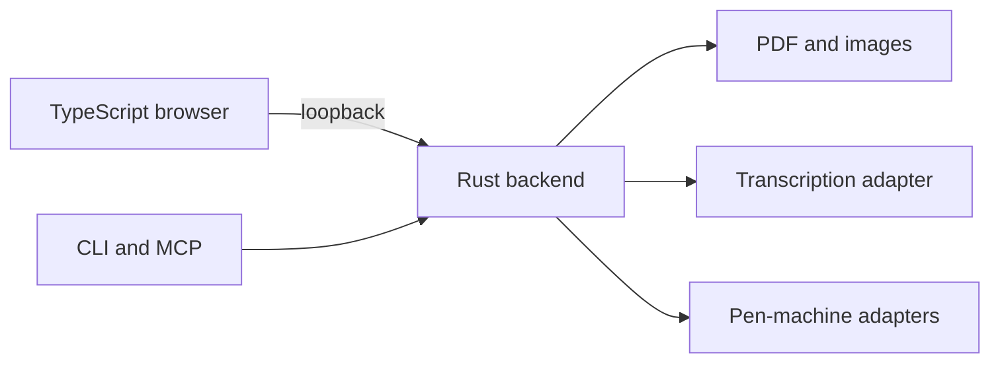

# Atrament

> Project started: August 31, 2026

**An artificial penmanship atelier that alchemizes text, lectures, formulas,
and photographs into uncannily human notebooks—PDF or real ink.**

Atrament is a disposable localhost workspace for composing polished handwritten
notes. The first-release design admits either a complete structured notebook or
a targeted semantic command batch from an LLM, then validates accepted state
before PDF, preview, live-plan, or physical-output projections.

It is not a word processor, a handwriting font, or a cloud notebook. Content is
semantic, layout is compiled against a physical page, handwriting comes from a
calibrated personal profile, and every visual adjustment remains an explicit
constraint.

## Executable handwriting-composition core

The technically defining output is **physical pen geometry**, not editor state
or an export codec. The Rust handwriting pipeline accepts authored grapheme
strokes, selected seeded variation and optional statistical mean dimensions;
then it places directed pen segments on real pages, applies lower-baseline
slant and heading-ink treatment, and validates opt-in connections between
consecutive glyphs. The same resulting physical segments feed the native
**vector PDF and raster PNG** exporters.

The numerical, side-effect-free engine is the independently testable Rust crate
`atrament_handwriting_stroke_projection`. The production
`atrament-profiles notebook` command imports its `project_ink_segment` and
`connect_ink_segments` functions for **every** authored glyph and selected
join; the browser is a glyph-authoring client, not the source of PDF geometry.
See [the ink engine](docs/technical/handwriting-stroke-projection.md)
for the exact call graph, admission boundaries and regression commands.

This is currently **caller-authored penmanship with deterministic creative
variation**, not automatic letter-shape generation, trained handwriting
recognition, or evidence of a calibrated human writer. The broader full
notebook-generation experience remains under development.

## Personal priority: automate handwritten notebooks

Atrament exists because repetitive compulsory handwriting wastes time I would
rather spend learning, thinking, and living. The practical priority is a
**local Rust CLI and localhost web editor** for configuring notebook paper and
statistical handwriting, including per-glyph adjustments and symbols used in
Mexico, Spain, and English. The editor must load and save separate notebook
and handwriting profiles, expose all admitted numeric controls with ranges,
show a real preview, and export printable PDF or transparent PNG pages.

**Target glyph geometry (not yet complete):** The base **o** is a perfect
circle, and a simple **a** combines that circle with a stem. The printed
two-storey **a** and joined cursive are separate, selectable forms. Each glyph
has editable stroke order and direction, including deliberate reversal, plus
precisely placed accents (especially vowels), ñ and ü.

The user can iteratively tune each glyph and visibly change ink thickness,
height, slant, spacing and line regularity without losing the ideal base.
Pasted text or Markdown must wrap into real notebook pages with headings,
lists and automatic pagination. Titles can have aesthetic marker lettering,
colors and highlighter strokes before PDF/transparent PNG export.

**Rust is the application authority.** The existing TypeScript UI is a thin
localhost client, not a separate renderer or profile engine. Do not add a
Python notebook application, a second server, or parallel profile semantics.
Advanced layout, mathematics, LLM tooling, animation, desktop packaging
and plotters remain future work. Basic Markdown pagination and decorative
headings belong to the first real notebook-to-PDF journey.

For the staged, unfinished work see [TODO.md](TODO.md) and the
[Rust-first local roadmap](docs/technical/rust-cli-localhost-priority.md).

## Current implementation and release status (November 3, 2026)

Atrament already has a Rust localhost server and browser workspace,
authenticated draft transport, physical-page and handwriting domain contracts,
and a local `.atrament` profile verifier, inspector, and canonical repacker.
Run the Rust binary without arguments for the existing localhost workspace;
its notebook metadata, paper, handwriting statistics controls and native
PDF/PNG paper preview are connected. Local profile file read/write now has an
explicit opt-in directory; full rendered handwriting is still unfinished.
The available CLI commands are documented below.

The native bounded statistical controls and the localhost profile editing
workflow now have a real Firefox-to-Rust acceptance test: separate notebook
and handwriting profiles are edited with sliders/numeric inputs, saved to
the opted-in local directory, reopened, and previewed. An exact `ñ` override
and maximum unsigned 64-bit seed survive the round-trip, while invalid
statistics cannot overwrite the accepted file. PNG preview is the notebook
**paper layer**; handwriting remains numeric-only, not generated ink.

The same browser-saved notebook profile also opens in the independent Rust
`atrament-profiles` CLI and exports a real two-page paper PDF and 150-DPI
transparent PNG. The selected PNG page has an identical SHA-256 digest to
the browser preview. These remain paper-layer exports, not drawn handwriting
or full notebook content.

The earlier 77 tasks were accepted as bounded academic/design artifacts, not
as proof of a finished product. **Eight P1 executable TODOs remain** for
Spanish/English glyphs, joined strokes, semantic flow, notebook PDF/PNG,
decoration, image overlays, printing and the personal end-to-end journey.

Another 21 P2–P4 implementation tracks preserve deferred complexity without
blocking the local CLI and localhost first delivery. The previous NO-GO
decision still applies to production claims, and physical hardware is not
required for local use. The authoritative open list is [TODO.md](TODO.md).

### Localhost Open/Save for notebook and handwriting profiles (opt-in)

The existing **Rust** loopback workspace accepts an explicitly selected,
pre-existing directory for two distinct native profile types. No server-side
file writes are enabled in the default no-argument mode:

```sh
mkdir -p ./my-atrament-profiles
cargo run -q -p atrament_runtime_bootstrap -- --profiles-dir \
  ./my-atrament-profiles
```

After the normal authenticated session opens in the browser, use **Notebook
page profile → Local notebook filename → Save local notebook** or
**Handwriting statistics → Local handwriting filename → Save local
handwriting**. **Open local** loads an existing file and its exact revision;
after editing, **Save local** checks that revision before allowing a
replacement. The original **Load JSON** file picker and **Save JSON**
download still work without this directory opt-in.

Names are deliberately limited to one ASCII `*.json` basename (maximum
64 characters); paths and symlinks cannot be selected by the browser.
The Rust host stores each type separately as `notebook-NAME` and
`handwriting-NAME` in the selected directory. For example, entering
`pages.json` and `writer.json` produces
`my-atrament-profiles/notebook-pages.json` and
`my-atrament-profiles/handwriting-writer.json`.
The directory must exist when the process starts, and the current atomic
file commit transport supports Linux; neither an upload nor a download
silently changes this directory.

The authenticated, same-origin `GET /api/notebook/file` and
`GET /api/handwriting/file` require a unique
`X-Atrament-Profile-Name: NAME` header. Each returns canonical native
profile JSON and a `sha256:` revision for the exact source bytes.
Corresponding `POST` requests also require Origin, JSON body, and
`X-Atrament-Profile-Revision: new` to create a new target, or the
previously read SHA-256 revision to replace an observed regular file.
Existing/new-name collisions and stale revisions return HTTP 409;
invalid JSON, names, duplicates or unexpected paths refuse before commit.

Without `--profiles-dir`, these file routes respond HTTP 503, while
read-only validation and PDF/PNG rendering continue to work.

The selected-directory save uses the existing Rust bounded-reader and
Linux atomic file commit adapter. It is not a general remote file manager,
does not persist anything in browser storage, and does not provide a
cross-process lock against simultaneous external writers. A failed
or uncertain commit must not be treated as permission to blindly retry an
overwrite; reopen the profile and inspect the result first.

### Native Rust printable-paper PDF and PNG (limited first slice)

The `atrament-paper` Rust CLI can already generate a physically sized **blank,
ruled, squared-grid, or dotted sheet** using the existing Rust page-profile,
nominal paper-mark, and vector PDF components. For example:

```sh
cargo run -q -p atrament_notebook_paper_cli -- \
  --style grid --width-mm 210 --height-mm 297 --spacing-mm 5 \
  --margin-top-mm 22 --margin-bottom-mm 16 \
  --margin-left-mm 20 --margin-right-mm 14 \
  --line-color '#c5d4e7' > paper.pdf
```

The default is an A4 5-mm square grid; `--style ruled`, `--style dot`, and
`--style blank` select other paper. `--paper-size a3|a4|a5|b5|letter|legal`
selects standard physical dimensions. `--landscape` or `--portrait`
explicitly chooses orientation, including for a loaded paper profile.

Set a paper-size preset before any manual `--width-mm` or `--height-mm`
overrides; the saved JSON retains the resulting exact dimensions. All
measurements are millimeters and the PDF uses physical point dimensions,
not screenshot pixels. Invalid options fail before the CLI writes PDF bytes.

This is a **paper-only** CLI: it does not load/save notebook or handwriting
profiles, draw handwriting, embed images, or provide handwriting controls.
The localhost page includes a paper-only editor with numeric inputs and
sliders, plus a separate Rust-validated handwriting statistics editor.
Neither editor is a complete notebook profile or handwriting renderer.

A printable collection of identical paper sheets is possible with `--pages`
(1–32). This is an output-only choice, not a field in the paper profile:

```sh
cargo run -q -p atrament_notebook_paper_cli -- \
  --paper-size a5 --style ruled --spacing-mm 7 --pages 12 > sheets.pdf
```

Pages contain the selected paper marks only; they do not yet include
handwriting, dates, page numbers, or custom per-page content.

For a **transparent PNG** of one physical paper sheet, select Rust PNG export
and DPI instead of the default vector PDF:

```sh
cargo run -q -p atrament_notebook_paper_cli -- \
  --paper-size a5 --style grid --spacing-mm 5 \
  --format png --dpi 150 --output sheet.png
```

Rust renders paper marks as RGBA pixels over transparency and writes the
physical DPI into PNG metadata. The supported DPI range is 72–300; output
is limited to five million pixels and 24 MB. A4 at 300 DPI is too large,
so use a lower DPI for larger sheets. The PNG exporter supports one sheet,
not handwriting, embedded image assets, or PDF's `--pages` option.

For explicit file saving instead of shell redirection, pass `--output FILE`.
It uses the existing Rust atomic file-commit adapter and refuses to overwrite
an existing file or symlink. `--replace` permits replacement of an existing
regular file, never a symlink; invalid profiles and geometry are rejected
before the target is changed. An uncertain post-commit durability failure is
reported explicitly rather than treated as a safe retry:

```sh
cargo run -q -p atrament_notebook_paper_cli -- \
  --paper-size letter --style ruled --pages 2 --output ruled.pdf
cargo run -q -p atrament_notebook_paper_cli -- \
  --style grid --emit-profile --output paper-profile.json
cargo run -q -p atrament_notebook_paper_cli -- \
  --profile paper-profile.json --spacing-mm 4.5 \
  --emit-profile --output paper-profile.json --replace
```

The explicit file-saving transport is Linux-only for now. Without `--output`,
the original stdout PDF/JSON behavior remains unchanged. PNG may also be
written to stdout explicitly with `--format png`.

The authenticated localhost runtime also exposes this **same Rust authority**.
After a compatible session handshake, `GET /api/paper/profile` returns the
canonical default JSON; `POST /api/paper/profile` checks and canonicalizes a
paper-only profile; `POST /api/paper/pdf` produces its physical vector
PDF; and `POST /api/paper/png` produces transparent RGBA paper bytes.

PNG POST also requires exactly one `X-Atrament-Png-Dpi: 150` header
(value 72–300) and returns `Content-Type: image/png`. Every POST
requires the exact session Origin, Bearer credential and bounded JSON
input. These routes do not save files server-side or render handwriting.

The same Rust session now admits `GET /api/handwriting/profile` for the
uncalibrated default, `POST /api/handwriting/profile` for canonical, bounded
statistics validation, and `GET /api/handwriting/dimensions` for the ten
variable names, physical units, and domain bounds. All three require the
current session credential; POST additionally requires the exact Origin.
These default validation endpoints do not themselves save files or render
written glyphs. The opt-in file endpoints above are separate.

The localhost workspace presents a **paper profile** editor after a
successful session handshake. It offers A3/A4/A5/B5/Letter/Legal presets,
blank/ruled/grid/dot patterns, physical dimensions, editable spacing and
four margins (numeric fields and synchronized sliders), and line color.

Choose **Load JSON** to validate a selected paper-only profile through Rust,
**Save JSON** to download the Rust-canonicalized profile, **Export PDF** for
vector paper, or **Export transparent PNG** for a pixel image. PNG DPI has
linked numeric and slider inputs. The browser renders neither PDF nor PNG
and persists no profile in browser storage; downloads are explicit actions.

A separate **handwriting statistics** section loads the Rust dimension
catalog and versioned JSON profile only after session admission. It allows
editing all ten native dimensions with numeric fields and sliders for minimum,
maximum, mean, median, and deviation, plus seed, and exact per-grapheme
overrides such as `ñ` and decomposed accents.

**Load JSON** validates with
Rust, **Save JSON** downloads canonical Rust-validated statistics, and
**Default** restores the uncalibrated native seed-zero profile. Bounds and
units come from Rust; this is a numeric statistics preview, not actual ink
rendering. **Preview seeded number in Rust** uses the current (including
unsaved) controls, an exact grapheme, the selected native dimension, and a
zero-based occurrence. Authenticated `POST /api/handwriting/preview` checks
the whole profile and returns a repeatable integer for identical inputs.

This is not calibrated ink or glyph shape data, and the preview saves no file.

The localhost editor preserves all unsigned 64-bit seeds and occurrence
indices, including values above JavaScript safe integer precision, as exact
decimal JSON tokens. It requires a modern browser with JSON parse source
context; browsers without it refuse rather than round a saved seed.

Server-side file persistence is available only by explicitly launching the
Rust runtime with a selected directory as described below; full notebook
content and handwriting rendering are not implemented yet.

For a reusable paper-only profile, the same CLI can emit versioned JSON,
read it again, and apply further explicit edits:

```sh
cargo run -q -p atrament_notebook_paper_cli -- \
  --style ruled --spacing-mm 7 --emit-profile > paper-profile.json
cargo run -q -p atrament_notebook_paper_cli -- \
  --profile paper-profile.json --margin-top-mm 18 > ruled.pdf
```

`--profile` must precede edit flags and name an explicit file; an
option-shaped operand such as `--help` is not a valid profile path.
For a basename beginning with a dash, use an explicit directory prefix
such as `./-paper.json`. The `atrament.paper.v1` profile uses integer
micrometers, has a 4-KiB input ceiling, rejects duplicate or unknown
fields, and is validated against the actual PDF path before acceptance.
The shell chooses the output file and handles any overwrite; this
paper-only CLI is separate from the opt-in localhost notebook/handwriting
profile Open/Save feature above.

### Shared native paper and handwriting profile CLI

`atrament-profiles` is the first combined **Rust-only profile CLI**. It
reuses `atrament-paper` for physical paper/PDF options, and the bounded Rust
handwriting-statistics codec for separate `atrament.handwriting.statistics.v1`
files. The paper schema is still paper-only, not a complete notebook schema.

```sh
cargo run -q -p atrament_profile_editor_cli -- \
  handwriting --seed 7 --output handwriting.json
cargo run -q -p atrament_profile_editor_cli -- \
  handwriting --profile handwriting.json \
  --set-global height 2500 3500 3000 3000 200 \
  --set-glyph 'ñ' width 1800 2600 2200 2200 200 \
  --output handwriting.json --replace
cargo run -q -p atrament_profile_editor_cli -- \
  handwriting --profile handwriting.json \
  --remove-glyph-dimension 'ñ' width \
  --output handwriting.json --replace
cargo run -q -p atrament_profile_editor_cli -- \
  handwriting --profile handwriting.json --inspect
cargo run -q -p atrament_profile_editor_cli -- \
  handwriting --profile handwriting.json \
  --inventory-text '¡Hola, señor! ¿Qué tal? «Sí» ñ ∞'
cargo run -q -p atrament_profile_editor_cli -- \
  handwriting --profile handwriting.json --preview-glyph 'ñ' 7
cargo run -q -p atrament_profile_editor_cli -- \
  paper --style ruled --emit-profile --output paper.json
cargo run -q -p atrament_profile_editor_cli -- \
  paper --profile paper.json --spacing-mm 6 --output sheet.pdf
```

Each statistical edit requires the dimension name followed by **minimum,
maximum, mean, median, and standard deviation** in that dimension's native
units: micrometres, millidegrees, or parts per thousand. Ten named global
variables and exact per-grapheme overrides, including decomposed accents,
are supported.

`--remove-glyph GRAPHEME` removes an entire exact glyph,
`--remove-glyph-dimension GRAPHEME DIM` restores that dimension to its
global value, and removing the last override deletes the empty glyph.
Missing glyphs or dimensions refuse before saving.

The Rust CLI `--inventory-text` audit checks each distinct Unicode extended
grapheme against the existing 114-entry English/Spanish **text** inventory,
reports whether a matching exact statistical override exists, and lists
unlisted graphemes explicitly. NFC `ñ` and NFD `ñ` remain separate;
mathematical symbols such as `∞` are reported outside this *text*
inventory because mathematical coverage is a separate authority. The audit
allows 1–4096 UTF-8 bytes, refuses control characters and output-file flags,
and writes only to stdout. **Inventory membership does not provide glyph
outlines, fallback consent, or rendered handwriting.**

The read-only `--preview-glyph GRAPHEME OCCURRENCE` CLI command produces
a reproducible integer preview for each of ten admitted dimensions using
the stored seed, exact grapheme identity, and occurrence index. It applies
global controls and per-grapheme overrides without saving or rendering.
This is intentionally an **uncalibrated numeric estimate**: the configured
mean, deviation, and limits affect it, but the median, exact distribution
moments, and ink shapes are **not** reproduced. Use it to compare edits,
not to claim a finished handwriting style.

The default profile is **not calibrated handwriting**; its seed is recorded,
but no stochastic stroke generator is connected yet.

`--profile` must come before statistical edits. Input is limited to 1 MiB,
unknown/duplicate fields or impossible statistics refuse, and output is
canonical JSON. `--output` refuses to overwrite an existing file unless
`--replace` is explicit; existing symlinks cannot be overwritten.

For example, `--set-global height 2500 3500 4500 3000 200` is invalid and
refuses before any output file change. The initial localhost statistics
editor now accepts bounded global and per-grapheme changes. Notebook
content profiles, actual handwriting rendering, and server-side Open/Save
web controls remain open implementation tasks.

### Native notebook page metadata profile (first Rust slice)

The `atrament-profiles notebook` subcommand creates a **versioned
`atrament.notebook.v1` profile** containing the existing Rust-validated
`atrament.paper.v1` sheet plus date placeholder style and location, border
radius in micrometres, optional printed numeric date, page numbers, and
a printed-sheet flag. This is page metadata, **not** notebook body content,
searchable date text, or generated handwriting. Existing seven-field v1
files reopen with an empty printed-date field.

```sh
cargo run -q -p atrament_profile_editor_cli -- \
  paper --style ruled --spacing-mm 7 --margin-top-mm 25 \
  --emit-profile --output my-paper.json
cargo run -q -p atrament_profile_editor_cli -- \
  notebook --paper-profile my-paper.json --date-style box \
  --date-placement top-right --date-text 2026-11-03 \
  --border-radius-um 3000 \
  --page-numbers true --printed-sheet false --output notebook.json
cargo run -q -p atrament_profile_editor_cli -- \
  notebook --profile notebook.json --page-numbers false \
  --output notebook.json --replace
cargo run -q -p atrament_profile_editor_cli -- \
  notebook --profile notebook.json --inspect
```

Notebook input is bounded at 8 KiB. The nested paper and notebook fields
are validated by Rust. Unknown or duplicate fields, invalid dates,
impossible paper geometry or oversized borders refuse. `--profile`
must precede edits.

`--output` refuses existing files unless `--replace` is explicit, and never
overwrites symlinks. Invalid inputs cannot change the output.

A saved notebook profile can also export its **paper layer** through the
shared Rust PDF or PNG renderer, without a separate paper JSON file:

```sh
cargo run -q -p atrament_profile_editor_cli -- \
  notebook --profile notebook.json --date-style box \
  --date-placement top-right --export-paper pdf --pages 3 \
  --output notebook-paper.pdf
cargo run -q -p atrament_profile_editor_cli -- \
  notebook --profile notebook.json --page-numbers true \
  --export-paper png --quality final --png-page 10 \
  --output notebook-page-10.png
```

For rasterized notebook pages, `--quality preview` renders at 72 DPI;
`--quality final` renders at 150 DPI. Both use the same physical paper
and authored ink as `--dpi 72` or `--dpi 150`, respectively. Choose one:
`--quality` and explicit `--dpi` are mutually exclusive and PNG-only.
The original 150-DPI default and `--dpi 72..300` remain supported.

### CLI text and Markdown flow onto notebook pages

The Rust notebook CLI can now turn **caller-supplied text or a restricted
Markdown file** into page-local handwriting strokes using the selected
notebook paper and **only glyphs you have actually authored**. In the localhost
**Authored glyph strokes** editor, select a geometric `a`, click
**Construct**, and explicitly download its TSV as `ink.tsv`. Then:

```sh
printf '# a\n\na a a\n- a\n' > notes.md
cargo run -q -p atrament_profile_editor_cli -- \
  notebook --printed-sheet false --export-paper pdf \
  --glyph-file ink.tsv --flow-markdown-file notes.md \
  --output notes.pdf
cargo run -q -p atrament_profile_editor_cli -- \
  notebook --printed-sheet false --export-paper png \
  --png-page 1 --dpi 72 --glyph-file ink.tsv \
  --flow-markdown-file notes.md --output notes-page-1.png
```

To add reproducible, bounded pen-like variation to the **printed paper
ruling** under the authored text, select both export-only options:

```sh
cargo run -q -p atrament_profile_editor_cli -- \
  notebook --printed-sheet false --export-paper pdf --pages 2 \
  --ruler-seed 2026 --ruler-error-mm 0.150 \
  --glyph-file ink.tsv --flow-markdown-file notes.md \
  --output notes-varied.pdf
```

Use the same pair with `--export-paper png --dpi 72 --png-page 2` for a
transparent, separately varied selected sheet. The seeded normal offsets
are capped at 0.250 mm and preserve each rule's nominal endpoints and the
printable paper region. The actual glyph ink, date, border and page numbers
stay unchanged.

Unspecified ruler options retain the old PDF/PNG bytes; blank/dotted
patterns and preprinted sheets refuse variation. This does not change
saved paper/notebook v1 profile bytes or represent calibrated physical
pen samples.

To export pasted or piped Markdown without saving a temporary source file,
select `-` for `--flow-markdown-file` (or `--flow-text-file` for plain
text):

```sh
printf '# a\n\na a\n- a\n' | cargo run -q \
  -p atrament_profile_editor_cli -- notebook \
  --printed-sheet false --glyph-file ink.tsv \
  --flow-markdown-file - --export-paper pdf --output notes.pdf
```

This explicit stdin mode accepts at most 4096 UTF-8 bytes and the same
source validation as a regular file, without implicit writes. Empty,
invalid, or oversized input refuses before replacing an existing output.
The other profile and glyph flags still require caller-selected files.

Flow source options are **export-only**, not fields in a saved notebook
profile. Omitting `--export-paper pdf|png` explicitly refuses instead of
returning or replacing a profile JSON that omits the selected text.
The normal `notebook --output notebook.json` profile-only save is unchanged.

Without `--output`, the same commands write binary PDF or PNG bytes to
standard output, so shell redirection can select the destination instead.
Native acceptance compares both Markdown and plain piped stdout against
PDF and both selected PNG pages; invalid source emits no partial bytes.
Do not redirect stderr into the binary output.

Both exports were smoke-tested with the editor's geometric `a` strokes;
the PDF is a real one-page document and PNG is 72-DPI RGBA. By default, a
Markdown heading gets a dark pen underline and a list item gets an ink mark.

To highlight a title with a **colored marker band behind the handwritten
strokes**, add `--heading-style marker --heading-color '#F8DE91'` to either
export. Marker weight follows the Markdown heading level: `#` uses four
**opaque** 1.4-mm pen lines, `##` uses three 1.15-mm strokes, and `###` uses
two 0.95-mm strokes. Deeper `####`, `#####`, `######` headings use
respectively two 0.76-mm, one 0.62-mm and one 0.50-mm strokes.

Underline widths step down through 0.55, 0.42, 0.30, 0.24, 0.18 and
0.12 mm. `--heading-style underline --heading-color '#A462D0'` changes only
the underline color. Select `--heading-style double-underline` to add a
second level-weighted ink line 0.9 mm above the original, optionally with
`--heading-color '#64A3C5'`; `--heading-style none` removes ornaments.

For an opt-in title position, select `--heading-align center` or
`--heading-align right`. Native layout measures the farthest nominal
authored glyph contour, then moves both ATX (`#` through `######`) and
Setext (`===` or `---`) titles with their underlines or marker strokes
inside the printable page or selected fixed flow region. Ordinary prose,
lists, quotes, thematic rules and code keep their original positions.

```sh
cargo run -q -p atrament_profile_editor_cli -- notebook \
  --glyph-file glyph-strokes.tsv --flow-markdown-file notes.md \
  --heading-align center --heading-style double-underline \
  --export-paper pdf --output centered-titles.pdf
```

Omitting alignment or selecting `--heading-align left` preserves
prior ink bytes. This option requires Markdown flow, admits only
`left|center|right` once and refuses an unfit one-line heading or
out-of-region projected ink without overwriting existing output.
Alignment is a transient export setting, not a saved notebook style.
It does not calculate optical center from final varied pen-stroke paths.

For independent **handwritten title lettering**, use
`--heading-ink-color '#BD376A' --heading-ink-scale 180`. This recolors only
Markdown heading glyphs and increases their pen thickness to 180 percent;
body text, authored glyph coordinates, canonical TSV and decorative marker
bands retain their original settings. The permitted weight range is
100–250 percent. For example:

```sh
cargo run -q -p atrament_profile_editor_cli -- notebook \
  --glyph-file glyph-strokes.tsv --flow-markdown-file notes.md \
  --heading-style marker --heading-color '#F8DE91' \
  --heading-ink-color '#BD376A' --heading-ink-scale 180 \
  --export-paper pdf --output decorated-notes.pdf
```

Both ink options require Markdown flow, are compatible with the existing
seeded `--glyph-variation` and saved mean profiles, and apply after the
selected authored/varied stroke width is established. If a thicker pen
exceeds the valid 80–1500 µm bound or a page margin, export refuses before
an existing file is replaced.

Levels still change decoration, **not** the
glyph dimensions or ideal geometry; no new title font is synthesized. The
4096-ink-segment cap remains. These are simple pen decorations, **not**
translucent highlighters, continuous cursive or image layers.

For a notebook profile already saved as `notebook.json`, supply
`--profile notebook.json` before the flow options to use its paper/margins
instead of defaults.

To constrain the text to a fixed physical area, add
`--flow-region LEFT_UM TOP_UM WIDTH_UM HEIGHT_UM`, in integer
micrometres measured from the **top-left of each sheet**. For example,
`--flow-region 30000 40000 50000 30000` repeats a 50 × 30 mm
writing area starting 30 mm from the left and 40 mm from the top. It
must fit entirely inside the selected paper's printable margins and
have enough space for the measured handwritten glyphs and row pitch.

With the default paper, an impossible region is refused before reading selected
files or stdin. Imported profiles keep their own authoritative margins.

To add intentional line spacing to either plain or Markdown flow, select
`--flow-pitch-um 18000` for an 18 mm **minimum** physical row pitch. The
accepted inclusive range is 9,000–30,000 µm. The original 9 mm pitch
remains the default, and a selected handwriting profile's larger measured
glyph height or baseline clearance takes precedence over this minimum.
The pitch repeats on every page, including a selected `--flow-region`:

```sh
cargo run -q -p atrament_profile_editor_cli -- notebook \
  --glyph-file glyph-strokes.tsv --flow-markdown-file notes.md \
  --flow-region 30000 40000 50000 60000 --flow-pitch-um 18000 \
  --export-paper pdf --output spacious-notes.pdf
```

This option is export-only, requires one flow source, and does not mutate
saved notebook JSON or manual `--place-text` positions. Invalid, duplicate
or unsupported values refuse before reading selected source files or stdin.
Wider leading can require more physical pages; the normal 32-page limit,
explicit PDF `--pages` budget, region ink-clearance checks, and PNG page
selection still apply. This pitch option does not change paragraph gaps.

For pasted Markdown with blank lines between paragraphs or blocks, choose
`--flow-paragraph-gap-um 12000` to request 12 mm of paragraph separation.
The accepted inclusive range is 0–12,000 µm, with a 4 mm default; `0`
removes the extra gap, and repeated blank lines still collapse to one gap.
This setting does not change row pitch or plain-text blank rows. It can
cause headings, rules and following text to relocate to a later page.
For example, use both independent spacing controls:

```sh
cargo run -q -p atrament_profile_editor_cli -- notebook \
  --glyph-file glyph-strokes.tsv --flow-markdown-file notes.md \
  --flow-pitch-um 12000 --flow-paragraph-gap-um 6000 \
  --export-paper pdf --output spaced-notes.pdf
```

The paragraph option requires Markdown flow, is export-only and cannot be
repeated. Invalid selections refuse before opening source files or stdin.
Normal 32-page, 128-row, selected-region, ink-clearance, explicit PDF-page
and PNG-page limits continue to apply; this is not automatic word spacing
or persistent semantic paragraph styling.

Use `--flow-body-inset-um 6000` to move **flowing Markdown prose** 6 mm
right of its normal writing origin, across every wrapped row and explicit
hard break. The accepted range is 0–12,000 µm; default zero keeps exact
previous output. Heading ornaments, bullets, numbered labels, checkboxes,
quote bars and their text, and literal fenced/four-space-indented rows keep
their own origins. The selected inset reduces the prose writing width, so
narrow fixed regions may wrap onto extra pages or refuse when less than
4 mm of writing width remains.

```sh
cargo run -q -p atrament_profile_editor_cli -- notebook \
  --glyph-file glyph-strokes.tsv --flow-markdown-file notes.md \
  --flow-body-inset-um 6000 --flow-paragraph-gap-um 6000 \
  --export-paper pdf --output inset-notes.pdf
```

The body inset is export-only, requires Markdown flow, and does not change
notebook JSON, plain-text flow, or positioned manual ink. Invalid, duplicate
or unsupported selections refuse before opening selected source files or
stdin. Native Rust regressions compare unchanged default output, physically
measured wrapping, structural markers, deterministic PDF/PNG/ink TSV, and
refusal without overwriting a chosen PDF.

Use `--flow-body-right-inset-um 6000` to reserve another 6 mm to the
**right** of flowing Markdown prose. It decreases measured text capacity
without moving the left origin. Both physical margins can be selected
independently, and neither moves heading decorations, list/checkbox labels,
quote bars or literal indented/fenced rows.

```sh
cargo run -q -p atrament_profile_editor_cli -- notebook \
  --glyph-file glyph-strokes.tsv --flow-markdown-file notes.md \
  --flow-body-inset-um 4000 --flow-body-right-inset-um 6000 \
  --export-paper pdf --output bounded-prose.pdf
```

The right inset is also bounded to 0–12,000 µm, requires Markdown and is
export-only. An omitted or explicit zero preserves the earlier physical
output; combined insets must leave at least 4 mm for a prose row. Invalid
or duplicate settings fail in source-independent preflight; failed physical
admission leaves a selected existing output intact.

Select `--flow-body-align center` or `--flow-body-align right` to place
each wrapped Markdown prose row within its measured physical writing
width. Both left/right body insets still bound that row; alignment uses
its farthest nominal glyph contour, not just the advance of the last
letter. Headings, list/checkbox rows, quote bars, literal four-space
lines, fenced code and manually positioned glyphs retain their anchors.

```sh
cargo run -q -p atrament_profile_editor_cli -- notebook \
  --glyph-file glyph-strokes.tsv --flow-markdown-file notes.md \
  --flow-body-inset-um 4000 --flow-body-right-inset-um 6000 \
  --flow-body-align center --export-paper pdf \
  --output centered-prose.pdf
```

This is an export-only Markdown selection. Omitted alignment or explicit
`left` retains the earlier PDF/PNG/ink TSV bytes. Invalid or repeated
values refuse before source-file/standard-input access, and unfit
writing rectangles cannot overwrite a previously accepted PDF. The
horizontal center is nominal, not optical or based on varied ink paths.

For Markdown blockquotes, use `--flow-quote-align center` or `right` to
position only the quoted handwriting within its measured writing band.
The vertical quote rule stays in the selected left gutter on every physical
row, including wrapped continuations and subsequent pages. Existing
`--flow-list-quote-inset-um` and `--flow-list-quote-right-inset-um` still
bound the quote text without moving its rule; list markers and prose
alignment remain independent.

```sh
cargo run -q -p atrament_profile_editor_cli -- notebook \
  --glyph-file glyph-strokes.tsv --flow-markdown-file notes.md \
  --flow-list-quote-inset-um 4000 \
  --flow-list-quote-right-inset-um 6000 \
  --flow-quote-align center --export-paper pdf \
  --output centered-quotes.pdf
```

Omitting the option or selecting `left` preserves earlier PDF/PNG/ink TSV
bytes. This Markdown-only CLI option does not save an alignment style or
move manually placed ink, and nominal contours do not predict varied pen
extents. Unsupported or duplicate selections refuse before source reads.

Select `--flow-quote-color '#1070E0'` to change the physical pen color
of the vertical Markdown quote rules independently of their text.
Every wrapped physical row, including rows balanced across page turns,
retains its own correctly positioned bar in the selected RGB. The option
does not tint quoted handwriting, page decorations, headings, bullets,
checkboxes, thematic rules, or manually placed ink.

```sh
cargo run -q -p atrament_profile_editor_cli -- notebook \
  --glyph-file glyph-strokes.tsv --flow-markdown-file notes.md \
  --flow-quote-align center --flow-quote-color '#1070E0' \
  --export-paper pdf --output colored-quotes.pdf
```

Omitted colors and explicit historical `#1E304A` produce identical
PDF/transparent PNG/ink TSV bytes. This transient Markdown-only selection
accepts exactly six hexadecimal RGB digits, refuses invalid/duplicate
flags before opening selected sources, and cannot replace existing
output when physical layout fails.

For unordered Markdown bullets and checkbox tasks, select
`--flow-bullet-align center` or `right` to align each measured row of item
text within the list writing band. The bullet dash or checkbox stays at
its original structural gutter even after wrapping or moving to another
page. Numbered labels such as `1.` and `2)` are authored handwriting;
their alignment is a separate choice. Heading, quote and prose alignment
are independent.

```sh
cargo run -q -p atrament_profile_editor_cli -- notebook \
  --glyph-file glyph-strokes.tsv --flow-markdown-file notes.md \
  --flow-list-quote-inset-um 4000 \
  --flow-list-quote-right-inset-um 6000 \
  --flow-bullet-align center --export-paper pdf \
  --output centered-bullets.pdf
```

Omitted and explicit `left` preserve earlier PDF/PNG/ink TSV bytes. This
Markdown-only, export-only option measures nominal glyph contours; it does
not move original list markers, persist notebook semantics or guarantee
optical alignment after pen variation. Invalid selections refuse before
source reads, and unfit layouts preserve existing selected output files.

Markdown unordered lists can also choose a **physical bullet mark**
without changing their text: `--flow-bullet-style dash|dot|ring`. The
omitted/default `dash` keeps the existing short horizontal pen stroke;
`dot` uses a short, heavier ink stroke, and `ring` draws a small closed,
eight-segment outline. These are deterministic Rust vector pen segments,
not a substituted glyph or a raster stamp. All three fit in the same
fixed marker gutter, including list continuations and page turns.

```sh
cargo run -q -p atrament_profile_editor_cli -- notebook \
  --glyph-file glyph-strokes.tsv --flow-markdown-file notes.md \
  --flow-bullet-style ring --export-paper pdf \
  --output ring-bullet-notes.pdf
```

The choice applies to `-`, `*`, and `+` unordered bullets only. Checkbox
outlines/checks, authored numbered labels, quotes, headings and prose
remain unchanged; bullet text still obeys its independent alignment and
insets. Explicit `dash` is byte-equivalent to the omitted selection in
PDF, transparent PNG and exported ink TSV.

A ring uses eight pen segments instead of one, counting toward the existing
total physical ink limit. Invalid values, repeated options or non-Markdown
selection refuse before reading sources. This export-only control does not
persist semantic lists.

For authored Markdown numbered lists, opt into
`--flow-ordered-align center` or `right` to place the handwritten numeral,
delimiter and item text together within the available list writing row.
Wrapped continuation rows retain the measured hanging label indent before
applying alignment within their remaining width. The selected left/right
list insets still constrain the ink. Other headings, quotes, bullets and
body paragraphs are unaffected.

```sh
cargo run -q -p atrament_profile_editor_cli -- notebook \
  --glyph-file glyph-strokes.tsv --flow-markdown-file notes.md \
  --flow-ordered-align right --export-paper pdf \
  --output right-aligned-numbers.pdf
```

Omitting the flag or explicitly selecting `left` preserves the old
native PDF, transparent PNG and ink TSV bytes. The option is Markdown-only
and transient; it does not renumber items, alter pen strokes, or establish
persisted semantic list alignment. Invalid values, duplicates, and
unrenderable rows refuse before replacing an output file.

For checkbox tasks (`- [ ]` and `- [x]`), use
`--flow-task-align center` or `right` to align their *text* independently
of unordered bullets. The checkbox outline and check remain in their
original structural gutter, including on continued physical pages.
If both task and bullet alignment are selected, the task setting wins
for tasks only; bullets retain the bullet setting.

```sh
cargo run -q -p atrament_profile_editor_cli -- notebook \
  --glyph-file glyph-strokes.tsv --flow-markdown-file notes.md \
  --flow-bullet-align left --flow-task-align right \
  --export-paper pdf --output task-aligned-notes.pdf
```

Omitting task alignment preserves the previous behavior: checkbox text
inherits `--flow-bullet-align`, or remains at its original origin if neither
is supplied. An explicit task `left` can undo a selected bullet center/right
alignment for checkbox text without moving the marks. The option requires
Markdown and is export-only; invalid or duplicate values refuse before input
reads, and physical layout failure never replaces a selected output file.

Markdown checkbox tasks also support the physical pen shape selection
`--flow-task-style square|diamond`. By default the exact original square
is rendered; `diamond` draws four directed pen segments forming a 2.5-mm
rhombus in the same fixed gutter. Checked diamonds place their two-stroke
check inside that outline. Neither setting requires an authored checkbox
glyph, alters task text, affects unordered bullets or adds new page rows.

```sh
cargo run -q -p atrament_profile_editor_cli -- notebook \
  --glyph-file glyph-strokes.tsv --flow-markdown-file notes.md \
  --flow-task-style diamond --export-paper pdf \
  --output diamond-tasks.pdf
```

Omission and explicit `square` produce identical PDF/transparent PNG and
ink TSV bytes. The option applies only to the native transient Markdown
flow and remains independent of task/bullet text alignment and selected
page insets. Invalid/duplicate values and non-Markdown usage refuse
before input reads; unfit physical layout preserves any existing output.

Markdown bullet and checkbox marks can now receive separate physical pen
colors using `--flow-bullet-color '#RRGGBB'` and
`--flow-task-color '#RRGGBB'`. The first colors only the synthetic
`-`/`*`/`+` bullet strokes, whether dash, dot or ring. The second colors
the checkbox outline **and** its two connected check strokes, whether
square or diamond. Neither option recolors the authored words or numbers,
quote bars, headings, rules or paper decoration.

```sh
cargo run -q -p atrament_profile_editor_cli -- notebook \
  --glyph-file glyph-strokes.tsv --flow-markdown-file notes.md \
  --flow-bullet-style ring --flow-bullet-color '#007FFF' \
  --flow-task-style diamond --flow-task-color '#FA0340' \
  --export-paper pdf --output colored-list-marks.pdf
```

Omitted colors retain the original dark blue (#1E304A); selecting that
same color explicitly preserves PDF/transparent PNG/ink TSV bytes.
Only the first physical row of a wrapped list item receives marker ink,
even across page breaks. Both controls are transient, Markdown-only,
and independent of list text alignment and physical placement. Values
must be exact six-digit hexadecimal RGB; invalid or duplicate flags
refuse before reading selected sources, and failed geometry cannot
overwrite a selected output file.

To indent only the **first physical row** of each Markdown prose block,
select `--flow-body-first-line-indent-um 8000`. This shifts the first
row 8 mm right and shortens its writing width by the same amount; wrapped
continuation rows use the original body insets and full remaining width.
A hard Markdown row break starts a new physical block, so its next row
also receives the indent. Headings, list/checkbox labels, quotes, fenced
code, literal four-space rows and manual placements are unaffected.

```sh
cargo run -q -p atrament_profile_editor_cli -- notebook \
  --glyph-file glyph-strokes.tsv --flow-markdown-file notes.md \
  --flow-body-inset-um 4000 --flow-body-right-inset-um 6000 \
  --flow-body-first-line-indent-um 8000 \
  --export-paper pdf --output indented-first-rows.pdf
```

The `0..12000` µm choice is export-only and composes with centered or
right-aligned body text inside the first row's narrower writing area.
Omission or explicit zero keeps older PDF, PNG and ink TSV bytes.

The first-row rectangle must still fit at least 4 mm; impossible combinations
refuse before changing an existing output. Invalid and repeated options
fail before the CLI reads a selected file or standard input. This is not
a saved semantic paragraph style or automatic typographic first-line
indentation across explicit hard breaks.

To indent only **wrapped continuation rows** of Markdown prose, select
`--flow-body-continuation-indent-um 8000`. Unlike a first-line indent, this
keeps the paragraph's opening row at its original left inset and moves later
rows 8 mm right, reserving the same space from their measured writing width.
It also works with an independently selected first-line indent: both rows
use their own constrained rectangles for center/right alignment.

```sh
cargo run -q -p atrament_profile_editor_cli -- notebook \
  --glyph-file glyph-strokes.tsv --flow-markdown-file notes.md \
  --flow-body-inset-um 4000 --flow-body-right-inset-um 6000 \
  --flow-body-continuation-indent-um 8000 \
  --export-paper pdf --output hanging-prose.pdf
```

The optional 0–12 mm offset repeats on every physical page where the same
Markdown prose block continues. An explicit hard break starts a fresh block;
headings, markers, quotes, literal indented lines and code are not moved.
Omission and explicit zero preserve previous PDF, PNG and ink TSV bytes.

A selected continuation that cannot fit at least 4 mm of writing width
refuses without replacing an earlier export. This is export-only typography,
not a persisted semantic paragraph style.

For a little more space to the right of Markdown list labels and quote
rules, select `--flow-list-quote-inset-um 6000`. This adds 6 mm to the
existing 6 mm offset of each bullet, ordered item, checkbox task and
one-level blockquote, including their wrapped continuation rows.
The actual bullet dashes, checkbox outlines and vertical quote rules
move together with the authored text; numbered labels remain handwritten.

```sh
cargo run -q -p atrament_profile_editor_cli -- notebook \
  --glyph-file glyph-strokes.tsv --flow-markdown-file notes.md \
  --flow-list-quote-inset-um 6000 \
  --export-paper pdf --output indented-lists.pdf
```

The value is an additional 0–12,000 micrometres; default zero preserves
the previous exact physical output. This export-only option requires
Markdown flow and does not move headings, normal prose, thematic rules,
fenced code, or literal indented rows. It may be combined with the
independent prose left/right insets, and all selected sheet/region
constraints still apply. A narrow region that cannot hold 4 mm of
list/quote text refuses before replacing an existing file.

To reserve writing room at the **right** of those same structural rows,
select `--flow-list-quote-right-inset-um 6000`. It reduces the usable
width for bullets, numbered lists, checkbox tasks and one-level quotes
without changing their left-hand text origin or moving the synthetic
dash, checkbox or quote rule. The original left inset remains independent.

```sh
cargo run -q -p atrament_profile_editor_cli -- notebook \
  --glyph-file glyph-strokes.tsv --flow-markdown-file notes.md \
  --flow-list-quote-inset-um 3000 \
  --flow-list-quote-right-inset-um 6000 \
  --export-paper pdf --output bounded-lists.pdf
```

This additional 0–12,000 µm reserve applies only to Markdown flow.
Omitted or explicit zero preserves exact previous output bytes; headings,
ordinary prose, thematic rules and literal indented/fenced rows remain
unchanged. Wrapped structural rows and their physical pages are measured
against the combined left and right reserves.

Bad, repeated or plain-text
selections refuse before source reads; a too-narrow region refuses without
overwriting an existing output. The selection is export-only and does not
modify notebook profile JSON.

The CLI continues content on the next physical page when needed;
`--pages` and `--png-page` still refuse impossible selections. Invalid,
overlapping-margins or too-small areas refuse before any selected file
is replaced. The final glyph and decorative ink is checked again after
statistical slant, seeded variation, and heading pen-width changes; an
overshooting stroke refuses even if the original line measurements fit.

This applies across all PDF pages and separately selected PNG pages.

Explicit caller-authored `--ink-line` annotations and `--place-text`
glyph runs may coexist with plain/Markdown flow. Their positions are
independent of the flow rectangle but must fit the physical printable
sheet. A positioned run on a later sheet extends the automatic PDF page
count and makes that otherwise empty sheet selectable via `--png-page`:

```sh
cargo run -q -p atrament_profile_editor_cli -- notebook \
  --glyph-file glyph-strokes.tsv --flow-markdown-file notes.md \
  --flow-region 30000 40000 50000 30000 \
  --place-text 2 80000 50000 'ñ' \
  --export-paper png --png-page 2 --dpi 72 --output note-overlay.png
```

For reusable manually positioned ink, create a UTF-8 TSV file with the exact
`atrament.page-ink.v1` header and one physical segment per row. Each row has
seven **tab-separated** fields: one-based page, X1, Y1, X2, Y2, width in
micrometres, and `#RRGGBB` ink color. For example:

```sh
{
  printf 'atrament.page-ink.v1\n'
  printf '2\t25400\t25400\t50800\t50800\t700\t#DE1144\n'
} > page-ink.tsv
cargo run -q -p atrament_profile_editor_cli -- notebook \
  --ink-file page-ink.tsv --export-paper pdf --output authored.pdf
cargo run -q -p atrament_profile_editor_cli -- notebook \
  --ink-file page-ink.tsv --export-paper png --png-page 2 --dpi 72 \
  --output authored-page-2.png
```

`--ink-file` uses the same native pen geometry and page admission as
`--ink-line`, including automatic PDF page inference and selected-page PNG.
It can be repeated and combined with inline lines, authored glyphs, or flow;
all physical strokes share the existing 4096-segment export ceiling.

Files are limited to 262144 bytes, require at least one row, and must be
explicitly selected regular files (no symlinks). Instead of a path,
`--ink-file -` reads the same bounded TSV from standard input and accepts
piped `--emit-ink-file` output without an intermediate file. Only one stdin
source may be selected across `--ink-file -`, `--glyph-file -`, and
`--flow-*-file -`; a second selection refuses.

Notebook input filenames for
`--profile`, `--paper-profile`, `--glyph-file`, `--ink-file` and
`--flow-*-file` cannot be bare option-shaped tokens. Prefix `./` to select
an intentionally dash-prefixed filename, such as `./--notes.md`; `-` remains
reserved for the three explicitly documented stdin-capable sources. For
example:

```sh
cargo run -q -p atrament_profile_editor_cli -- notebook \
  --glyph-file glyph-strokes.tsv --flow-markdown-file notes.md \
  --emit-ink-file | \
cargo run -q -p atrament_profile_editor_cli -- notebook \
  --ink-file - --export-paper pdf > replay.pdf
```

Malformed rows, oversized streams or later invalid ink refuse before replacing
an output. Inline zero-length strokes or ink crossing the physical page
origin refuse before reading selected sources, including an open stdin pipe.
This is a reusable **physical source**, not a new saved notebook body schema,
automatic glyph generation, or an image layer.

The complementary `--emit-ink-file` compiles the **actual projected physical
strokes** of selected inline ink, positioned glyphs and plain/Markdown flow to
the same TSV format. It includes authored/seeded glyph positions, joins and
Markdown heading/list ornaments, rather than just the original templates:

```sh
cargo run -q -p atrament_profile_editor_cli -- notebook \
  --glyph-file glyph-strokes.tsv --flow-markdown-file notes.md \
  --heading-style marker --heading-color '#F8DE91' \
  --emit-ink-file --output compiled-ink.tsv
cargo run -q -p atrament_profile_editor_cli -- notebook \
  --ink-file compiled-ink.tsv --export-paper pdf --output replay.pdf
```

Without `--output`, `--emit-ink-file` writes UTF-8 TSV to stdout. It is
mutually exclusive with `--export-paper` and PDF/PNG page/DPI selectors;
invalid or empty physical ink refuses. The emitter validates every page with
the native printable PDF geometry before committing a bounded file. It uses
the same explicit `--replace`/no-clobber file transport.

A replay with the same paper and notebook metadata produces identical PDF and
selected PNG ink.
The TSV holds **only physical pen segments**, not paper, printed date, page
numbers, editable glyph definitions, semantic text or handwriting statistics.
Keep those source/profile inputs separately if future edits are required.

Standalone manual `--ink-line` and `--place-text` exports also infer the
last used physical PDF page when `--pages` is omitted. For example, a
manual stroke on page 3 produces three physical PDF sheets without an
explicit `--pages 3`.

Setting `--pages` still establishes a strict budget:
requesting only two sheets refuses before replacing any output. Known manual
page numbers exceeding that budget refuse before reading selected files or
waiting for an open stdin source. Inline ink outside the known default paper
margins also refuses before source reads.

Fully inline manual `--place-text` glyphs receive the same early check
when their strokes,
statistics, flow and paper depend on no selected input files. Their actual
expanded pen contours are checked, including pages outside a selected PNG.
A selected notebook/paper profile or glyph/statistics source may change
geometry, so its ink clearance is checked after loading it.
Selected PNG pages remain caller-chosen with `--png-page` and do not imply
content on other pages.

Positioned runs are caller-authored overlays, **not** flow obstacles: they
do not reserve space or automatically avoid overlap with the generated
body. Unselected pages are still validated before export, including
missing exact glyph shapes and out-of-margin ink. Explicit PDF page
budgets cannot omit these overlays, and empty PNG page selections refuse.

Omitting the flag retains full-printable-area composition. This first
bounded region is **one repeated page-local text rectangle**, not
arbitrary per-block fixed placements, image avoidance or persisted
semantic region identities.

Use `--flow-text-file` for plain text, or `--flow-text` and
`--flow-markdown` for inline command arguments. Plain-text newlines each
start a physical row. In Markdown, consecutive ordinary lines form one
soft-wrapped paragraph.

Two- or three-space-indented body lines can continue a `> quoted` paragraph
while retaining its quote bar. Unindented body text ends the quote as before.
Two spaces or a trailing backslash before a newline request a hard row break
for ordinary and quoted paragraphs.

Up to three leading ASCII spaces on an ordinary Markdown paragraph line
are syntax and do not shift ink. Four or more remain literal spaces,
without inferring an indented code block. If literal indentation would
consume an entire selected writing row before its first visible glyph,
flow refuses instead of silently moving that glyph to another row or page.

Paired trailing backslashes remain literal and need authored glyphs.

Native Rust regression coverage now compares two-space and trailing-backslash
hard breaks through ordinary paragraphs, quotes, unordered/numbered lists and
checkbox tasks across one- and multi-row physical regions. A separate literal
fence regression confirms pasted Unicode line separators retain the same
physical code rows. The two-page quoted case also matches independently
placed native PDF ink and both transparent PNG sheets byte for byte, including
CRLF and Unicode break spellings; invalid glyphs or page selections preserve
an existing export. These are export-only guarantees, not persisted blocks.

Consecutive Markdown blank lines collapse to one 4-mm paragraph gap, with
leading/trailing blanks ignored. Plain-text blank lines instead
reserve full physical writing rows; they count toward the 128-row limit and
can create a new page. Headings and lists end ordinary paragraphs.

A list item may soft-continue with a two- or three-space-indented ordinary
line, preserving one bullet, checkbox or numbered hanging indent after
wrapping; four-space indentation remains literal and nested lists are not
supported. When the item wraps, its first row and marker stay with the first
continuation row if the selected sheet can hold both, unless that would
orphan a preceding heading. A one-row region still paginates normally.
Two trailing source spaces end a list item before any subsequent indented
body row; pasted Unicode line separators do the same.

Adjacent `>` quote lines form one soft-wrapped quoted paragraph, with the
same two-space hard-break and blank-paragraph rules. When a quote wraps, its
first two physical rows and their separate vertical rules stay on one page
if a fresh page can hold both. A preceding heading keeps its first quoted
row instead; one-row regions remain valid and paginate normally.

A wrapped ordinary Markdown paragraph also keeps its first two physical
rows together when a fresh page can fit them. Literal fenced code,
four-space-indented rows and plain-text lines keep their existing physical
breaks. A preceding heading's first-row guarantee takes priority, and a
one-row region still paginates normally.

Longer wrapped Markdown paragraphs, bullets, numbered/checkbox items and
quoted paragraphs also avoid a lone final physical row when the preceding
sheet holds at least three rows of that same block and a fresh sheet can fit
its last two rows. Quote rules move with the relocated text; list markers
stay with the first row. This may shift following content, but never moves
the block's first two rows or a preceding heading/rule reservation. Two-row
or shorter regions, fenced code, literal indentation and plain text retain
their previous breaks.

A three-row wrapped Markdown paragraph, bullet, checkbox, numbered item or
quote also stays together on the next sheet when its first two rows would
otherwise fit on the previous sheet, the next sheet can fit all three, and
the previous sheet has other visible ink. Bullet/checkbox marks and quote
bars move with their associated rows; numbered hanging indents are unchanged.
This never breaks a preceding title/rule reservation or moves literal code,
indented rows or independent plain-text lines. Two-row sheets retain their
normal pagination, and following content starts after the relocated block.

A four-row wrapped Markdown block likewise moves intact when a fresh sheet
fits all four rows, one or two earlier visible rows remain on the previous
sheet, and its original layout would split two-plus-two or three-plus-one.
Decorative quote bars, bullets and checkboxes move with their owner rows.
Preceding title/rule reservations still win; sheets with fewer than four
rows use ordinary breaks and the existing terminal-row balance instead.

A five-row wrapped block similarly moves intact when the next sheet has
five rows of usable space, the current sheet already contains independent
ink, and the block would split four-plus-one, three-plus-two or two-plus-three.
Its list marks and quote rules move with the text; heading/rule pairing and
narrower-page fallback remain unchanged. This is still CLI-only pagination.

The same rule now covers **any complete wrapped Markdown block** of at least
three physical rows that fits on the next sheet, rather than stopping at five
rows. It moves a paragraph, list item or quote only when at least two rows
were initially placed on the previous sheet and independent ink remains
there. Earlier heading/rule pairings win; blocks larger than one physical
sheet retain normal pagination and terminal-row balance. The 128-row CLI
limit is unchanged, and this does not persist semantic notebook blocks.

An immediately preceding Markdown heading, or a chain of ATX/Setext
headings, can move with a complete two-or-more-row paragraph, list item or
quote when the full group fits one fresh sheet and independent ink remains
on the original sheet. Each collapsed 4-mm Markdown blank-line gap *between*
headings or before the following wrapped block is measured and preserved.
Repeated blank source lines collapse identically.

Native underline/marker, list and quote strokes move with their original rows,
as do numbered hanging indents. An earlier heading or thematic rule reservation
is never detached; fenced physical blank rows, oversize groups, short sheets
and literal content keep normal pagination. This remains an export-only CLI
rule, not persisted notebook structure.

A standalone Markdown thematic rule also stays with its first following
visible row when a fresh sheet can hold both, including intervening blank
paragraph gaps or fenced-code rows. A heading before the rule takes priority
when both pairings cannot fit. An ending rule and one-row regions retain
ordinary pagination; this is not full block keep-together.

A Markdown thematic rule and its complete immediately following wrapped
paragraph, list item or quote can now relocate together when the full group
fits on a fresh physical sheet and independent ink remains on the previous
sheet. One collapsed 4-mm Markdown paragraph gap after the rule travels with
the group. The separator's exact native pen line and each quote/list mark
retain their row offsets, including numbered hanging indents.

Fenced blank rows, oversize groups, a preceding heading's reservation and
literal flow retain earlier behavior. This is CLI-only, not persisted
semantic structure.

A free thematic rule can also travel with a following ATX/Setext heading
chain and its complete wrapped paragraph, list item or quote when the entire
measured group fits one new physical sheet. A collapsed 4-mm gap after the
rule, between titles or before the body stays in its original position.
Rule ink, heading markers/underlines and list/quote decorations follow their
own rows, including exact authored numbering and continuation indentation.

Existing earlier-heading reservations, fenced physical blanks, oversized
groups and short-sheet fallback remain unchanged. This is not a persisted
semantic notebook or general multi-block page fitting.

Consecutive Markdown thematic rules now also travel together with a complete
page-fitting wrapped paragraph, list item or quote, optionally through a
heading chain. Each separator contributes its own measured physical row;
collapsed 4-mm gaps between separators remain distinct from gaps before
headings or body text. The native pen centerlines and accompanying quote or
heading ink retain their exact page-local offsets.

The earlier first-row reservation still wins when the complete chain cannot
fit one sheet. This remains CLI-only pagination without persisted semantic
block identity.

The rule-chain first-row reservation now also measures *all* consecutive
separators and their collapsed gaps before the first following visible
Markdown row, even if that row does not wrap. When the chain plus that row
fits a new sheet, the complete group starts together instead of leaving
two separators behind on the previous page. If it cannot fit, the older
first-rule/next-row reservation remains in force. Headings that already
own a rule retain their existing precedence.

A terminal chain of three or more thematic rules can now move entirely to a
fresh page even without a following text row. Each collapsed 4-mm gap between
rules moves with its physical pen centerline; no blank tail row is added.
When the terminal chain exceeds the height of a fresh page, normal fallback
pagination remains valid. This is still export-only layout, not persistent
semantic block identity.

A free ATX or Setext heading can now reserve a trailing run of two or more
Markdown thematic rules as one group. If all physical rows and their distinct
collapsed 4-mm gaps fit a new sheet, they move together after independent ink.
Short sheets fall back to the prior heading/first-rule pairing; an earlier
heading or rule retains its ownership, and intervening text or fences do not
join this terminal group.

Exact native PDF/PNG heading and rule ink moves without inventing blank
trailing rows. This is export-only pagination.

A free chain of adjacent ATX/Setext headings also stays with its final one
or more thematic rules when the entire measured group fits a fresh sheet.
This prevents a short terminal rule from being left on a later page after
independent earlier ink. All intervening collapsed 4-mm gaps remain in
place; fenced content, intervening body text, prior reservations and groups
too tall for a fresh sheet retain their earlier fallback. Exact native
PDF and both PNG pages match manually placed ink in regression tests.

A terminal Markdown sequence may also alternate free headings and thematic
rules, such as `# Title`, `---`, `## Subtitle`, without splitting the last
title from a page-fitting group. A later Setext heading consumes one measured
row, not an extra rule; each collapsed 4-mm gap on either side of a separator
moves with its own heading and rule ink. This applies only when no intervening
body/list/quote or fenced content breaks the terminal sequence, and a fresh
sheet can hold the full group. Short-sheet fallback remains unchanged.

A separate six-level regression checks every title underline weight and
separator centerline, ten independent collapsed gaps, level-specific marker
strokes, and the original short-sheet fallback. Independent native PDF and
both selected PNG pages match manual authored glyph and rule placement.

A deterministic cross-syntax regression now checks 128 mixed Markdown
compositions across eight physical region heights and both plain
underline and marker-heading modes. Equivalent ATX/Setext titles,
thematic rules, task/bullet syntax, quotes, soft paragraphs and
literal fences preserve identical page-local glyphs and ornaments.
Native PDF and both selected PNG pages also replay byte-for-byte
for a mixed two-page example; refusal preserves existing bytes.
This is a verification extension, not a new semantic compiler.

A rule that already reserved its first visible row takes priority over a
following block when the complete group cannot move together. Its next row
still stays attached when that smaller reservation fits; later continuation
rows may paginate normally. Other heading/second-rule precedence is unchanged.

A Markdown heading keeps its first following visible row on the same physical
page when there is room for both (including an optional 4-mm paragraph gap);
an ending heading and a sheet too short for two rows remain valid. Long text
wraps and paginates automatically (up to 32 physical pages).

The Markdown subset supports single-line `#` through `######` headings;
spaces separating the ATX marker from the title (including expanded tabs)
are syntax and do not indent the authored heading ink.

It also supports `-`/`*`/`+` bullets, single-level `> text` or `>text`
blockquotes, and numbered items such as `1. text` or `2) text`
(with one to nine ASCII digits). Numbered items use your **authored** digit
and `.` or `)` glyph ink; unlike unordered bullets, there is no automatic
number shape. Standalone `---`, `***`, `___`, `- - -` and similar lines
with three or more identical marks (optional interior ASCII spaces and up to
three leading spaces) draw the same thin horizontal rule up to 60 mm wide
in one physical row, without authored punctuation. When `---` immediately
follows an ordinary paragraph, it instead marks an H2 title.

Bare `#`–`######` heading markers, a single `-`, `*` or `+` list marker,
and one-to-nine-digit ordered labels such as `1.` without item text refuse
as empty Markdown blocks even if their literal glyph ink was authored.

Escape a leading marker to print it literally, or use four initial spaces
for literal indented punctuation. For example, three source lines `a`,
`\===`, `a` print `a === a` with an authored equals glyph rather than a
Setext title; the backslash itself needs no glyph. A standalone `-` after a
paragraph is still a Setext H2 underline rather than an empty list item.

A nonempty title followed immediately by one or more `=` or `-` marks
on a line of their own becomes a Setext H1 or H2 heading. The delimiter
may have zero to three initial ASCII spaces and optional trailing spaces;
it requires no handwritten punctuation ink. Insert a blank line before
`---` for a thematic separator, while standalone `===` remains literal
and requires an explicitly authored `=` glyph.

A source containing only separators refuses until it includes visible text.

Each list item starts on its own row; wrapped continuations
align beneath the first item glyph after the *measured* numeral, separator
and any authored spaces. Tabs following numbered labels use the same
four-column source expansion as other pasted tabs; the expanded spaces count
toward the physical hanging indent, including on later pages.
A label too wide to leave room for its first item glyph refuses rather
than creating an orphan numeral row. Every subsequent glyph must also fit
that narrower continuation width after wrapping; otherwise the native
export refuses instead of overflowing its region.

One-row-per-page regressions confirm the hanging indent on page two,
including a two-digit label with two authored spaces and an opt-in
per-digit letter-spacing override. They compare native PDF and transparent
PNG ink to independently placed glyphs and preserve accepted exports on
invalid page counts or regions. A further seeded regression covers 540
variable-width one-to-nine-digit labels with exact Unicode body ink,
and a real PDF/PNG comparison verifies a three-digit label with separately
configured numeral and punctuation widths across two physical pages.
An upper-bound regression now compares nine-digit ordered hanging-indents
against ten-digit literal text on two physical PDF/PNG pages, including exact
Unicode ink, narrow-region refusal and immutable previously accepted output.

A two-space-indented Markdown source line can soft-continue a numbered item;
its inline equivalent yields identical native page-local ink. A separate
real PDF/PNG regression checks a mixed-width `12)` label, accented `ó` on
page two, measured hanging indent and refusal without replacing prior ink.

Quote text is inset 6 mm and gets a 0.4-mm vertical ink rule on each
physical row, including wrapped continuations; the `>` marker itself needs
no authored glyph.

Bare `>` lines between visible quoted paragraphs insert the same single
4-mm gap as an empty Markdown line. Multiple markers may interleave with
ordinary blank source lines without adding quote-bar rows or extra gaps.
Native regressions now verify two independent interior quote gaps, including
wrapped accents, short physical sheets, and exact two-page PDF/transparent
PNG against independently placed ink. Invalid selected pages or missing glyphs
cannot replace an accepted export.

Isolated, leading, trailing and non-quote-followed empty quote markers still
refuse. An intervening heading, thematic rule, literal indented row or fenced
block also ends quoted adjacency: an empty `>` after such a block refuses even
if a preceding paragraph was quoted. Native refusal coverage also includes
ordinary prose, Setext titles, ordered items and their continuations, checked
tasks, and escaped literal markers. The original PDF and both selected PNG
pages remain unchanged when these inputs are refused, including LF/CRLF.

Equivalent ATX and Setext titles followed by a legal quoted paragraph gap
produce byte-identical two-page PDF and transparent PNG ink. A separate
bounded Rust matrix checks matching physical coordinates across quoted gap
variants and page heights.

A further 1,152-case cross-product validates
wrapped quote rows after ATX/Setext titles, hard breaks and collapsed gaps
under short physical regions and alternate heading ink treatments. One
independent native PDF/two-PNG test pins the exact page-two title, underline
and both quote bars; malformed empty quote syntax cannot overwrite exports.
These are export-only regressions, not semantic notebook persistence.

A quoted line containing only a final backslash (the Markdown hard-break
marker) also refuses: it is not an empty `>` separator and cannot silently
replace authored text with a 4-mm gap. Native tests assert the rejected input
cannot replace an existing PDF or PNG, including on two physical sheets.
Bounded backtick and tilde code fences (three or more identical marks,
up to three initial spaces) preserve literal handwriting lines, including
physical blank rows and source punctuation.

An opening fence may have one short ASCII language tag, but no monospace
font or syntax highlighting is invented. Fence characters are syntax;
visible code still requires exact authored glyph shapes. Prefix a
leading backtick or tilde with one backslash to print it literally outside
a fence instead of starting one; the punctuation glyph remains authored.

A mismatched or unclosed fence refuses before writing output.

Nested quotes, inline styles,
tables and full Markdown are not yet supported. In Markdown, all three
unordered bullet markers produce the same physical ink dash; the `+` marker
does not require a separately authored `+` glyph. Up to four spaces after
the bullet marker (including expanded tabs) are syntax, including before
checkboxes; further leading spaces stay in the authored text.
In plain text it remains literal and still needs an authored shape.

Only visible handwriting glyphs contribute their selected statistical
height/baseline to the physical row pitch; Markdown-only `#`, `-`, `*`, `+`,
`>` and Setext heading delimiters do not, whereas authored numbered-list
labels do.

The source limit is 4,096 UTF-8 bytes, with up to 128 laid-out lines.

An initial UTF-8 byte-order mark is accepted as file metadata (still within
the 4,096-byte cap), not a required glyph. Interior or repeated byte-order
marks remain literal; their missing authored shapes refuse before export.

The same 4096 total exported pen-segment limit still applies.

In the authenticated localhost workspace, paste Markdown into **Source
material**, then choose **Download source as Markdown (.md)**. The explicit
browser download is `atrament-source.md` and preserves the current draft
text without a JavaScript Markdown renderer. It refuses empty, invalid
Unicode or over-4,096-byte source, but **does not** promise the Rust CLI will
accept unsupported syntax or missing glyphs. To produce real handwritten
pages, use the downloaded file with your already-authored glyph library:

```sh
cargo run -p atrament_profile_editor_cli -- notebook \
  --glyph-file glyph-strokes.tsv \
  --flow-markdown-file atrament-source.md \
  --export-paper pdf --output notebook.pdf
```

The source download itself does not render or save a semantic notebook. It
requires a compatible browser session and never sends a new network request.

If `notes.md` includes an unauthored character (for example `ñ` when
only `a` was saved), export refuses with its exact Unicode identity;
no PDF/PNG is created or overwritten. Author more glyphs in the editor
or select a deliberate native `--fallback-glyph` mapping. The CLI does
not yet save semantic notebook body content or offer browser Markdown
paste/preview, automatic handwriting shapes, cursive joining or
custom title letterforms beyond recolored/thickened authored strokes.

The same Rust-only CLI can draw **explicit caller-owned pen segments** over
paper, printed dates, and page numbers. A separate `--ink-line` is repeated
for each straight segment, with `PAGE X1_UM Y1_UM X2_UM Y2_UM WIDTH_UM
'#RRGGBB'` (one-based page number, physical micrometres, ink color). For
example, the following draws red diagonal ink *only on page 2* of a two-page
A4 PDF, then emits its transparent RGBA page-2 PNG:

```sh
cargo run -q -p atrament_profile_editor_cli -- \
  notebook --printed-sheet true --export-paper pdf --pages 2 \
  --ink-line 2 25400 25400 50800 50800 700 '#DE1144' \
  --output notebook-ink.pdf
cargo run -q -p atrament_profile_editor_cli -- \
  notebook --printed-sheet true --export-paper png --png-page 2 --dpi 72 \
  --ink-line 2 25400 25400 50800 50800 700 '#DE1144' \
  --output notebook-ink-page-2.png
```

A bounded **caller-drawn glyph overlay** is also available through the same
Rust CLI. A `--glyph-stroke GRAPHEME X1 Y1 X2 Y2 WIDTH_UM '#RRGGBB'`
entry declares one segment of an exact Unicode grapheme, relative to its
4 × 5 mm cell (X: 0–3500 µm, Y: 0–4500 µm). Repeat it for the same
character to form a real multistroke outline. `--place-text PAGE X_UM
Y_UM TEXT` places those exact shapes with a fixed 4-mm horizontal advance,
including spaces. For example, these *illustrative diagonals* render on
page 2, without claiming they resemble anyone's handwriting:

```sh
cargo run -q -p atrament_profile_editor_cli -- \
  notebook --printed-sheet true --export-paper pdf --pages 2 \
  --glyph-stroke 'ñ' 100 100 3300 4400 350 '#1C3344' \
  --glyph-stroke '∞' 200 3500 3000 100 350 '#1C3344' \
  --place-text 2 25400 30000 'ñ ∞ ñ' --output glyphs.pdf
```

To connect carefully authored neighboring letters without editing the
original glyphs, add `--join-text-pair LEFT RIGHT` to a native notebook
PDF/PNG export. For example, after authoring both exact Unicode shapes:

```sh
cargo run -q -p atrament_profile_editor_cli -- notebook \
  --printed-sheet true --export-paper pdf \
  --glyph-file my-glyph-strokes.tsv \
  --place-text 1 25400 30000 'ñó' \
  --join-text-pair 'ñ' 'ó' --output connected.pdf
```

The opt-in pair (up to 32 distinct pairs) must actually occur adjacent
within one text run. On each occurrence, Rust connects the previous glyph's
**last authored pen endpoint** to the next glyph's **first** only when the
physically transformed ink has identical RGB and width and a gap of at most
1200 µm. A wrong direction, long gap or unmatched pair refuses the whole
export, leaving existing output unchanged.

If a letter's final stroke is a lifted accent rather than the intended
cursive exit, select `--join-text-anchors LEFT RIGHT EXIT ENTRY` instead
of `--join-text-pair`. `EXIT` and `ENTRY` are 1-based stroke ordinals
within their respective exact glyphs. For example, `--join-text-anchors
'ó' 'a' 1 1` connects the exit of `ó` stroke 1 to the entry of `a`
stroke 1.

Invalid ordinals, duplicate pair requests and unsafe physical bridges
refuse before changing a selected PDF or PNG. This selection
changes only the exported bridge, never the authored glyph TSV.

Spaces, line/page breaks and
separate placed runs prevent unintended joins. Seeded variation and saved
mean transforms affect the measured physical bridge, not the source TSV.
This is explicit straight connector ink, **not** a saved joined cursive
path, parametric pen primitive or automatic letter joining.

Graphemes need authored strokes. Without an explicitly selected fallback,
missing ones refuse with every exact UTF-8 grapheme and Unicode code-point
sequence, rather than disappearing. Composed `ñ` and decomposed `ñ` are
distinct. The same flags can export
transparent PNG using `--export-paper png --png-page 2 --dpi 72`; page 1
remains unmarked by page-2 ink.

There are at most 4096 authored template
segments, 16 text runs of up to 96 graphemes each, and 4096 final pen
segments combined with `--ink-line` or the selected letter bridges. Physical
placement and ink width are
checked by the existing PDF/PNG compositor before the selected output changes.

For a complete **English/Spanish text-only draft**, open the authenticated
localhost glyph editor and click **Fill missing 114 English/Spanish text
glyphs (unsaved)**. With the default 3.5 × 4.5-mm template cell, the
single action creates **114 exact Unicode graphemes and 2,728 sampled pen
segments**. It includes lowercase and uppercase alphabets, NFC and NFD
Spanish accents, the baseline punctuation/quotes and digits; optional
mathematics and currencies remain separate. It never replaces existing
custom strokes, even if the same letter has different NFC and NFD forms.

A clipped shape, ambiguous authored dotted `i`, or oversized TSV library
refuses the entire change, leaving the previous unsaved draft intact.

Only **Download stroke TSV** writes a file; nothing is sent to the backend
by the fill action. The native `glyphs --audit-baseline` command can
independently audit the downloaded 114-key coverage before PDF/PNG export:

```sh
cargo run -q -p atrament_profile_editor_cli -- glyphs \
  --profile my-glyph-strokes.tsv --audit-baseline
```

The live **Bilingual text baseline** indicator shows exact authored keys
out of 114 without saving or normalizing data. Click **Inspect next missing
text glyph (read-only)** to cycle to an unauthored exact character and its
matching geometric guide (including distinct NFD accents), without drawing
or downloading ink. This control disables when complete or after session
end. Real Firefox and Rust acceptance tests verify the explicit TSV output,
physical PDF/transparent PNG rendering, and refusal on unknown glyphs.

To start a complete **lowercase-only geometric draft** without drawing
26 letters by hand, open the authenticated localhost glyph editor and click
**Fill missing lowercase a–z (unsaved)**. It uses the selected center,
radius, pen width and color; already-authored shapes remain unchanged.
Review individual letters, then click **Download stroke TSV** explicitly.
For a downloaded `my-glyph-strokes.tsv`, the native CLI can render a short
word directly onto a selected paper page:

```sh
cargo run -q -p atrament_profile_editor_cli -- notebook \
  --printed-sheet true --export-paper pdf \
  --glyph-file my-glyph-strokes.tsv \
  --place-text 1 25400 30000 'hola' --output hola.pdf
```

The default 26-letter draft has 739 sampled strokes. Rust accepted an
exact readback and exported both PDF and transparent 72-DPI PNG for `hola`.

For Spanish vowels and `ñ`, click **Fill missing Spanish accents (unsaved)**
after authoring the lowercase bases. This explicitly composes the seven
precomposed NFC forms `á é í ó ú ñ ü` without replacing existing target ink.

A missing base or ambiguous handwritten `i` refuses the entire batch; only
a clearly separated dot in `i` is removed from the copied accented form.

The seven accented letters plus lowercase a–z have 986 sampled strokes by
default. Rust audited all seven targets with no missing glyphs, reopened the
TSV byte-for-byte, and rendered `niño` to PDF and transparent 72-DPI PNG.

For pasted text that uses **decomposed Unicode**, click **Fill missing
decomposed Spanish accents (unsaved)** after authoring the lowercase bases.

The separate button composes `á é í ó ú ñ ü` under their exact NFD keys;
it never overwrites NFC or already-authored NFD ink. Both batches together
produce a 1,233-stroke, 40-grapheme default library (26 lowercase, 7 NFC,
7 NFD). Rust reopened it, audited all 14 accented forms with zero missing
shapes, and exported `ñ í` to a real one-page PDF and transparent 72-DPI
RGBA PNG. A refused NFD batch leaves the prior draft unchanged; downloading
and Rust export remain explicit gestures.

For notebook sentences, choose the explicit geometric starters **. , ! ¡ ? ¿**
or click **Fill missing basic punctuation (unsaved)** after selecting center,
radius, pen width and ink.

Full and inverted exclamation marks retain exact
straight strokes; `?` and `¿` share three ideal quadratic arcs with a
separate dot and exact 180-degree rotation of the exported integer samples.

A short pen stroke forms each period and comma. A missing mark is added only
after the whole batch passes bounds and native TSV caps. Existing ink remains
unchanged.

The combined 26 lowercase, 14 accents and six punctuation forms
produce **1,339 strokes across 46 exact glyphs**. Rust audited the mixed
phrase `¡hola! ¿qué? ,.` with zero missing forms and exported `¡hola! ¿qué?`
to real PDF and transparent 72-DPI RGBA PNG. Question-mark curves remain
sampled segments in the native stroke TSV, not analytic PDF primitives.

For quoted notes, the editor also offers selectable **« » ‘ ’ “ ”**
geometry and a separate **Fill missing quotation marks (unsaved)** action.

Guillemets are two ordered straight chevrons; curly singles and doubles
are respectively one or two independent quadratic strokes sampled to the
Rust TSV. Opening/closing geometry is mirrored exactly after rounding each
sampled integer coordinate. Existing custom quotation strokes remain
untouched. The combined default lowercase/accents/punctuation/quotation
library is **1,443 sampled strokes across 52 exact Unicode glyphs**.

Rust audited `«¡hola!» “¿qué?” ‘sí’` without missing ink and exported
`«¡hola!» “¿qué?”` to a real PDF and transparent 72-DPI RGBA PNG.

The analytic SVG guides are still approximated by straight TSV chords.

For arithmetic exercises, select **+ - − = × ÷** or click
**Fill missing basic math operators (unsaved)**. These six shapes use
exact straight, ordered SVG/TSV strokes, with separate Unicode identities
for ASCII hyphen-minus `-` and the mathematical minus sign `−`.

Division dots require pen clearance from the bar. Existing glyph ink is
retained and a bad batch refuses before editing the unsaved draft.

Together with the earlier 52 forms, this yields **58 exact glyphs and
1,454 sampled strokes**. Rust audited `a+b−c=d×e÷f` with zero missing
shapes and exported one-page PDF and transparent 72-DPI RGBA PNG.

This does not include equation parsing or mathematical layout.

The wider **Fill missing math** action independently includes 17 exact
math symbols. Its partial-derivative `∂` is an explicit high-tail and bowl
of four ideal SVG quadratic curves, sampled as 64 continuous directed pen
chords in the Rust-compatible glyph TSV. The editor retains any existing
custom `∂` ink, and choosing not to author it still triggers the native
missing-glyph refusal. A two-row `∂∫` notebook has been exported as a
vector PDF and transparent PNG; neither format embeds the original SVG
curves or supplies general equation typesetting.

For temperatures and percentages, choose the two separate manual glyph
starters **degree `°`** and **percent `%`** in the geometry editor. Degree
is a single ideal SVG ring (48 sampled directed TSV strokes); percent is
two independent rings and one diagonal (97 sampled strokes). Each ring
keeps its exact circular SVG preview, but native PDF/PNG uses the saved
integer-micrometre pen chords, not embedded SVG curves. These two manual
choices do **not** change the 17-symbol math fill batch or overwrite
existing custom shapes; clipped geometry or inadequate pen clearance
refuses before altering the draft.

After selecting the glyphs and explicitly downloading their stroke TSV,
render them with the native notebook flow compiler:

```sh
cargo run -q -p atrament_profile_editor_cli -- notebook \
  --printed-sheet true --glyph-file my-glyph-strokes.tsv \
  --flow-text '°%' --export-paper pdf --output degree-percent.pdf
```

The Rust CLI reopens these exact Unicode glyphs, audits both with zero
missing shapes and exports physical PDF or transparent PNG. An unauthored
neighboring symbol still refuses without replacing an accepted export.

For class exercises, page labels and dates, use the separate **Fill missing
digits 0–9 (unsaved)** gesture or select each numeral in the geometric
starter picker. Zero is an exact SVG ellipse, distinct from circular `o`;
eight has two separate ellipses, and the other numerals use analytic
quadratic arcs and/or exact straight strokes.

Only integer-micrometre
sampled segments persist to Rust. Previously authored digit shapes are
never replaced by batch fill, and invalid or oversized batches leave the
unsaved library unchanged. Default digits add **412 sampled segments**.

Together with lowercase, NFC/NFD accents, punctuation, quotations and
basic arithmetic, the opt-in library has **68 exact graphemes and 1,866
strokes**. The Rust CLI separately audited all ten digits with zero
missing shapes and exported `0123456789` into a physical A4 PDF and a
transparent 72-DPI 596×842 RGBA PNG. Ten digit glyphs on a page consume
412 of the native 512 final-stroke budget; repeated long numeric runs
can exceed that limit and refuse.

The **Fill missing uppercase A–Z (unsaved)** action adds a separately
selectable print-capital geometric draft without changing authored glyphs.

`O` and `Q` reuse the mathematically exact circle of lowercase `o` in
SVG; `C` and `G` reuse its open circular arc. Curved capitals have analytic
quadratic guides, while straight capitals use exact ordered pen segments.

The 26 capitals add **512 sampled segments**, giving **94 exact glyphs
and 2,378 strokes** after all eight opt-in actions. The Rust CLI audited
`ABCDEFGHIJKLMNOPQRSTUVWXYZ` with zero missing shapes, read the TSV
back byte-identically and exported a genuine one-page A4 PDF plus a
transparent 72-DPI PNG. Note that the uppercase alphabet *alone*
uses all 512 permitted final ink strokes on one page; longer text must
be split or use a smaller authored stroke vocabulary.

To complete the common uppercase Spanish accents without touching authored
bases or existing target ink, click **Fill missing uppercase Spanish accents
(unsaved)** for composed Á É Í Ó Ú Ñ Ü; the independent **decomposed
uppercase accents** control adds their seven NFD forms. Both actions use
the same explicit native-bounded accent composer as lowercase forms, and
refuse a missing capital base, out-of-cell accent or oversized draft
atomically. The 14 extra exact Unicode forms add **278 stroke segments**.

All ten opt-in fills now offer **108 distinct glyphs and 2,656 strokes**.

The Rust CLI audited all 14 uppercase accent forms with zero missing ink,
read their TSV byte-identically, and rendered one-page A4 PDF and a
transparent 72-DPI RGBA PNG. Neither accented batch downloads a file
without an explicit save gesture.

One final optional **Fill missing text punctuation (11 forms, unsaved)**
action adds `; : " ' … – — ( ) [ ]` without replacing existing strokes.

Parentheses use two quadratic SVG arcs (sampled as native pen chords),
while brackets, dashes, quotes and small marks use exact straight strokes.

The action validates ink bounds and native library caps atomically. Together,
all eleven opt-in fills create **119 exact Unicode glyphs and 2,738 stroke
segments**. The 119 include all **114 frozen English/Spanish text baseline
graphemes** plus five additional distinct basic mathematics signs; ASCII
hyphen-minus is already in the text baseline. Rust independently audited
the combined library with **zero missing baseline glyphs**, read the TSV
back byte-identically, and produced real A4 PDF and transparent 72-DPI
PNG for the eleven text punctuation forms.

The high-capacity **cross-language integration regression** generates all
119 geometric forms directly from the browser constructor, verifies native
114/114 text-baseline coverage, and composes their 2,738 pen segments into
one physically bounded PDF and a transparent 72-DPI PNG. It also tests
explicit Unicode fallback, refusal of unapproved substitution, and atomic
refusal above the 4,096-segment export ceiling. To reproduce:

```sh
pnpm run build:frontend
node --test \
  tests/backend/profile-editor-cli/composition/bilingual-handwriting-export.mjs
```

This test uses the Rust CLI through Cargo and temporary test-owned files.
The sample is a geometric inventory sheet, not a real writer's handwriting.

Full baseline starter coverage does not imply native analytic curves,
calibrated handwriting, italic/cursive connections or Unicode-wide font
support. Semantic Markdown is not yet connected to the browser glyph
editor. The native renderer now caps output at 4,096 physical ink
strokes per export. The shapes are editable geometric starters, not
personal handwriting or retained analytic PDF curves.

The **Rust glyph-library CLI** can now save and reopen those exact authored
strokes independently of numeric statistics and notebook page metadata:

```sh
cargo run -q -p atrament_profile_editor_cli -- glyphs \
  --glyph-stroke 'ñ' 100 100 3300 4400 350 '#1C3344' \
  --glyph-stroke '∞' 200 3500 3000 100 350 '#1C3344' \
  --output my-glyphs.tsv
cargo run -q -p atrament_profile_editor_cli -- notebook \
  --printed-sheet true --export-paper pdf --pages 2 \
  --glyph-file my-glyphs.tsv \
  --place-text 2 25400 30000 'ñ ∞ ñ' --output glyphs.pdf
```

`glyphs --profile my-glyphs.tsv` prints the canonical library to stdout.
The exact same 512-KiB-bounded LF-terminated UTF-8 TSV can be piped as
`glyphs --profile -` or `notebook --glyph-file -`, without an intermediate
file. `glyphs --profile` requires an explicit file path; prefix `./` for
dash-prefixed names such as `./--glyphs.tsv`, while plain `-` still selects
stdin. For example, using the authored shapes saved above:

```sh
cat my-glyphs.tsv | cargo run -q -p atrament_profile_editor_cli -- \
  glyphs --profile - --audit-text 'ñ ñ ∞'
cat my-glyphs.tsv | cargo run -q -p atrament_profile_editor_cli -- \
  notebook --printed-sheet true --glyph-file - \
  --place-text 1 25400 30000 'ñ ∞ ñ' --export-paper pdf \
  --output piped-glyphs.pdf
```

Each command may consume standard input only once. Source glyph identities
remain exact (composed `ñ` differs from decomposed `ñ`); missing authored
outlines are reported or refused, never silently generated. Invalid TSV or
an excessive stream refuses before replacing an already selected output.

Additional `--glyph-stroke` flags append segments; to redraw one letter,
use `--remove-glyph 'ñ'` before adding its new strokes. An explicit
`--output ... --replace` saves the revision. To discover missing shapes for
an exact Unicode string, run a read-only glyph audit:

```sh
cargo run -q -p atrament_profile_editor_cli -- glyphs \
  --profile my-glyphs.tsv --audit-text '¡Señor! «Sí» ñ ∞'
```

Use `glyphs --profile my-glyphs.tsv --audit-baseline` to check every member
of the frozen **114 exact English/Spanish text graphemes** automatically,
including accents and guillemets. The baseline does **not** include math;
audit `∞`, equations or other symbols separately with `--audit-text`.

The audit lists each distinct visible grapheme, its Unicode code points, and
its actual authored stroke count or missing status; it does not confuse the
statistical/text baseline with renderable ink. Only an ordinary ASCII
space is an implicit 4-mm blank advance in positioned handwritten text;
non-breaking (`U+00A0`), thin (`U+2009`) and narrow non-breaking (`U+202F`)
spaces count as exact separately authorable glyphs. The read-only audit now
reports them as missing when not authored, matching native PDF/PNG refusal,
instead of silently ignoring them.

Tabs and ASCII line boundaries in an
audit are treated as source structure, not glyph ink. No Unicode space
normalization or invented fallback is performed. To verify the actual
**stroke order, endpoint direction, physical widths and RGB color** for a
single authored glyph, inspect it without changing its TSV:

```sh
cargo run -q -p atrament_profile_editor_cli -- glyphs \
  --profile my-glyphs.tsv --inspect-glyph 'ñ'
```

For a read-only preview of possible continuous pen paths within one exact
glyph, use `glyphs --profile my-glyphs.tsv --inspect-paths 'ñ'` instead.

The report groups consecutive authored segments only when the directed end
of one equals the start of the next and both have the same width and RGB.

It lists stroke-number ranges, endpoints and candidate pen-lift boundaries.

A multi-segment same-pen contour whose last endpoint meets its first is
labeled `[closed loop]` in both native and browser inspectors. The label
is derived, not persisted as a new v1 TSV path or analytic-circle field.

Reordering or reversing a stroke may split the reported paths. Explicitly
using `--join-strokes` can merge paths by inserting an authored bridge.

To **remove** a redundant seam without adding any new ink, use
`glyphs --profile ink.tsv --merge-strokes 'ñ' 1 --output merged.tsv`.
This coalesces only touching, co-directed, exactly collinear consecutive
strokes of the same exact Unicode glyph, with identical pen width and color.

The one-based index selects the first stroke in that glyph's authored order,
even if unrelated TSV rows are interleaved. Turns, reverse travel and rounded
midpoints off the original line refuse; unlike the connector, merging does
not bridge a gap.

For a **remergeable subdivision** of one exact authored stroke, select
`glyphs --profile ink.tsv --split-stroke-exact 'ñ' 1` or use **Split selected
stroke exactly** in the localhost glyph editor. This alternative to the
ordinary rounded `--split-stroke` chooses a strict whole-micrometre point on
the original directed line: its coordinate step is the upper-middle member
of the line's integer lattice. It admits a split only when the greatest
common divisor of its absolute X/Y displacements exceeds one. Diagonal
segments without such a point refuse rather than introducing a tiny bend.

Both halves preserve the same Unicode key, direction, width and ink color;
subsequent `--merge-strokes 'ñ' 1` restores the exact original TSV row. The
native CLI and browser accept no more than 4,096 total strokes; neither
changes an imported source file automatically. Browser edits can be undone
or redone within the bounded session history, then deliberately downloaded.
The old rounded midpoint tool remains available for manual contour tuning.

The groups are **diagnostic**: neither inspection nor TSV stores semantic
pen-down groups, interpolated curves, or inferred cursive joins.

The report numbers the segments in the same order the native PDF compositor
uses, with original `(start x, start y) -> (end x, end y)` positions in
micrometres. `ñ` and `ñ` remain different exact Unicode identities, and
only recorded segments are reported; no cursive joins, pen lifts or stroke
groups are inferred. Inspection is stdout-only and refuses missing or
invalid glyphs, conflicting audits and all `--output` selections.

The same native CLI now edits **actual pen order and direction** on the
explicitly loaded exact Unicode glyph, using the inspector's **one-based**
indices:

```sh
cargo run -q -p atrament_profile_editor_cli -- glyphs \
  --profile my-glyphs.tsv --reverse-stroke 'ñ' 1 \
  --inspect-glyph 'ñ'
cargo run -q -p atrament_profile_editor_cli -- glyphs \
  --profile my-glyphs.tsv --reverse-stroke 'ñ' 1 \
  --output revised-glyphs.tsv
```

`--reverse-stroke` swaps one segment's pen endpoints but not its pigment,
thickness or TSV position. `--move-stroke` shifts one segment to the selected
position within that exact grapheme, retaining all other glyphs' record slots;
NFC/NFD identities are not merged.

For a three-stroke glyph,
`--move-stroke 'ñ' 3 1` places its third stroke first. Edits happen in option
order. Invalid indices, absent shapes, empty operations and same-position
moves refuse.

Without `--output`, the revised TSV or inspection report is stdout-only;
the source never changes. Use `--output my-glyphs.tsv --replace` deliberately
for an in-place atomic replacement after checking the new order. These are
straight sampled strokes, not spline pen paths or joined cursive.

The CLI also supports per-segment **geometry editing and deletion**, without
redrawing a whole glyph. For example, change the first `ñ` segment's endpoints,
pen width and color, then inspect or explicitly save the draft:

```sh
cargo run -q -p atrament_profile_editor_cli -- glyphs \
  --profile my-glyphs.tsv \
  --set-stroke 'ñ' 1 600 800 1000 1400 300 '#223344' \
  --inspect-glyph 'ñ'
cargo run -q -p atrament_profile_editor_cli -- glyphs \
  --profile my-glyphs.tsv --remove-stroke 'ñ' 1 \
  --output revised-glyphs.tsv
```

`--set-stroke GRAPHEME INDEX X1 Y1 X2 Y2 WIDTH_UM '#RRGGBB'`
uses the exact bounded input validation of `--glyph-stroke`; it replaces only
one existing segment, preserving neighboring strokes and glyphs.
`--remove-stroke GRAPHEME INDEX` deletes only the selected segment. Both
operate in the same sequential, one-based exact Unicode index space as
reordering.

A missing glyph or stroke, invalid geometry or empty resulting
library refuses before saving. An explicit `--output` is required for a
disk write; add `--replace` only to overwrite an existing regular file.

To **derive a new glyph** from an already-authored base, use
`--copy-glyph SOURCE TARGET` before adding extra pen strokes. This is a
one-time copy of the source's ordered segments, not a live link:

```sh
cargo run -q -p atrament_profile_editor_cli -- glyphs \
  --profile my-glyphs.tsv --copy-glyph 'o' 'a' \
  --glyph-stroke 'a' 2900 850 2900 3950 300 '#203040' \
  --output derived-a.tsv
```

This example requires an authored `o` and an unoccupied `a`. It copies the
source loop segments to `a` and explicitly adds a right-hand stem, while
keeping `o` unchanged.

You can then edit the new `a` independently via
`--set-stroke`, `--reverse-stroke` and `--move-stroke`. Duplicate targets,
missing source ink, invalid Unicode and exceeding the bounded 4,096-stroke
library refuse.

To **reuse one authored pen path** without replacing an already-inked
Unicode glyph, inspect the source with `--inspect-paths` and select its
one-based candidate path index:

```sh
cargo run -q -p atrament_profile_editor_cli -- glyphs \
  --profile my-glyphs.tsv --inspect-paths 'ñ'
cargo run -q -p atrament_profile_editor_cli -- glyphs \
  --profile my-glyphs.tsv --copy-path 'ñ' 2 'ñ' \
  --output extended-glyphs.tsv
```

`--copy-path SOURCE PATH_INDEX TARGET` appends only the directed source
path's actual sampled strokes, even when target ink already exists. Source
and target must be two distinct, exact visible Unicode graphemes; NFC and
NFD forms remain separate identities. Unrelated and interleaved rows retain
their order. The path index follows the same adjacency and pen agreement
rules reported by `--inspect-paths`; it can change after intervening edits.
Missing paths, oversized libraries and invalid keys refuse without writing
an output file. The browser's **Copy selected continuous pen path to glyph**
control offers the same opt-in action with one-step undo/redo. It uses an
explicit target input and only writes to disk on **Download stroke TSV**.

To duplicate a pen path in-place (or append it to another exact glyph)
with an explicit micrometre offset, use the separate shifted-copy option:

```sh
cargo run -q -p atrament_profile_editor_cli -- glyphs \
  --profile my-glyphs.tsv \
  --copy-path-shifted 'ñ' 2 'ñ' 150 -200 \
  --output shifted-glyphs.tsv
```

`--copy-path-shifted SOURCE PATH_INDEX TARGET DX_UM DY_UM` requires at
least one nonzero integer offset (X within ±3500 µm, Y within ±4500 µm).
Unlike plain copy, `SOURCE` and `TARGET` may be identical. The operation
appends independently translated directed strokes; original and previously
existing target ink are unchanged. The entire round pen contour must stay
inside the 3500×4500 µm glyph cell.

Over-budget, invalid Unicode, zero shift or clipped ink refuses atomically
without replacing a selected file. In the browser, choose a source
stroke, enter the target glyph and set **Selected path horizontal/vertical
shift**. Then choose **Copy selected path with signed X/Y shift**.
Session undo/redo and explicit TSV download work as for ordinary copy.
Neither operation persists analytic curves.

These are copied pen segments, not live references, saved pen lifts,
analytic curve primitives or inferred cursive joins.

The operation copies **sampled segments**; an exact analytic
circle, anchored diacritics and joined cursive still require separate work.
An integration test also copies the browser's actual sampled `o` to `ö`,
adds two user-owned diaeresis marks and checks exact native PDF/PNG parity
against an independently assembled browser TSV.

The versioned format
starts with `atrament.glyph-strokes.v1`, followed by one **tab-separated**
`GRAPHEME X1 Y1 X2 Y2 WIDTH_UM #RRGGBB` record per line (UTF-8, LF).
It supports 4096 strokes and up to 512 KiB, checks exact grapheme identity
without normalizing NFC/NFD, and refuses malformed, missing, oversized or
unprintable input before PDF/PNG output replacement. The file is an
**authored shape library**, not a sampled writer model; no Python is used.

For a missing exact grapheme, the notebook CLI can borrow an existing
caller-authored shape **only** with `--fallback-glyph MISSING AUTHORED`.
For example, after saving the `ñ` template above:

```sh
cargo run -q -p atrament_profile_editor_cli -- notebook \
  --printed-sheet true --export-paper pdf \
  --glyph-file my-glyphs.tsv --fallback-glyph 'ñ' 'ñ' \
  --place-text 1 25400 30000 'ñ ñ' --output fallback.pdf
```

Up to 64 run-local mappings are allowed. The source must lack its own
strokes and the target must already have them; duplicates, chains, invalid
graphemes or an unauthored target refuse. The output reuses the actual
selected shape, not a synthesized glyph. With `--handwriting-profile`,
the *requested source* grapheme's statistics scale that borrowed shape.

Mappings are neither stored in `my-glyphs.tsv` nor inferred from Unicode
normalization. Choose visually acceptable substitutions deliberately;
`glyphs --audit-text` still reports the library's original stroke coverage.

This is a **caller-controlled glyph-fallback path**, not a font, automatic
letter-shape generator, semantic text layout, or statistical handwriting.
The localhost browser now offers an **Authored glyph strokes** section after
session admission. Choose an exact grapheme, pen color, start/end micrometre
coordinates, and stroke thickness with numeric fields or matching ranges.
Click **Add stroke** to inspect the actual segments in the SVG preview.

Choose any existing segment from the selector (or click its drawn line) to
load its saved coordinates, thickness and color into the controls. **Update
selected stroke** validates and replaces only that segment; **Remove selected
stroke** deletes only that segment, not the other shapes for the grapheme.
Invalid updates leave the saved draft untouched.

The selected segment can be **reversed** (swap start and end) or moved
**earlier/later** among segments of the exact same grapheme. Other Unicode
entries retain their relative order and ink. The native TSV sequence remains
the chosen drawing order, but v1 line segments do not represent a grouped
curved pen stroke.

For a geometric starting point, choose an explicitly supported glyph
(`o`, `a`, `ó`, `á`, `b`, `d`, `p`, `q`, `g`, `n`, `u`, `h`, `m`,
`l`, `t`, `f`, `r`, `s`, `v`, `w`, `k`, `x`, `y`, `z`, `c`, `e`,
`i`, `í` or `j`) and its matching
geometric starter. Adjust the center and radius in
micrometres, then deliberately replace that letter's unsaved strokes.
The `o`/`a` forms share a true analytic circle.

The `b` and `d` reuse the same exact circle with a left or right
ascender stem; `p` and `q` use corresponding descender stems. At the
default geometry each saves 48 loop chords plus one straight stem, while
the guide remains a true SVG circle. Stems extend 1.5 radii above or below
the center, and geometry plus pen width must fit the 3500×4500 µm cell.

A simple `a` adds a right stem. A separately selectable
**printed two-storey `a`** adds two smooth quadratic upper arches
above the same circular bowl. Both forms can have an acute `á` accent.

A separate exact SVG construction guide updates with the numbers without
writing ink. The existing Rust v1 glyph TSV, PDF and PNG exporters cannot
retain circle or quadratic primitives. The 48-segment circular bowl gains
a stem (49 lines for simple `a`), an acute (49 for `ó`), or both (50 for
simple `á`).

Two-storey `a` adds 32 upper-arch samples and a right stem
(81 lines); two-storey `á` adds an accent (82). This is **sampled near-curve
ink**, not an exact vector-curve PDF export.

The editor also offers six explicit **italic** choices: `o`, `ó`, simple
`a`/`á` and two-storey `a`/`á`. Select the italic form, set a whole-number
rightward slant from 0 to 20 degrees (12 by default), then deliberately
replace that exact glyph. The analytic SVG guide shears the original circle,
stem, upper arch and accent around the lower baseline; the regular geometric
starter remains unchanged.

The downloadable v1 TSV contains bounded, individually rounded integer
pen segments, not a saved italic style or vector ellipse. Pen clipping
refuses the entire candidate before replacing any authored strokes. A
real Rust export test checks italic accented `áó` (131 ink lines) against
independently supplied PDF/PNG pen strokes. This is a selectable sampled
italic starter, **not** cursive joining or persistent geometry metadata.

For **existing hand-drawn strokes** of any exact Unicode glyph, use the
separate **Authored glyph italic angle** and **shear baseline Y** controls,
then click **Slant all selected glyph strokes (unsaved)**. A 12-degree tilt
around 3550 µm is the default; both controls are explicit and bounded.
The selected glyph's full line and accent sequence shears as one group,
keeping strokes connected and interleaved NFC/NFD/other glyphs untouched.

This is a deliberate in-memory edit, not a live uncommitted preview: save
an original TSV before changing the shape, then download the edited TSV
separately. Repeating the action compounds the shear. Invalid angles,
missing glyphs or clipped pen tips refuse the entire edit without erasing
previously accepted work. The exporter still saves sampled straight lines;
no analytic curves, named variants or automatic cursive are persisted.

The native Rust glyph CLI now applies that same intentional transform to a
previously saved exact Unicode glyph, independently of the browser:

```sh
cargo run -q -p atrament_profile_editor_cli -- glyphs \
  --profile regular.tsv --shear-glyph 'á' 12 3550 \
  --output italic.tsv
```

`--shear-glyph GRAPHEME ANGLE_DEG BASELINE_Y_UM` accepts whole degrees
0–20 and a baseline from 0–4500 µm. The original TSV stays unchanged
unless the caller explicitly requests `--output` with `--replace`.
The operation keeps each stroke's color, width, direction, original
row slot and NFC/NFD spelling. The native and browser shears produce
byte-identical glyph TSV and physically identical PDF/transparent PNG.

A clipped pen edge or invalid input refuses before writing an output file;
0 degrees is a valid identity edit. Saving overwrites sampled coordinates,
not a retained analytic or named italic variant.

The browser editor exposes **Undo last glyph transform** and **Redo last
glyph transform** for the most recent eight accepted session-local ink edits:
slant, size and pen transforms, manual pen changes, starter replacements,
accent compositions and one-click bulk fills. Each bounded in-memory step
holds exact before/after TSV bytes and stroke selection. Undo restores
original coordinates, pen properties and Unicode identities even after
rounding losses; redo reapplies the exact accepted change. No automatic
download or Rust profile write occurs.

Select the exact grapheme associated
with the next history step to undo or redo it. **Select next undo glyph**
and **Select next redo glyph** navigate to the exact NFC/NFD owner without
modifying the draft or advancing the history cursor. A live status reports
applied/retained steps and the next action's glyph and edit kind, even when
a different glyph is selected. Undo/redo remain disabled until the correct
Unicode grapheme is selected.

A bulk fill is one step regardless of how many
missing glyphs it adds. Within the glyph editor (but outside editable fields),
Ctrl+Z/Command+Z undoes the next eligible exact-glyph step; Ctrl+Y,
Ctrl+Shift+Z or Command+Shift+Z redoes it. These shortcuts leave text-field
native undo, other selected Unicode keys and active pen traces untouched.

The **Clear all strokes for selected glyph** control removes one exact
Unicode key's complete authored shape as a single reversible history step.
It does not affect any other key, including equivalent-looking NFC/NFD
spellings. An empty in-memory library can be undone, but cannot be saved as
a native TSV until another glyph is authored or an undo restores one.

**Reflect all selected glyph strokes (unsaved)** mirrors the exact
selected Unicode glyph about a chosen vertical X coordinate (0–3500 µm)
or horizontal Y coordinate (0–4500 µm). It reflects ordered, directed
sampled endpoints without reversing their pen directions, changing widths
or pigment, or touching any sibling glyph. A read-only SVG preview shows
up to 128 proposed strokes; full edits accept the native 4,096-stroke TSV
limit. Invalid axes, nondecimal pivots and clipped round pen caps refuse
without changing authored ink. Each accepted reflection is one bounded
undo/redo step, and downloading TSV remains a separate explicit action.

This is a browser-only geometry authoring control: the downloaded v1 TSV
holds its already-reflected integer segments for independent Rust PDF/PNG
export. It does not add a persisted mirror parameter or infer a cursive
path, and the native CLI has no matching reflection flag.

A real headless Firefox/localhost regression verifies the mirror controls,
read-only preview, clipping refusal, exact NFC/NFD TSV download, undo/redo,
and lack of new backend requests. Rust independently reopens the downloaded
TSV and renders real PDF and transparent PNG ink from the reflected strokes.

**Split selected stroke at its midpoint (undoable)** adds a manual pen
editing step. Select one directed segment, then split it into two touching
integer-micrometre segments with unchanged pen width and color. The second
half becomes selected, so its endpoints can be adjusted separately.

Splits retain source order and exact NFC/NFD keys, but a rounded midpoint
can deviate from the original straight line by less than one micrometre.
A one-unit-long stroke or the 4,096-segment limit refuses; no hidden pen
lift, saved parametric curve, or implicit TSV download is introduced. The
eight-step editor recovery can undo/redo the whole split.

A real headless Firefox/localhost test verifies the split button, exact
selected coordinates, NFC/NFD recovery boundaries and explicit TSV
download with no additional backend requests. Rust independently
reopens that browser-created file, verifies one continuous pen path
and renders physical PDF and transparent PNG ink.

New edits after undo discard the redo tail, and the oldest step is evicted
after eight successful edits. Identity transforms and refused edits preserve
history; a successful TSV import or session reset clears it. Download
independent TSV copies for long-term recovery or named style variants.
This is **not persistent history** or a persistent curve model.

Beside these controls, **Proposed slanted glyph preview** shows the exact
sampled pen coordinates before changing any authored ink. Changing the
angle or baseline updates the read-only SVG immediately. The preview
uses the same Unicode key, tangent rounding and pen-edge validation as
the actual Rust-compatible edit; refused inputs clear the preview and
display a visible reason.

The SVG is deliberately limited to **128
segments per selected glyph**; the actual edit keeps the larger native
4,096-stroke library limit. The guide draws straight sampled chords,
not persisted analytic vector curves, and never downloads or saves ink.
Its touch-safe region permits ordinary scrolling on mobile.

**Resize selected glyph height (unsaved)** adjusts every vertical
coordinate of one authored exact Unicode glyph by 50–150% about a chosen
0–4500 µm baseline. A separate **Proposed glyph height preview** shows
up to 128 sampled pen segments without changing the draft; the actual
editor and Rust CLI preserve the 4,096-segment library limit. Neither
horizontal positions nor pen widths, colors, order, and neighboring Unicode
records change. The current cell's pen half-width clearance is enforced.

The equivalent native CLI edit is:

```sh
cargo run -q -p atrament_profile_editor_cli -- glyphs \
  --profile regular.tsv --scale-glyph-height 'á' 110 2250 \
  --output taller.tsv
```

`--scale-glyph-height GRAPHEME PERCENT BASELINE_Y_UM` accepts integer
percentages and baselines only. Both engines round to the nearest whole
micrometre with the same tie behavior. Invalid bounds, clipped pen tips,
collapsed short vertical segments, and missing exact glyph ink all refuse
without changing source or prior output. A 100% operation is an identity.

Browser and CLI produce byte-identical TSV, including after a separate
italic shear; actual PDF/transparent PNG ink also matches. Height edits
append a bounded undo step, and a percentage
change is not guaranteed to be invertible after integer rounding. Download
an original TSV before destructive editing. This is not a persistent
regular/tall glyph variant or a calibrated continuous curve.

A real headless Firefox/localhost regression checks preview rounding,
explicit downloads for accepted and refused edits, independent NFC/NFD
rows and mathematical ink, and unchanged backend-request counts.

**Resize selected glyph width (unsaved)** symmetrically scales every X
endpoint in the selected exact Unicode glyph by 50–150% around a user-set
0–3500 µm X anchor. A separate preview remains read-only and capped at 128
sampled strokes; actual browser/Rust edits admit the complete 4,096-stroke
library. Y coordinates, pen widths, pigment, order and sibling Unicode rows
remain unchanged, and ink must retain pen half-width clearance inside both
cell axes. Any collapsing horizontal pen segment refuses the whole edit.

```sh
cargo run -q -p atrament_profile_editor_cli -- glyphs \
  --profile regular.tsv --scale-glyph-width 'ó' 110 1750 \
  --output wider.tsv
```

The Rust and browser controls use the same micrometre rounding and require
an explicit save, with 100% as identity. A dedicated browser and native
regression plus export integration prove exact TSV parity and matching
PDF/transparent PNG after combining width with italic shear. Width edits
append an in-memory undo step. A sampled
width change is not a persistent geometric or named glyph variant.

A real headless Firefox/localhost test also verifies X-anchor previews,
accepted and rejected width actions, exact NFC/NFD TSV bytes and no extra
backend requests.

**Resize selected glyph pen thickness (unsaved)** adjusts the physical width
of every authored pen segment in one exact Unicode glyph, from 50–150% of
its current pen thickness. Stroke endpoints, direction, color and order are
unchanged. A read-only 128-segment SVG preview shows the proposed round-cap
ink before Apply; a refused preview or edit does not change the draft.

```sh
cargo run -q -p atrament_profile_editor_cli -- glyphs \
  --profile regular.tsv --scale-glyph-ink 'ó' 110 \
  --output thicker.tsv
```

Both browser and Rust use half-up micrometre rounding, enforce the native
80–1500 µm pen range, and reject round caps that would extend past the
3.5 × 4.5 mm glyph cell. Existing NFC/NFD, mathematical and other sibling
glyph TSV rows are preserved byte-for-byte. A 100% change is an identity;
other percentages may lose precision when rounded.

New regression tests
prove exact TSV and real vector PDF/transparent PNG parity, including after
an independent height edit. This is an explicit destructive edit of an
unsaved sampled-line glyph, not a new persistent width variant or a
calibrated variable-pressure stroke. Download a copy before changing it.

The same bounded-history buttons restore exact previous widths after an
accepted pen-thickness edit, even when rounded scaling is not invertible.

A real Firefox/localhost session independently exercises the live pen-width
SVG preview, accepted and rejected edits, exact Unicode TSV downloads, and
absence of additional backend requests.

Lowercase `n` and `u` now have separately selectable analytic quadratic
constructions: `n` uses an upper hump and two stems, while `u` uses a lower
bowl and two stems. Each SVG guide shows two exact quadratic arcs; each
TSV template contains their 32 line samples and two stems (34 segments).
The marks retain explicit pen order and can be selected, reversed or moved.

A lowercase `h` reuses `n`'s upper quadratic arch with an extended left
ascender; its template still contains 34 ordered sampled segments. A
lowercase `m` adds a second quadratic hump: four exact SVG quadratic arcs,
64 exported curve chords and three explicitly ordered stems (67 segments).
The SVG is an ideal construction guide; its TSV/PDF/PNG ink is sampled.

A clipped ascender refuses before replacing the previously authored glyph.
A byte-identical 101-segment `hm` library also passed the Rust CLI readback
and exported a real one-page PDF and transparent RGBA PNG.

Compose `n` into `ñ` or `u` into `ü` with **Compose accent from authored
base**; these produce respectively 37 and 36 sampled segments at the default
center/radius. The original `n` and `u` are unchanged. Neither glyph is an
entire alphabet or a continuous native quadratic in the exported PDF.

The lowercase `c` is a 270-degree exact SVG circular arc with a right-hand
gap, serialized as 36 rounded chords. The `e` reuses precisely those chords
and adds a horizontal crossbar (37 segments); both remain editable.

The tall `l` is one exact vertical line segment; `t` is a separate
vertical stem with one straight e-style crossbar (2 ordered segments).
Their SVG guides use the same exact line coordinates as the native TSV,
without curve approximation. With an out-of-cell ascender, the editor
refuses replacement rather than clipping or changing earlier glyphs.

An `f` reuses the tall `l` stem and the exact `t` crossbar, preserving two
separately ordered strokes. A lowercase `r` reuses `n`'s true quadratic
shoulder and left stem but deliberately omits the `n` right stem: one
straight stroke and 32 sampled chords (33 TSV segments). Its SVG keeps
both ideal quadratic arcs. Both templates remain user-selectable and refuse
clipped geometry without changing saved ink; this is still not cursive.

The `g` starter keeps precisely the same analytic circle as `o` and adds
a right-hand stem followed by an ideal quadratic descender hook. The TSV
contains 48 rounded circle chords, one exact stem and 16 connected hook
chords (65 ordered segments). The SVG retains the exact circle and curve,
while clipping of the descender or pen refuses replacement atomically.

The symmetric `v` uses two exact straight segments and `w` uses four
connected straight segments, reusing one SVG guide with no additional
resource sink. The exported Rust TSV retains those same integer vertices
and explicit pen order, not an approximated curve. Failed out-of-cell
geometry leaves previously authored ink unchanged.

Lowercase `k` has a tall stem and two separate diagonals (3 lines), `x`
has two disconnected crossing diagonal pen strokes, `y` has two fork
strokes plus a lower descender (3 lines), and `z` has three connected
straight strokes. The ideal SVG guide shares exact source coordinates
with the Rust-compatible authored TSV. It uses explicit SVG `M` moves
when a pen must be lifted; these are not joined cursive strokes. The
browser refuses clipped `k` ascenders and `y` descenders, including the
pen's half-width margin, without replacing saved shapes.

A dotted `i` has one straight stem plus one short dot stroke (2 segments).

A separately selectable `í` instead keeps the stem and puts a rising acute
above it (2 segments) **without an extra dot**. The dotted `j` extends its
stem into a quadratic descender hook: the SVG keeps the ideal curve and
native TSV samples 16 connected chords, for 18 ordered segments with
stem and dot. The hook and pen width must fit the cell; invalid placement
refuses without changing saved ink. Compose an authored `e`
into `é` to add the acute as a separate final segment (38 total here).

The **Compose accent from authored base** action normally copies each
source stroke. For `í` and decomposed `i` plus acute, it recognizes only a
simple two-stroke `i` with a distinctly separated short upper dot.

It
replaces that dot with an acute in the new target, preserving the original
source `i`. Ambiguous hand-drawn `i` forms refuse rather than discarding a
potentially intentional stroke; use the explicitly dotless `í` geometric
starter or manually adjust the source when that happens. Native v1 export
still contains sampled line ink, not analytic font or Bézier resources.

For `ó` and both `á` variants, **Acute horizontal shift**
(-500 to +500 µm) and **Acute lift** (0 to 500 µm) move the accent
without moving the loop or upper arch. In two-storey `á`, the accent
starts above the taller upper story, so the default 1100 µm radius
does not fit; reduce it (for example to 600 µm). The SVG follows the
controls before ink replacement, and invalid clearance refuses atomically.

Invalid coordinates, arch/accent clearance, pen thickness or library caps
refuse without replacing any template; other graphemes remain untouched.
General analytic persistence, universal accent anchoring, italic and
cursive remain unfinished.

Drag across the SVG preview with a mouse, pen or touch to trace a letterform
as up to 128 connected line segments per gesture. Canceled, zero-length and
oversized gestures do not change the saved draft.

To develop a related form, enter a different exact source grapheme under
**Copy strokes from exact grapheme** and choose **Replace selected glyph
with copy**. This explicitly
replaces only the target glyph's unsaved template; its strokes can then be
edited independently. It does not silently substitute symbols or synthesize
handwriting.

**Compose accent from authored base** uses the same exact base-glyph
field as Copy, but requires a matching accented target. For example, after
articulating `e` strokes choose `e` as the source and `é` (or exact `e` plus
combining acute) as the target.

The editor creates a separate target with original stroke order, endpoints
and colors unchanged, then appends a bounded ink mark using the selected
pen color. Supported pairs are `a/e/i/o/u`
(and their uppercase forms) with acute, `n/N` with tilde and `u/U` with
umlaut. Accent shift (-500..500 µm) and lift (0..500 µm) apply to the new
mark; all coordinates remain integer micrometres.

Each mark is one acute segment, three joined tilde segments or two dot-like
short strokes. It is
**explicit one-time target replacement**, not attachment metadata or a
normalization-based runtime fallback: `ñ` and `n` plus combining tilde
remain distinct keys.

Missing bases, mismatched targets and clipped marks refuse without replacing
any existing target. For `í`, a simple identifiable dot is removed only from
the copied target ink; an ambiguous hand-drawn dot refuses atomically.

This is bounded compositional ink for shapes the user actually supplied,
not a full geometric alphabet, analytic accent persistence or automatic
script joining. The source is never modified; the user can still reorder
or reverse each target pen segment after composition.

The browser **Reverse selected continuous path** and **Move selected path**
controls now have exact native CLI equivalents. Inspect candidate paths via
`glyphs --profile ink.tsv --inspect-paths 'ñ'`, then use one-based
`--reverse-path 'ñ' INDEX` for a path of two or more connected segments.
`--move-path 'ñ' FROM TO` swaps adjacent whole paths without changing
their internal pen directions. Both preserve other Unicode keys and TSV
row slots, and require an explicit `--output FILE` to save.

For example, `glyphs --profile ink.tsv --move-path 'ñ' 1 2
--reverse-path 'ñ' 2 --output revised.tsv` edits a loaded library
without overwriting its source. Paths are determined from exact endpoint
continuity, RGB and pen width at the moment of each edit; indices can
change after an edit. These controls do not persist explicit pen lifts,
curve primitives, or a cursive model.

**Translate selected continuous pen path** moves every segment of
the chosen exact-glyph pen path by explicit signed micrometre X/Y
offsets. Use it to reposition a handwritten accent or a larger
connected contour without breaking endpoint joins or moving another
Unicode glyph. The browser validates the entire path, including
the pen's half-width clearance from the 3.5 × 4.5 mm cell edges.

The native CLI also supports signed
`glyphs --profile ink.tsv --translate-path 'ñ' 1 150 -200
--output revised.tsv` with the same one-based path numbers
reported by `--inspect-paths`. Multiple translations are applied
in command order, with the same cell and pen-radius clearance
checks. Existing unrelated Unicode TSV rows and the source file
remain unchanged.

A zero shift, out-of-range integer, clipped ink or TSV overflow
refuses without changing the unsaved draft. An isolated accent
stroke can also be translated as its own one-segment path.
The path order, color and widths remain authored; this is
not a new native TSV field or an automatically inferred anchor.

**Scale selected pen path around its first endpoint** independently
adjusts that continuous path's horizontal and vertical size by 50–150%.
The browser's two percentage inputs apply one unsaved, undoable edit. The
selected path's original first pen endpoint stays fixed; all shared joints
use identical whole-micrometre rounding, so its segments remain connected.
Unrelated paths, pen direction, color, width, and NFC/NFD glyph rows remain
unchanged.

For native editing, inspect the one-based path number first, then use:

```sh
cargo run -q -p atrament_profile_editor_cli -- glyphs \
  --profile ink.tsv --scale-path 'ñ' 1 125 75 \
  --output scaled.tsv
```

The CLI checks both percentages before reading a selected stdin library.
A 100%/100% request, rounded no-op, zero-length stroke, bad path index or
round-pen cap reaching outside the 3500 × 4500 µm cell refuses before
writing a file. The original library never changes without an explicit
file output, and no new scaling field or persistent pen-lift marker is
added. Browser and native scaling were checked against 256 deterministic
byte-for-byte Unicode and refusal cases, including negative rounding ties.

**Slant selected continuous pen path** changes only the connected pen
contour containing the currently selected stroke. Set a signed whole angle
from -20 to 20 degrees (not zero) and a horizontal baseline at Y 0–4500 µm.

The browser records a single undoable edit, without changing the underlying
authored glyph library until an explicit TSV download.

The native equivalent uses the one-based path index from `--inspect-paths`:

```sh
cargo run -q -p atrament_profile_editor_cli -- glyphs \
  --profile ink.tsv --shear-path 'ñ' 1 -12 2600 \
  --output slanted.tsv
```

Both implementations move each X endpoint by the rounded horizontal shear
of its distance above or below the selected baseline. Y coordinates, shared
directed joints, width, color, interleaved Unicode rows and unselected paths
remain intact. Invalid angles, missing paths, unchanged rounded ink and
round-pen clipping refuse atomically, including before a selected unclosed
CLI stdin pipe is read.

Native PDF and transparent PNG exports use the same resulting physical stroke
geometry. A 256-case cross-runtime comparison confirms exact output TSV and
error behavior. This edits v1 sampled strokes, not saved slant metadata or
analytic curves.

**Reflect selected continuous pen path** mirrors only the one path
containing the selected stroke, around a chosen vertical X or horizontal Y
coordinate (whole micrometres). It preserves directed joints, stroke order,
pen style and other paths of the same glyph, even when unrelated NFC/NFD
rows are interleaved. The new browser path reflection controls record one
bounded, unsaved undoable edit; the corresponding native command is:

```sh
cargo run -q -p atrament_profile_editor_cli -- glyphs \
  --profile ink.tsv --reflect-path 'ñ' 1 x 1750 \
  --output mirrored.tsv
```

Select the one-based path from `--inspect-paths`. The X pivot must be from
0–3500 µm, or the Y pivot from 0–4500 µm. Pen caps must remain entirely
within the same 3500 × 4500 µm cell on **both** axes. Invalid axes,
missing paths, clipping and unchanged ink refuse without altering input or
existing output.

Reflecting again about the same axis restores the exact v1 TSV bytes;
there is still no saved pen-lift identity or analytic curve.

**Rotate selected continuous pen path** turns only the connected path
containing the selected stroke around explicit integer X/Y micrometre pivots,
clockwise in physical page coordinates. The localhost editor accepts a nonzero
whole angle from -20 to 20 degrees, preserves shared rounded joints and all
other paths, and records one unsaved Undo/Redo step. The native equivalent is:

```sh
cargo run -q -p atrament_profile_editor_cli -- glyphs \
  --profile ink.tsv --rotate-path-ink 'ñ' 1 20 1750 2250 \
  --output rotated.tsv
```

Choose the current one-based connected path number from `--inspect-paths`.
Unlike the pre-existing `--rotate-path` (which changes the first stroke of a
closed loop), `--rotate-path-ink` changes actual pen geometry. Pivots must be
within X 0–3500 and Y 0–4500 µm. Full round pen caps must remain inside the
cell; collapsed segments, rounded no-ops, invalid selections and clipping
refuse without changing the source or existing output. Unicode NFC/NFD keys
and other same-glyph paths remain distinct. The CLI and browser agree across
256 deterministic accepted/refused exact TSV cases. No path metadata or
synthetic handwriting is persisted by this editing action.

**Apply pen width and color to selected continuous path** updates only the
selected exact Unicode grapheme's inferred, connected pen path. The browser
uses the existing **Pen width** and **Ink color** fields, records one bounded
undoable step, and does not save until **Download stroke TSV** is selected.
Other paths, directed endpoints and interleaved NFC/NFD glyph rows remain
unchanged.

The native equivalent is:

```sh
cargo run -q -p atrament_profile_editor_cli -- glyphs \
  --profile ink.tsv --style-path 'ñ' 1 501 '#ABCDEF' \
  --output restyled.tsv
```

The one-based path number comes from `--inspect-paths`; it may change
after another edit. Width must be an integer from 80 to 1500 µm and
color an exact six-digit hexadecimal RGB value. Every selected endpoint
must retain its full round-pen clearance in the 3500 × 4500 µm cell.

Missing paths, unchanged pen style, malformed operands or clipped ink
refuse without changing the source file or an existing output. This is
authored line styling, not a saved pen-lift identifier or a new curve.

**Remove selected continuous pen path** deletes exactly the selected
candidate path's segments, without erasing other paths or Unicode rows.
The browser operation is one undoable, unsaved step; the Rust equivalent
is `glyphs --profile ink.tsv --remove-path 'ñ' 2 --output revised.tsv`.
Both refuse deleting the final authored path, since native TSV v1 requires
at least one stroke. Missing paths and malformed indices also refuse
without changing an existing file; no auto-save or learned pen lift occurs.

**Start closed pen loop at selected stroke** changes the start of an
existing closed, same-pen path without changing any segment's geometry
or direction. Select a later stroke inside the loop. Open contours,
single strokes, and a no-op first-stroke choice refuse.

The native CLI equivalent is `glyphs --profile ink.tsv --rotate-path 'o' 1 3
--output loop.tsv`: path 1 begins at its third stroke, counting within
that path, while unrelated Unicode rows retain their TSV slots.
This changes pen travel order, not its mathematical outline; TSV v1
still stores ordered line samples rather than analytic circles.

**Close selected open pen path** appends one straight line from an
existing same-pen candidate path's final directed endpoint to its first.
The path must already contain at least two continuous strokes. Its
closing gap must be nonzero and at most 1200 µm; fully closed loops,
single strokes and exhausted 4096-segment libraries refuse without
changing the local draft. The added segment follows the last path stroke,
leaving interleaved NFC/NFD and unrelated Unicode ink in order.

Use `glyphs --profile ink.tsv --close-path 'o' 1 --output closed.tsv`
for the same explicit operation in the native Rust CLI, with path numbers
from `--inspect-paths`. The exact new v1 TSV can then be reopened and
rendered to native PDF or transparent PNG. This is a manually requested
straight connector, not mathematical closure of an analytic circle,
a new curve primitive, or an inferred pen-up/cursive model.

**Close selected open pen path with four curved segments** is an explicit
alternative to the straight closing bridge. Select a continuous path with
at least two strokes and use the same signed horizontal/vertical bend
controls as the adjacent curved join. The four sampled quadratic segments
run from the last directed endpoint to the selected path's own starting
point; no following path is needed.

Their rounded whole-µm joints preserve
the selected pen's width and color while unrelated NFC/NFD rows stay in
place. One browser Undo/Redo step records the draft change without saving.

The native Rust equivalent is:

```sh
cargo run -q -p atrament_profile_editor_cli -- glyphs \
  --profile ink.tsv --close-path-curved 'ñ' 1 0 -200 \
  --output closed-curved.tsv
```

The bend is an explicit midpoint offset (-600..600 µm per axis) and must
be nonzero, transverse to the closure gap and visibly survive integer
rounding. An already closed path, a single segment, a gap over 1200 µm,
clipped pen caps, collapsed samples, invalid typed operands or fewer than
four spare library slots refuse before replacing an output.

The CLI also
preflights malformed choices before reading an open stdin source. Saved
TSV remains four ordinary directed line segments, not a native Bézier
or persistent path identifier. Rust PDF and transparent PNG use exactly
the same closed physical ink as the browser's exported TSV.

**Join selected path to following same-pen path** adds one deliberate
straight bridge between adjacent candidate paths of the same exact glyph.
The selected path's final endpoint leads to the next path's first endpoint,
with no endpoint edits or reordered source strokes. Both paths must use the
same pen width and RGB, have a nonzero gap no greater than 1200 µm, and
fit the full round pen within the 3500 × 4500 µm authoring cell. The action
is a single session-only Undo/Redo step; it does not download automatically.

The corresponding native command is `glyphs --profile ink.tsv
--join-next-path 'ñ' 1 --output joined.tsv`. Obtain the current one-based
path index from `--inspect-paths`; after a join the two paths become one,
so later path numbers can change. The complete TSV is validated before
writing, including the 4096-segment cap. Missing next paths, different
pen styles, long or clipped bridges refuse without replacing output.
Saved TSV is accepted by the same Rust PDF and transparent PNG compositor.
Malformed path options also refuse before attempting to read a selected
unclosed stdin glyph source. This is not automatic cursive joining, analytic
curve construction or persistent path-identity metadata.

**Join selected path with a curved pen gesture** is a separate manual
alternative to the straight path bridge. The editor takes signed horizontal
and vertical bends (each -600..600 µm) from the midpoint of the selected
path's end and the next path's start. A nonzero *transverse* bend samples a
quadratic arc into four directed, whole-micrometre segments. This makes a
small smooth-looking connector without replacing source segments or adding
a new v1 TSV curve field. The joined contour can be inspected, edited,
exported, and reversed with the existing path tools.

The equivalent native command is:

```sh
cargo run -q -p atrament_profile_editor_cli -- glyphs \
  --profile ink.tsv --join-next-path-curved 'ñ' 1 0 -200 \
  --output curved.tsv
```

The two candidate paths must have identical RGB/pen width, distinct endpoints
at most 1200 µm apart, and enough space for four extra segments under the
4096-stroke and 512-KiB bounds. All sampled round caps must fit the full
3500 × 4500 µm cell, and no new segment may collapse or form an unchanged
straight connection after rounding. Invalid integers, style mismatches,
clipped geometry, missing next paths and exhausted capacity refuse without
changing the library or any existing output. The CLI checks malformed
operands before opening a selected stdin glyph library. In the browser the
operation is a single unsaved Undo/Redo step until deliberate TSV download.

Native and browser tests compare 256 deterministic accepted/refused exact
Unicode cases, with real PDF/transparent PNG byte parity after TSV reload.
This is a manually sampled four-piece pen gesture, **not** an analytic curve
primitive, automatic ligature generation, or calibrated handwriting.

**Load stroke TSV** reads an explicit existing glyph file into an in-memory
draft. **Download stroke TSV** saves the canonical native-compatible file;
there is no automatic saving or new server-side file endpoint. The Rust CLI
still validates the file on `glyphs --profile` or `notebook --glyph-file`.
Invalid/oversized files and Unicode controls refuse.

The browser additionally offers **Seeded handwriting comparison** for any
exact glyph with authored strokes, including `ó`, `ñ`, and decomposed forms.

The top SVG row shows three identical ideal copies; the lower row uses the
same glyph three times with a reproducible 32-bit integer seed. Width,
height, pen thickness, slant, horizontal spacing and endpoint regularity
have independently bounded spread controls.

Within each occurrence, scale,
slant and pen size vary together; shared pen endpoints stay connected even
when individual strokes are reordered. A changed seed changes the lower
row without changing the ideal row. A clipped, collapsed, invalid or overly
complex (over 128-stroke) sample refuses visibly instead of clipping ink.

A real Firefox/Rust localhost test checks accented `ó` replay and refusal.

The comparison is SVG-only until the user explicitly selects one of its
three **lower-row occurrences** and clicks **Download selected variation as
separate TSV**. That downloads `my-varied-glyph-strokes.tsv`, replacing only
the currently selected exact grapheme's strokes in a separate complete
native-compatible library. Other authored Unicode glyphs remain unchanged;
invalid, oversized or clipped variations refuse before the download. The
original versioned library and its **Download stroke TSV** output stay
byte-identical across preview seeds and derived downloads. Rust verifies
and renders the derived shape independently:

```sh
cargo run -q -p atrament_profile_editor_cli -- glyphs \
  --profile my-varied-glyph-strokes.tsv --audit-text 'ó'
cargo run -q -p atrament_profile_editor_cli -- notebook \
  --printed-sheet true --export-paper pdf \
  --glyph-file my-varied-glyph-strokes.tsv \
  --place-text 1 25400 30000 'óó' --output varied.pdf
```

A real Firefox/Rust localhost test captures the actual selected-sample TSV
download in a disposable session. Rust audits the browser-exported
49-stroke `ó` with zero missing shapes and byte-identical readback, then
renders a genuine A4 one-page PDF and transparent 72-DPI 596×842 RGBA PNG.
The separate TSV is **one chosen stored variant per Unicode key**: both
`ó` occurrences in that example use the same selected template. For **native
per-occurrence** variation instead, supply the original authored library to
the Rust `notebook` CLI and explicitly select the same six bounded browser
spreads. The following exports independent, seeded variants for repeated
letters, without editing the original TSV:

```sh
cargo run -q -p atrament_profile_editor_cli -- notebook \
  --printed-sheet true --export-paper pdf \
  --glyph-file my-glyph-strokes.tsv \
  --place-text 1 25400 30000 'óóó' \
  --place-text 1 25400 39500 'óóó' \
  --glyph-variation 42 8 8 10 7 200 40 --output varied-lines.pdf
```

The seven `--glyph-variation` values are **uint32 seed**, maximum width,
height and pen-thickness spreads (0–20% each), slant (0–12 degrees),
per-occurrence horizontal tracking (0–500 µm), and endpoint regularity
(0–150 µm). It uses the same xorshift samples and exact Unicode glyph keys
as the browser preview.

For optional slow baseline rhythm across each placed text row, append
`--glyph-line-drift MAX_UM` to the same command. `MAX_UM` is 0–150 micrometres
and requires `--glyph-variation`; it uses that document seed and a distinct
stream for each physical run. Every eight source grapheme columns (including
ordinary spaces), an independently seeded offset is chosen, and intermediate
columns interpolate smoothly. All strokes within one grapheme receive the
same vertical offset, preserving authored contours and pen direction.

The printed row pitch and nominal wrapping do not change. `0` produces the same
PDF/PNG bytes as omitting the option, while nonzero values can move strokes
outside printable bounds and therefore still refuse before output commit.

For opt-in horizontal word rhythm, add `--glyph-word-drift MAX_UM` (0–150
micrometres) with `--glyph-variation`. It draws one seeded offset for every
ASCII-space-delimited word in each placed row. Adjacent letters of that word
shift together, so explicit intra-word pen joins still touch their original
endpoints; repeated ASCII spaces mark only one word boundary.

The offset changes neither nominal advances nor wrapping. It has a separate
random stream from line drift, so both options can be selected simultaneously.

For shared word-level vertical rhythm, select `--glyph-word-rise MAX_UM`
(0–150 micrometres), also with `--glyph-variation`. All authored strokes in
one ASCII-space-delimited word move up or down by the same seeded offset,
including any selected intra-word joining segments. Its random stream is
independent of horizontal word drift and smoothly interpolated line drift.
The drawn ink still must fit on the real sheet; row pitch and nominal wrapping
do not change.

For shared pen-width rhythm, add `--glyph-word-pressure MAX_PERCENT` (0–20)
with the same `--glyph-variation` seed. Each ASCII-space-delimited word
receives one independent, signed width percentage from 100 ± the selected
maximum. All its strokes receive that multiplier after their local jitter
and selected statistical mean, combined with heading-ink scaling.

Equal input widths remain equal within a word, allowing valid short pen
joins when the underlying per-glyph thickness jitter is zero. Nonzero
per-glyph thickness jitter can still make adjacent pens incompatible.

For shared pigment-lightness rhythm, select
`--glyph-word-pigment MAX_PERCENT` (0–20) with `--glyph-variation`.
Each ASCII-space-delimited word gets one seeded signed percentage from an
independent stream. Positive
values lighten its RGB toward white; negative values darken it toward black.

The same shade applies to all authored segments and selected same-pen joins,
including any heading-ink color override. It changes only displayed pigment,
never stroke shape, pen width, nominal advance, or the canonical glyph TSV.
This is a deterministic print-preview color treatment, not simulated ink
absorption, a calibrated writer or a physical color-change instruction.
Zero spread preserves original PDF, PNG and page-ink TSV bytes exactly.

For shared italic rhythm, add `--glyph-word-slant MAX_MDEG` (0–5000
millidegrees, or up to five degrees), again with `--glyph-variation`.
Each ASCII-space-delimited word receives one seeded, signed shear angle;
its letters retain the same lower-baseline tilt while their authored
contours and pen order stay unchanged. This shear composes with the selected
handwriting profile's mean slant in Rust's physical-stroke engine, including
its checked geometry and printable-ink admission.

It does not modify the saved glyph library, nominal advances or page flow.
A zero maximum uses the legacy geometry exactly; a nonzero maximum can
make ink unprintable and safely refuse the entire export. Distinct seeded
streams keep word slant, pressure, word position and line drift
independently selectable.

For shared letter-width rhythm, add `--glyph-word-width MAX_PERCENT`
(0–15) with `--glyph-variation`. Each ASCII-space-delimited word gets
one seeded, signed width percentage. Rust applies it to the authored
horizontal stroke coordinates without changing pen widths, stroke order,
nominal advances or wrapping.

It composes with saved mean glyph width and
the selected word slant through the same physical-ink engine. Whole-word
pen joins are recomputed from their actual final endpoints; an overlong
bridge or a stroke crossing printable margins refuses before export. The
source glyph library is never rewritten; zero is byte-identical to omission.

For shared letter-height rhythm, add `--glyph-word-height MAX_PERCENT`
(0–15) with `--glyph-variation`. Each ASCII-space-delimited word receives a
separate seeded height percentage, applied to all its authored contours through
the same Rust physical-stroke projection. The lower writing baseline stays
fixed: taller glyphs grow upward and shorter glyphs retreat toward it. This
composes with saved mean glyph height and the other selected word variations,
without changing nominal text advances, row pitch, or the original TSV.

The zero spread leaves PDF/PNG and emitted page-ink TSV bytes identical to
omission. Longer ascenders can cross the page's printable top margin; the
export refuses instead of clipping or replacing the previous output. Shared
height preserves same-pen intra-word joins and directed stroke order. It is
an opt-in, CLI-only creative variation, not learned writer calibration.

For independent word-local letter spacing, select
`--glyph-word-tracking MAX_UM` (0–150) with `--glyph-variation`. Each
ASCII-space-delimited word gets one signed seeded tracking step; the first
glyph keeps its nominal origin, the next receives one step, and later glyphs
receive proportionally more. Two consecutive spaces still mark one boundary.

Each placed run gets independent word samples, and the next word returns to
its nominal start. Exact Unicode grapheme keys and caller-authored strokes
are unchanged, and even with a saved mean letter-spacing profile the native
layout advance is not recalculated from sampled tracking.

This command-only treatment composes with word height, width, pressure, slant,
line drift and word offsets. Opt-in same-pen joins still use actual endpoints;
tracking beyond a permitted join gap or physical page edge refuses instead
of dropping strokes. `0` preserves exact PDF, PNG and page-ink TSV bytes.

For a seeded word-local baseline incline, add
`--glyph-word-baseline-step MAX_UM` (0–150) with
`--glyph-variation`. Each ASCII-space-delimited word in a physical text run
receives an independent signed micrometre step. The first exact Unicode glyph
keeps its nominal baseline; each later glyph moves vertically by its
zero-based ordinal times that word's step.

The next word restarts at zero, even across repeated spaces. A negative
step inclines the word upward and a positive step downward on the page.

This option adds to line drift and shared word rise without changing original
glyph contours, pen widths, glyph source, nominal advances, row pitch or text
wrapping. Directed short joins use the actual final endpoints. Like tracking,
this optional rhythm can run off the printable sheet or extend a requested
bridge beyond 1200 µm; either condition refuses the whole export instead of
silently clipping or disconnecting ink. A zero spread preserves PDF, PNG and
page-ink TSV bytes exactly.

It is a CLI-only creative treatment, not a learned writer's baseline
or a saved notebook setting.

For example, extend the preceding command with
`--glyph-line-drift 120 --glyph-word-drift 90 --glyph-word-rise 90`
and `--glyph-word-pressure 12 --glyph-word-pigment 12`
with `--glyph-word-slant 3000`
with `--glyph-word-width 10 --glyph-word-height 10`,
`--glyph-word-tracking 100` and `--glyph-word-baseline-step 90` to produce
reproducible line, word, letter-spacing, baseline, ink, width, height and
italic rhythms. At `0`,
each extra option is
byte-identical to omission for PDF/PNG and emitted ink TSV. Widths outside
80–1500 µm and unprintable
pen clearance refuse before output commit; there is no silent clipping.
These CLI-only variations do not persist in a saved notebook, are not
calibrated to a person's writing, and do not create automatic cursive joins.

The occurrence sequence continues across manual
text runs and Markdown flow pages. Rust checks the fully sampled ink and
pen clearance (up to 128 template segments per glyph) before creating a
PDF or transparent PNG; invalid settings, clipped shapes and missing
sources refuse without replacing a selected output. A chosen saved
`--handwriting-profile` still applies its means **after** this optional
local variation; nominal line wrapping remains based on those means, with
physical overshoot refused rather than silently clipped.

This is an explicit creative perturbation of caller-authored strokes, not
learned or calibrated handwriting. The seed/settings and text placement are
still command-only, not saved in `atrament.notebook.v1`. Joined cursive,
cross-word contextual shape variation, stable semantic-line identity, and
a persisted complete notebook-to-PDF workflow remain unfinished.

Session end drops the unsaved draft. The browser generates explicit
print-starter strokes for the frozen 114-character bilingual text inventory
plus a small math set, but not a calibrated font, full Unicode coverage,
joined cursive, or analytic native curve outlines.

The saved glyph shape library is separate from `atrament.notebook.v1`;
placed text is still export-only, with browser-authored geometry imported
by CLI rather than directly composed in the browser. The 114-character
Spanish/English inventory has starter ink for every exact key, but the
finite fixed multilingual educational-page acceptance, curated authentic
handwriting and missing-symbol fallback still need runtime validation
before P1-012 can close.

The optional `--handwriting-profile ink.json` reads the existing saved
`atrament.handwriting.statistics.v1` file through the same strict Rust codec.

The `handwriting --profile` editor also requires an explicit path, not a bare
option-shaped filename or `-`; use `./--profile.json` for such a file.
For each exact authored grapheme it applies the **configured mean** of six
variables: `width`, `height`, `ink_thickness`, `letter_spacing`,
`baseline_offset` and `slant`. Width and height map the
3.5 × 4.5 mm template cell to physical micrometres; ink thickness
scales relative to 300 µm, baseline moves the segment vertically, and
character advance is width plus letter spacing. Literal spaces still
advance 4 mm. For example:

```sh
cargo run -q -p atrament_profile_editor_cli -- handwriting \
  --set-glyph 'ñ' width 3000 3000 3000 3000 0 \
  --output ink.json
cargo run -q -p atrament_profile_editor_cli -- notebook \
  --printed-sheet true --export-paper pdf --pages 2 \
  --handwriting-profile ink.json \
  --glyph-stroke 'ñ' 0 0 3500 4500 300 '#1C3344' \
  --place-text 2 25400 30000 'ññ' --output written.pdf
```

Scaled strokes still need to fit the paper's printable region and the
80–1500 µm physical pen width; nonpositive glyph advances refuse. Negative
baseline positions or excessive lengths also refuse before writing output.

Slant is a baseline-anchored shear using the mean millidegree angle:
positive slant leans the top right, negative leans left, and out-of-page
results refuse. These are deterministic transforms of *your supplied shapes*;
there is **no sampling** and no actual learned handwriting. The other
statistics (`roundness`, `flattening`, `pressure`, `texture`), and
standard deviation, min/max envelope, median, and seed, remain validated
profile data but **do not currently modify output ink**.

The compositor refuses zero-length strokes, nonprintable endpoints, line
width outside 80–1500 µm, unrequested PDF page numbers, and more than 4096
segments. Selected PNG pages render only their page's ink; invalid off-page
geometry still refuses.

The `--ink-line` arguments are **manually specified physical segments**, not
Unicode glyphs or calibrated handwriting; the separate caller-drawn glyph
option below associates exact Unicode graphemes with authored segments.
`atrament.notebook.v1` still saves page metadata alone; `--ink-line` marks
and caller-selected `--ink-file` sources are not stored in that profile or
editable in the localhost web UI yet.
The full notebook-content rendering task therefore remains open.

PDF allows 1–32 physical pages; transparent RGBA PNG renders one page at
72–300 DPI with physical resolution metadata. For `printed_sheet: true`,
existing ruling is suppressed to avoid duplicating marks on stationery.
When no date or page numbers are selected, preprinted PDF/PNG overlays are
unmarked.

No profile file is changed by rendering. Output is explicit and existing paths
require `--replace`; invalid options refuse before changing output bytes.

When a notebook selects a date placeholder (`line` or `box` at the top left
or top right), the same Rust PDF/PNG renderer draws a 36 × 8 mm reserved
area in the top margin. The optional `--date-text` (or `date_text` field in
the localhost notebook editor) prints fixed-width numerals and separators
inside that area, without synthesizing handwriting. Accepted examples are
`2026-11-03`, `03/11/2026`, `11/03/2026`, and `03.11.2026`.

An ambiguous day/month order is preserved exactly as typed, never guessed
from locale. Impossible Gregorian dates, malformed separators, or dates
without a selected placeholder refuse. Existing empty placeholders stay
empty. The reserved area requires at least 10 mm of top clearance and
36 mm of usable width; invalid placements refuse profile validation.

With `page_numbers: true`, Rust prints page numbers 1–32 in the bottom
margin using compact block numerals; each PDF page receives its own number.
A PNG export can select page 1–32 with `--png-page N` (defaults to page 1).
The PNG exporter emits one physical sheet per invocation, not an image bundle.

Numbering requires at least 7 mm of bottom margin; invalid profiles refuse.
Numbered sheets retain the number and date placeholder when `printed_sheet`
suppresses the existing paper marks.

A nonzero `border_radius_um` draws a 0.12-mm rounded outline along the
printable region in both PDF and transparent PNG; zero leaves the border off.
The radius must fit half the printable area, and each sheet-edge margin must
be at least 0.06 mm to contain the outline's centered stroke.

This is **not** a complete notebook export: only printed numeric date
annotations, paper marks and page numbers render. Handwriting, arbitrary text,
searchable text and image overlays remain unavailable. Date and page-number
glyphs are printed markers, not sampled pen strokes.

The localhost Rust runtime also exposes authenticated
`GET /api/notebook/profile` (default profile) and
`POST /api/notebook/profile` (bounded JSON validation and canonicalization).
These endpoints are in-memory only; POST does not persist a file or set
session-wide defaults. They require the existing session bearer credential
and same-origin admission, like the paper profile endpoint.

The authenticated localhost runtime also accepts notebook JSON at
`POST /api/notebook/paper/pdf` (with one `X-Atrament-Pdf-Pages: 1..32`
header) and `POST /api/notebook/paper/png` (with one
`X-Atrament-Png-Dpi: 72..300` header). PNG optionally accepts a single
`X-Atrament-Png-Page: 1..32` header and defaults to page 1 if omitted;
malformed or repeated page headers refuse before rendering.

Both formats use the same Rust notebook validator and paper serializer as the
CLI. The web editor supplies page/DPI headers from its PDF and PNG controls,
then downloads the selected physical paper layer. One PNG contains one sheet.

Preprinted-sheet suppression applies to ruling in both formats; explicitly
selected date placeholders, optional printed numeric dates, rounded outlines
and page numbers remain visible. Handwriting, arbitrary text and image
content are still not drawn in these outputs.

The localhost web editor now also offers **Notebook page profile** controls
for date placeholder style and placement, optional printed date text,
border radius, page numbers and preprinted-sheet intent. PDF/PNG exports draw
these annotations only when physically admissible.

**Use current paper** includes unsaved sheet settings before Rust validation.
**Preview selected page**
validates the current notebook proposal with Rust and shows the requested
PNG paper layer inline, including rounded borders, without downloading it.
Changing page or notebook settings hides stale previews; ending the session
revokes its image URL.

**Edit notebook paper** sends the notebook's embedded sheet into the visual
paper editor through Rust validation; **Use current paper** copies edited
settings back only when requested. Load and Save JSON use explicitly
selected files; no browser state is silently persisted or unsupported
metadata rendered beyond these annotations.

## The workspace

The following is the intended notebook workflow, not a claim that the
existing localhost shell already implements the complete editor. The design
uses a split workspace with two editors:

- **LLM editor:** task, structured notebook source, validation diagnostics, and
  the one-shot chat exchange.
- **Human editor:** live page preview, text correction, selection, movement,
  resize, crop, layering, and physical-page controls.

The first LLM workflow requires no embedded model account:

1. Paste the task, notes, formulas, sources, and optional images.
1. Select a handwriting profile, paper, style, and output mode.
1. Press the permanent **Copy prompt** button.
1. Paste that self-contained prompt once into the chosen chat.
1. Paste the structured response back into the LLM editor.
1. Resolve validation, source, glyph, collision, and overflow diagnostics.
1. Adjust the accepted page in the human editor.
1. Export PDF or compile a live writing plan.

The copied prompt includes the complete backend-owned return format, page
constraints, source rules, style vocabulary, and return envelope. It never
depends on hidden prior chat context.

After a notebook is accepted, the first-release design specifies a semantic
command mode. Instead of regenerating the notebook, an LLM returns a versioned
batch of typed operations against stable notebook identities and a specific base
revision. The backend contract validates the complete batch atomically, applies
only accepted semantic effects, and recomputes derived regions invalidated by
those effects and their dependencies.

The same command model is designed for clipboard-assisted chat, CLI, and MCP.
Clipboard responses remain untrusted until backend validation and review; the
frozen MCP contract projects the same validated application transaction without
requiring a browser click.

That MCP projection is designed to automate notebook inspection, bounded edits,
diagnostics, rendering, caller-authorized export, and device-neutral plan
compilation end to end. Typed results and stable blocking diagnostics provide
stop conditions instead of an unbounded "retry until success" loop.

Export still requires explicit caller or admitted host-policy path and overwrite
intent; paths found only in notebook or model text remain data. Physical machine
arming and start remain separate explicit safety operations rather than side
effects of a generic LLM edit.

### Targeted command mode

For a bounded edit to an accepted notebook, the backend can generate a command
prompt instead of a full-notebook formatting prompt. That request identifies the
base revision, readable context, writable semantic targets or insertion anchors,
and admitted command families.

The user copies it with the same **Copy prompt** control, pastes it into an
external chat, and pastes the returned command envelope into the same **Model
response** surface. The backend validates the complete batch, shows the semantic
diff and dependency-expanded impact, then applies one accepted transaction.

Unrelated semantic identities remain unchanged. Derived page regions may still
recompute when the changed target affects their dependencies, such as text
reflow moving later content.

With MCP, the clipboard round trip disappears: an agent can inspect the current
revision, validate or apply the same command batch, inspect its receipt and
diagnostics, then explicitly request rendering, export, or planning through the
same application core when those outputs belong to the caller's goal.

## What a notebook can contain

The initial semantic vocabulary covers the material expected in serious school
notes and assignments:

- headings, dates, paragraphs, quotations, lists, and definitions;
- citations, source notes, footnotes, and unresolved claims;
- inline and displayed mathematics, aligned work, matrices, and units;
- tables, boxes, dividers, arrows, labels, and page references;
- photographs, transparent line art, diagrams, and clipped regions;
- highlights, callouts, margin notes, and digital paper notes;
- multiple handwriting roles for body text, titles, labels, and annotations.

An LLM may organize and format content, but a plausible citation is not proof.
Atrament distinguishes material supplied by the user, derived material, cited
claims, and unresolved claims so the human can review them before export.

## Page geometry

Every page uses physical units. The user controls:

- sheet size, orientation, and printable region;
- blank, ruled, dotted, squared, or custom paper;
- grid or rule spacing and color;
- binding edge, outer margin, and top clearance;
- inner writing inset between the margin and content;
- border shape, corner roundness, and layer order;
- measured ruler error and controlled grid imperfection;
- default body, title, caption, and annotation sizes.

Flowing content moves to another page. Fixed content that crosses the writable
region produces a blocking diagnostic; nothing silently vanishes outside the
sheet.

## Images and drawings

Clipboard and file intake initially support PNG, JPEG, and WebP. An image can be
placed behind text, inline, above text, or inside a clipped region and exposes
position, size, crop, opacity, and z-order.

For simple educational drawings, Atrament can derive transparent single-color
line art with configurable levels. The intended result is readable black ink
that can be colored by hand later, not a muddy grayscale photograph.

## Two honest output modes

| Capability | Digital / PDF | Live / pen machine |
| --- | --- | --- |
| Ink | Multiple simulated colors | One calibrated physical pen |
| Titles | Decorative and layered | Sober, single-pen geometry |
| Highlights | Marker and color layers | Underline, box, spacing, or weight |
| Photographs | Color, crop, texture | Converted transparent line art |
| Paper notes | Fill, fold, and shadow | Unsupported |
| Page | Any configured printable page | One blank, flat, calibrated sheet |
| Drawing | Raster, vector, or line art | Single-color vector paths |
| Output | PDF and print | Validated motion plan |

Unsupported live objects are reported individually. Atrament never drops a
color, photograph, shadow, sticky note, or tool change merely to make a motion
plan compile.

A future compact, quiet, multi-tool writer may add physical colors and pen
changes through a new capability profile. It is not part of the initial live
contract.

## Visual language

The target is organized handwriting, not random decoration. Reference notebooks
contribute a shared grammar:

- one dominant title and unmistakable section hierarchy;
- short columns and bounded modules for dense material;
- tables and rules that are measured but not machine-perfect;
- highlights used for hierarchy rather than indiscriminate color;
- compact line diagrams, labels, arrows, and deliberate whitespace;
- handwriting and ruler variation that remains controlled and legible.

Digital themes may be colorful, layered, and playful. Live themes preserve the
same hierarchy with one pen through scale, spacing, boxes, underlines, and
line-art diagrams.

## Handwriting model

A portable `.atrament` profile records the writer's calibration evidence,
stroke vocabulary, contextual forms, joins, pen lifts, dimensions, variation
bounds, paper relationship, and pen or ink presets.

The renderer does not stamp a font repeatedly. It plans continuous strokes and
uses correlated, seeded variation across page, line, word, character, and
stroke scales. Controls include height, width, slant, roundness, flattening,
baseline drift, spacing, speed, pressure proxy, and alternate forms.

English and Spanish are the first complete language baseline. Profiles cover
their letters and diacritics, opening punctuation, curly quotations,
apostrophes, ellipsis, en and em dashes, and the admitted mathematical symbols.
Missing coverage is visible and blocking unless the user accepts a declared
fallback.

### Current local profile utilities (Linux)

The present `atrament` binary offers four explicit local profile operations:

```sh
atrament profile verify SOURCE.atrament
atrament profile check-canonical SOURCE.atrament
atrament profile inspect SOURCE.atrament
atrament profile repack SOURCE.atrament NEW-TARGET.atrament
atrament profile repack --replace SOURCE.atrament EXISTING-TARGET.atrament
```

Verification checks a bounded archive, manifest, member digests, and
JSON-section syntax, then reports only a fixed success message, without
revealing profile content. The read-only `check-canonical` operation performs
those checks and compares all original ZIP bytes with the deterministic
first-release encoding. Valid but noncanonical archives refuse without stdout,
with fixed messages distinguishing manifest JSON from ZIP framing; it does not
rewrite the source or display any private profile data. Inspection
performs the same integrity checks before displaying the manifest and readable
sections.

Repack performs those same checks, then writes canonical ZIP bytes to a
caller-selected destination using atomic, synchronized file creation. By
default, repack never overwrites an existing target. The explicit `--replace`
flag authorizes atomic replacement of an existing regular target (including
the selected source itself), or creation of an absent target, but never follows
symlinks.

Bare dash-prefixed tokens are treated as options in every profile command,
not source or output filenames. Prefix `./` to select a file such as
`./--replace`.

Canonical repack preserves verified opaque assets and unknown
optional features. Unsupported required features and malformed sections refuse
without changing an existing target.

These are independent command-line utilities; none accepts typed handwriting
sections into the active workspace, creates a session Export receipt, or
provides a notebook/PDF Export path.

## Rendering

Rust produces authoritative geometry on the CPU:

1. semantic blocks compile into physical layout boxes;
1. handwriting compiles into stroke centerlines and ink contours;
1. equations, tables, rules, and diagrams remain vector geometry;
1. ink, edge, deposition, paper, and highlight textures form separate layers;
1. bounded soft noise unifies the page without moving geometry;
1. PDF, preview, and live motion consume the appropriate shared authorities.

The same accepted document, profile, paper, assets, material presets, and seed
produce the same layout and stroke plans. No CUDA, WebGPU, or discrete compute
GPU is required.

## Architecture



- **Rust backend:** document model, physical units, layout, handwriting,
  deterministic CPU rendering, diagnostics, PDF, CLI, MCP, and motion plans.
- **TypeScript frontend:** localhost interaction, clipboard, split editors,
  direct manipulation, preview presentation, and accessibility. It has no
  runtime package dependency or independent domain-validation layer.
- **Hexagonal boundaries:** the browser and agents are inbound adapters;
  codecs, transcription, files, and physical writers are outbound adapters.
- **Ephemeral session:** no account, cloud sync, database, or autosave. Only an
  explicit import or export persists beyond the current localhost session.

The frontend never becomes a second layout engine, and hardware adapters never
become notebook authorities.

## Hardware compatibility

Compatibility is capability- and model-specific. Atrament distinguishes:

1. vector file export for vendor software;
1. a managed vendor CLI adapter;
1. a documented command-protocol adapter;
1. a direct device adapter with status and recovery.

Initial research baselines include:

- [NextDraw CLI](https://bantam.tools/nd_cli/) for SVG plotting, preview,
  configuration, pause, and resume control;
- [AxiDraw's SVG and interactive API](https://axidraw.com/doc/py_api/),
  including pen motion, preview, pause, and resume behavior;
- documented Graphtec devices with a plotting pen and HP-GL or GP-GL command
  modes, such as the [FC9000](https://graphtecamerica.com/fc9000/).

None is called supported until its exact model, firmware, transport, paper,
pen, usable area, homing, interruption, and safe-stop behavior pass physical
acceptance.

## Repository map

- [`TODO.md`](TODO.md) is the unfinished delivery sequence.
- [`docs/adr/index.yml`](docs/adr/index.yml) catalogs durable decisions.
- [`.jig/jig.toml`](.jig/jig.toml) anchors repository governance.
- [`docs/technical/index.yml`](docs/technical/index.yml) reserves measured
  implementation evidence and contracts.

## Responsible use

Use handwriting profiles created by, or with the explicit authorization of,
the represented writer. Atrament supports personal notes, accessibility,
authorized document production, and physical pen workflows; it does not make a
claim about who physically wrote an exported page.

## License

Original project code and documentation are available under the
[MIT License](LICENSE), with MIT SPDX notices in the source files. The project
also uses separately licensed dependencies and tools; their own licenses and
attribution requirements remain applicable.
