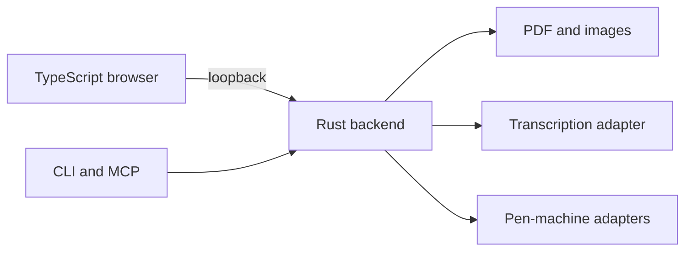

# Atrament

> Project started: August 31, 2026

**An artificial penmanship atelier that alchemizes text, lectures, formulas,
and photographs into uncannily human notebooks—PDF or real ink.**

Atrament is a disposable localhost workspace for composing polished handwritten
notes. The first-release design admits either a complete structured notebook or
a targeted semantic command batch from an LLM, then validates accepted state
before PDF, preview, live-plan, or physical-output projections.

It is not a word processor, a handwriting font, or a cloud notebook. Content is
semantic, layout is compiled against a physical page, handwriting comes from a
calibrated personal profile, and every visual adjustment remains an explicit
constraint.

## Personal priority: automate handwritten notebooks

Atrament exists because repetitive compulsory handwriting wastes time I would
rather spend learning, thinking, and living. The practical priority is a
**local Rust CLI and localhost web editor** for configuring notebook paper and
statistical handwriting, including per-glyph adjustments and symbols used in
Mexico, Spain, and English. The editor must load and save separate notebook
and handwriting profiles, expose all admitted numeric controls with ranges,
show a real preview, and export printable PDF or transparent PNG pages.

**Target glyph geometry (not yet complete):** The base **o** is a perfect
circle, and a simple **a** combines that circle with a stem. The printed
two-storey **a** and joined cursive are separate, selectable forms. Each glyph
has editable stroke order and direction, including deliberate reversal, plus
precisely placed accents (especially vowels), ñ and ü.

The user can iteratively tune each glyph and visibly change ink thickness,
height, slant, spacing and line regularity without losing the ideal base.
Pasted text or Markdown must wrap into real notebook pages with headings,
lists and automatic pagination. Titles can have aesthetic marker lettering,
colors and highlighter strokes before PDF/transparent PNG export.

**Rust is the application authority.** The existing TypeScript UI is a thin
localhost client, not a separate renderer or profile engine. Do not add a
Python notebook application, a second server, or parallel profile semantics.
Advanced layout, mathematics, LLM tooling, animation, desktop packaging
and plotters remain future work. Basic Markdown pagination and decorative
headings belong to the first real notebook-to-PDF journey.

For the staged, unfinished work see [TODO.md](TODO.md) and the
[Rust-first local roadmap](docs/technical/rust-cli-localhost-priority.md).

## Current implementation and release status (November 3, 2026)

Atrament already has a Rust localhost server and browser workspace,
authenticated draft transport, physical-page and handwriting domain contracts,
and a local `.atrament` profile verifier, inspector, and canonical repacker.
Run the Rust binary without arguments for the existing localhost workspace;
its notebook metadata, paper, handwriting statistics controls and native
PDF/PNG paper preview are connected. Local profile file read/write now has an
explicit opt-in directory; full rendered handwriting is still unfinished.
The available CLI commands are documented below.

The native bounded statistical controls and the localhost profile editing
workflow now have a real Firefox-to-Rust acceptance test: separate notebook
and handwriting profiles are edited with sliders/numeric inputs, saved to
the opted-in local directory, reopened, and previewed. An exact `ñ` override
and maximum unsigned 64-bit seed survive the round-trip, while invalid
statistics cannot overwrite the accepted file. PNG preview is the notebook
**paper layer**; handwriting remains numeric-only, not generated ink.

The same browser-saved notebook profile also opens in the independent Rust
`atrament-profiles` CLI and exports a real two-page paper PDF and 150-DPI
transparent PNG. The selected PNG page has an identical SHA-256 digest to
the browser preview. These remain paper-layer exports, not drawn handwriting
or full notebook content.

The earlier 77 tasks were accepted as bounded academic/design artifacts, not
as proof of a finished product. **Four immediate executable TODOs remain**
for Spanish/English glyph coverage, rendered notebook content, physical
printing acceptance and the complete personal end-to-end journey. Another
25 open follow-up implementation tracks preserve all deferred complexity
without blocking the local CLI and localhost first delivery. The previous
NO-GO decision still applies to production claims, and physical hardware
is not required for local use.

### Localhost Open/Save for notebook and handwriting profiles (opt-in)

The existing **Rust** loopback workspace accepts an explicitly selected,
pre-existing directory for two distinct native profile types. No server-side
file writes are enabled in the default no-argument mode:

```sh
mkdir -p ./my-atrament-profiles
cargo run -q -p atrament_runtime_bootstrap -- --profiles-dir \
  ./my-atrament-profiles
```

After the normal authenticated session opens in the browser, use **Notebook
page profile → Local notebook filename → Save local notebook** or
**Handwriting statistics → Local handwriting filename → Save local
handwriting**. **Open local** loads an existing file and its exact revision;
after editing, **Save local** checks that revision before allowing a
replacement. The original **Load JSON** file picker and **Save JSON**
download still work without this directory opt-in.

Names are deliberately limited to one ASCII `*.json` basename (maximum
64 characters); paths and symlinks cannot be selected by the browser.
The Rust host stores each type separately as `notebook-NAME` and
`handwriting-NAME` in the selected directory. For example, entering
`pages.json` and `writer.json` produces
`my-atrament-profiles/notebook-pages.json` and
`my-atrament-profiles/handwriting-writer.json`.
The directory must exist when the process starts, and the current atomic
file commit transport supports Linux; neither an upload nor a download
silently changes this directory.

The authenticated, same-origin `GET /api/notebook/file` and
`GET /api/handwriting/file` require a unique
`X-Atrament-Profile-Name: NAME` header. Each returns canonical native
profile JSON and a `sha256:` revision for the exact source bytes.
Corresponding `POST` requests also require Origin, JSON body, and
`X-Atrament-Profile-Revision: new` to create a new target, or the
previously read SHA-256 revision to replace an observed regular file.
Existing/new-name collisions and stale revisions return HTTP 409;
invalid JSON, names, duplicates or unexpected paths refuse before commit.

Without `--profiles-dir`, these file routes respond HTTP 503, while
read-only validation and PDF/PNG rendering continue to work.

The selected-directory save uses the existing Rust bounded-reader and
Linux atomic file commit adapter. It is not a general remote file manager,
does not persist anything in browser storage, and does not provide a
cross-process lock against simultaneous external writers. A failed
or uncertain commit must not be treated as permission to blindly retry an
overwrite; reopen the profile and inspect the result first.

### Native Rust printable-paper PDF and PNG (limited first slice)

The `atrament-paper` Rust CLI can already generate a physically sized **blank,
ruled, squared-grid, or dotted sheet** using the existing Rust page-profile,
nominal paper-mark, and vector PDF components. For example:

```sh
cargo run -q -p atrament_notebook_paper_cli -- \
  --style grid --width-mm 210 --height-mm 297 --spacing-mm 5 \
  --margin-top-mm 22 --margin-bottom-mm 16 \
  --margin-left-mm 20 --margin-right-mm 14 \
  --line-color '#c5d4e7' > paper.pdf
```

The default is an A4 5-mm square grid; `--style ruled`, `--style dot`, and
`--style blank` select other paper. `--paper-size a3|a4|a5|b5|letter|legal`
selects standard physical dimensions. `--landscape` or `--portrait`
explicitly chooses orientation, including for a loaded paper profile.

Set a paper-size preset before any manual `--width-mm` or `--height-mm`
overrides; the saved JSON retains the resulting exact dimensions. All
measurements are millimeters and the PDF uses physical point dimensions,
not screenshot pixels. Invalid options fail before the CLI writes PDF bytes.

This is a **paper-only** CLI: it does not load/save notebook or handwriting
profiles, draw handwriting, embed images, or provide handwriting controls.
The localhost page includes a paper-only editor with numeric inputs and
sliders, plus a separate Rust-validated handwriting statistics editor.
Neither editor is a complete notebook profile or handwriting renderer.

A printable collection of identical paper sheets is possible with `--pages`
(1–32). This is an output-only choice, not a field in the paper profile:

```sh
cargo run -q -p atrament_notebook_paper_cli -- \
  --paper-size a5 --style ruled --spacing-mm 7 --pages 12 > sheets.pdf
```

Pages contain the selected paper marks only; they do not yet include
handwriting, dates, page numbers, or custom per-page content.

For a **transparent PNG** of one physical paper sheet, select Rust PNG export
and DPI instead of the default vector PDF:

```sh
cargo run -q -p atrament_notebook_paper_cli -- \
  --paper-size a5 --style grid --spacing-mm 5 \
  --format png --dpi 150 --output sheet.png
```

Rust renders paper marks as RGBA pixels over transparency and writes the
physical DPI into PNG metadata. The supported DPI range is 72–300; output
is limited to five million pixels and 24 MB. A4 at 300 DPI is too large,
so use a lower DPI for larger sheets. The PNG exporter supports one sheet,
not handwriting, embedded image assets, or PDF's `--pages` option.

For explicit file saving instead of shell redirection, pass `--output FILE`.
It uses the existing Rust atomic file-commit adapter and refuses to overwrite
an existing file or symlink. `--replace` permits replacement of an existing
regular file, never a symlink; invalid profiles and geometry are rejected
before the target is changed. An uncertain post-commit durability failure is
reported explicitly rather than treated as a safe retry:

```sh
cargo run -q -p atrament_notebook_paper_cli -- \
  --paper-size letter --style ruled --pages 2 --output ruled.pdf
cargo run -q -p atrament_notebook_paper_cli -- \
  --style grid --emit-profile --output paper-profile.json
cargo run -q -p atrament_notebook_paper_cli -- \
  --profile paper-profile.json --spacing-mm 4.5 \
  --emit-profile --output paper-profile.json --replace
```

The explicit file-saving transport is Linux-only for now. Without `--output`,
the original stdout PDF/JSON behavior remains unchanged. PNG may also be
written to stdout explicitly with `--format png`.

The authenticated localhost runtime also exposes this **same Rust authority**.
After a compatible session handshake, `GET /api/paper/profile` returns the
canonical default JSON; `POST /api/paper/profile` checks and canonicalizes a
paper-only profile; `POST /api/paper/pdf` produces its physical vector
PDF; and `POST /api/paper/png` produces transparent RGBA paper bytes.

PNG POST also requires exactly one `X-Atrament-Png-Dpi: 150` header
(value 72–300) and returns `Content-Type: image/png`. Every POST
requires the exact session Origin, Bearer credential and bounded JSON
input. These routes do not save files server-side or render handwriting.

The same Rust session now admits `GET /api/handwriting/profile` for the
uncalibrated default, `POST /api/handwriting/profile` for canonical, bounded
statistics validation, and `GET /api/handwriting/dimensions` for the ten
variable names, physical units, and domain bounds. All three require the
current session credential; POST additionally requires the exact Origin.
These default validation endpoints do not themselves save files or render
written glyphs. The opt-in file endpoints above are separate.

The localhost workspace presents a **paper profile** editor after a
successful session handshake. It offers A3/A4/A5/B5/Letter/Legal presets,
blank/ruled/grid/dot patterns, physical dimensions, editable spacing and
four margins (numeric fields and synchronized sliders), and line color.

Choose **Load JSON** to validate a selected paper-only profile through Rust,
**Save JSON** to download the Rust-canonicalized profile, **Export PDF** for
vector paper, or **Export transparent PNG** for a pixel image. PNG DPI has
linked numeric and slider inputs. The browser renders neither PDF nor PNG
and persists no profile in browser storage; downloads are explicit actions.

A separate **handwriting statistics** section loads the Rust dimension
catalog and versioned JSON profile only after session admission. It allows
editing all ten native dimensions with numeric fields and sliders for minimum,
maximum, mean, median, and deviation, plus seed, and exact per-grapheme
overrides such as `ñ` and decomposed accents.

**Load JSON** validates with
Rust, **Save JSON** downloads canonical Rust-validated statistics, and
**Default** restores the uncalibrated native seed-zero profile. Bounds and
units come from Rust; this is a numeric statistics preview, not actual ink
rendering. **Preview seeded number in Rust** uses the current (including
unsaved) controls, an exact grapheme, the selected native dimension, and a
zero-based occurrence. Authenticated `POST /api/handwriting/preview` checks
the whole profile and returns a repeatable integer for identical inputs.

This is not calibrated ink or glyph shape data, and the preview saves no file.

The localhost editor preserves all unsigned 64-bit seeds and occurrence
indices, including values above JavaScript safe integer precision, as exact
decimal JSON tokens. It requires a modern browser with JSON parse source
context; browsers without it refuse rather than round a saved seed.

Server-side file persistence is available only by explicitly launching the
Rust runtime with a selected directory as described below; full notebook
content and handwriting rendering are not implemented yet.

For a reusable paper-only profile, the same CLI can emit versioned JSON,
read it again, and apply further explicit edits:

```sh
cargo run -q -p atrament_notebook_paper_cli -- \
  --style ruled --spacing-mm 7 --emit-profile > paper-profile.json
cargo run -q -p atrament_notebook_paper_cli -- \
  --profile paper-profile.json --margin-top-mm 18 > ruled.pdf
```

`--profile` must precede edit flags. The `atrament.paper.v1` profile uses
integer micrometers, has a 4-KiB input ceiling, rejects duplicate or unknown
fields, and is validated against the actual PDF path before acceptance.
The shell chooses the output file and handles any overwrite; this
paper-only CLI is separate from the opt-in localhost notebook/handwriting
profile Open/Save feature above.

### Shared native paper and handwriting profile CLI

`atrament-profiles` is the first combined **Rust-only profile CLI**. It
reuses `atrament-paper` for physical paper/PDF options, and the bounded Rust
handwriting-statistics codec for separate `atrament.handwriting.statistics.v1`
files. The paper schema is still paper-only, not a complete notebook schema.

```sh
cargo run -q -p atrament_profile_editor_cli -- \
  handwriting --seed 7 --output handwriting.json
cargo run -q -p atrament_profile_editor_cli -- \
  handwriting --profile handwriting.json \
  --set-global height 2500 3500 3000 3000 200 \
  --set-glyph 'ñ' width 1800 2600 2200 2200 200 \
  --output handwriting.json --replace
cargo run -q -p atrament_profile_editor_cli -- \
  handwriting --profile handwriting.json \
  --remove-glyph-dimension 'ñ' width \
  --output handwriting.json --replace
cargo run -q -p atrament_profile_editor_cli -- \
  handwriting --profile handwriting.json --inspect
cargo run -q -p atrament_profile_editor_cli -- \
  handwriting --profile handwriting.json \
  --inventory-text '¡Hola, señor! ¿Qué tal? «Sí» ñ ∞'
cargo run -q -p atrament_profile_editor_cli -- \
  handwriting --profile handwriting.json --preview-glyph 'ñ' 7
cargo run -q -p atrament_profile_editor_cli -- \
  paper --style ruled --emit-profile --output paper.json
cargo run -q -p atrament_profile_editor_cli -- \
  paper --profile paper.json --spacing-mm 6 --output sheet.pdf
```

Each statistical edit requires the dimension name followed by **minimum,
maximum, mean, median, and standard deviation** in that dimension's native
units: micrometres, millidegrees, or parts per thousand. Ten named global
variables and exact per-grapheme overrides, including decomposed accents,
are supported.

`--remove-glyph GRAPHEME` removes an entire exact glyph,
`--remove-glyph-dimension GRAPHEME DIM` restores that dimension to its
global value, and removing the last override deletes the empty glyph.
Missing glyphs or dimensions refuse before saving.

The Rust CLI `--inventory-text` audit checks each distinct Unicode extended
grapheme against the existing 114-entry English/Spanish **text** inventory,
reports whether a matching exact statistical override exists, and lists
unlisted graphemes explicitly. NFC `ñ` and NFD `ñ` remain separate;
mathematical symbols such as `∞` are reported outside this *text*
inventory because mathematical coverage is a separate authority. The audit
allows 1–4096 UTF-8 bytes, refuses control characters and output-file flags,
and writes only to stdout. **Inventory membership does not provide glyph
outlines, fallback consent, or rendered handwriting.**

The read-only `--preview-glyph GRAPHEME OCCURRENCE` CLI command produces
a reproducible integer preview for each of ten admitted dimensions using
the stored seed, exact grapheme identity, and occurrence index. It applies
global controls and per-grapheme overrides without saving or rendering.
This is intentionally an **uncalibrated numeric estimate**: the configured
mean, deviation, and limits affect it, but the median, exact distribution
moments, and ink shapes are **not** reproduced. Use it to compare edits,
not to claim a finished handwriting style.

The default profile is **not calibrated handwriting**; its seed is recorded,
but no stochastic stroke generator is connected yet.

`--profile` must come before statistical edits. Input is limited to 1 MiB,
unknown/duplicate fields or impossible statistics refuse, and output is
canonical JSON. `--output` refuses to overwrite an existing file unless
`--replace` is explicit; existing symlinks cannot be overwritten.

For example, `--set-global height 2500 3500 4500 3000 200` is invalid and
refuses before any output file change. The initial localhost statistics
editor now accepts bounded global and per-grapheme changes. Notebook
content profiles, actual handwriting rendering, and server-side Open/Save
web controls remain open implementation tasks.

### Native notebook page metadata profile (first Rust slice)

The `atrament-profiles notebook` subcommand creates a **versioned
`atrament.notebook.v1` profile** containing the existing Rust-validated
`atrament.paper.v1` sheet plus date placeholder style and location, border
radius in micrometres, optional printed numeric date, page numbers, and
a printed-sheet flag. This is page metadata, **not** notebook body content,
searchable date text, or generated handwriting. Existing seven-field v1
files reopen with an empty printed-date field.

```sh
cargo run -q -p atrament_profile_editor_cli -- \
  paper --style ruled --spacing-mm 7 --margin-top-mm 25 \
  --emit-profile --output my-paper.json
cargo run -q -p atrament_profile_editor_cli -- \
  notebook --paper-profile my-paper.json --date-style box \
  --date-placement top-right --date-text 2026-11-03 \
  --border-radius-um 3000 \
  --page-numbers true --printed-sheet false --output notebook.json
cargo run -q -p atrament_profile_editor_cli -- \
  notebook --profile notebook.json --page-numbers false \
  --output notebook.json --replace
cargo run -q -p atrament_profile_editor_cli -- \
  notebook --profile notebook.json --inspect
```

Notebook input is bounded at 8 KiB. The nested paper and notebook fields
are validated by Rust. Unknown or duplicate fields, invalid dates,
impossible paper geometry or oversized borders refuse. `--profile`
must precede edits.

`--output` refuses existing files unless `--replace` is explicit, and never
overwrites symlinks. Invalid inputs cannot change the output.

A saved notebook profile can also export its **paper layer** through the
shared Rust PDF or PNG renderer, without a separate paper JSON file:

```sh
cargo run -q -p atrament_profile_editor_cli -- \
  notebook --profile notebook.json --date-style box \
  --date-placement top-right --export-paper pdf --pages 3 \
  --output notebook-paper.pdf
cargo run -q -p atrament_profile_editor_cli -- \
  notebook --profile notebook.json --page-numbers true \
  --export-paper png --dpi 150 --png-page 10 \
  --output notebook-page-10.png
```

### CLI text and Markdown flow onto notebook pages

The Rust notebook CLI can now turn **caller-supplied text or a restricted
Markdown file** into page-local handwriting strokes using the selected
notebook paper and **only glyphs you have actually authored**. In the localhost
**Authored glyph strokes** editor, select a geometric `a`, click
**Construct**, and explicitly download its TSV as `ink.tsv`. Then:

```sh
printf '# a\n\na a a\n- a\n' > notes.md
cargo run -q -p atrament_profile_editor_cli -- \
  notebook --printed-sheet false --export-paper pdf \
  --glyph-file ink.tsv --flow-markdown-file notes.md \
  --output notes.pdf
cargo run -q -p atrament_profile_editor_cli -- \
  notebook --printed-sheet false --export-paper png \
  --png-page 1 --dpi 72 --glyph-file ink.tsv \
  --flow-markdown-file notes.md --output notes-page-1.png
```

Both exports were smoke-tested with the editor's geometric `a` strokes;
the PDF is a real one-page document and PNG is 72-DPI RGBA. A heading
gets a pen underline and a list item gets an ink marker. For a notebook
profile already saved as `notebook.json`, supply `--profile notebook.json`
before the flow options to use its paper/margins instead of defaults.

Use `--flow-text-file` for plain text, or `--flow-text` and
`--flow-markdown` for inline command arguments. Blank lines create gaps;
ordinary lines wrap onto additional pages automatically (up to 32).
The Markdown subset supports single-line `#`, `##`, `###` headings and
`-`/`*` bullets, **not** inline styles, tables or full Markdown.
The source limit is 4,096 UTF-8 bytes, with up to 128 laid-out lines.
The same 512 total exported pen-segment limit still applies.

If `notes.md` includes an unauthored character (for example `ñ` when
only `a` was saved), export refuses with its exact Unicode identity;
no PDF/PNG is created or overwritten. Author more glyphs in the editor
or select a deliberate native `--fallback-glyph` mapping. The CLI does
not yet save semantic notebook body content or offer browser Markdown
paste/preview, automatic handwriting shapes, cursive joining or aesthetic
heading lettering.

The same Rust-only CLI can draw **explicit caller-owned pen segments** over
paper, printed dates, and page numbers. A separate `--ink-line` is repeated
for each straight segment, with `PAGE X1_UM Y1_UM X2_UM Y2_UM WIDTH_UM
'#RRGGBB'` (one-based page number, physical micrometres, ink color). For
example, the following draws red diagonal ink *only on page 2* of a two-page
A4 PDF, then emits its transparent RGBA page-2 PNG:

```sh
cargo run -q -p atrament_profile_editor_cli -- \
  notebook --printed-sheet true --export-paper pdf --pages 2 \
  --ink-line 2 25400 25400 50800 50800 700 '#DE1144' \
  --output notebook-ink.pdf
cargo run -q -p atrament_profile_editor_cli -- \
  notebook --printed-sheet true --export-paper png --png-page 2 --dpi 72 \
  --ink-line 2 25400 25400 50800 50800 700 '#DE1144' \
  --output notebook-ink-page-2.png
```

A bounded **caller-drawn glyph overlay** is also available through the same
Rust CLI. A `--glyph-stroke GRAPHEME X1 Y1 X2 Y2 WIDTH_UM '#RRGGBB'`
entry declares one segment of an exact Unicode grapheme, relative to its
4 × 5 mm cell (X: 0–3500 µm, Y: 0–4500 µm). Repeat it for the same
character to form a real multistroke outline. `--place-text PAGE X_UM
Y_UM TEXT` places those exact shapes with a fixed 4-mm horizontal advance,
including spaces. For example, these *illustrative diagonals* render on
page 2, without claiming they resemble anyone's handwriting:

```sh
cargo run -q -p atrament_profile_editor_cli -- \
  notebook --printed-sheet true --export-paper pdf --pages 2 \
  --glyph-stroke 'ñ' 100 100 3300 4400 350 '#1C3344' \
  --glyph-stroke '∞' 200 3500 3000 100 350 '#1C3344' \
  --place-text 2 25400 30000 'ñ ∞ ñ' --output glyphs.pdf
```

Graphemes need authored strokes. Without an explicitly selected fallback,
missing ones refuse with every exact UTF-8 grapheme and Unicode code-point
sequence, rather than disappearing. Composed `ñ` and decomposed `ñ` are
distinct. The same flags can export
transparent PNG using `--export-paper png --png-page 2 --dpi 72`; page 1
remains unmarked by page-2 ink.

There are at most 4096 authored template
segments, 16 text runs of up to 96 graphemes each, and 512 final pen
segments combined with `--ink-line`. Physical placement and ink width are
checked by the existing PDF/PNG compositor before the selected output changes.

To start a complete **lowercase-only geometric draft** without drawing
26 letters by hand, open the authenticated localhost glyph editor and click
**Fill missing lowercase a–z (unsaved)**. It uses the selected center,
radius, pen width and color; already-authored shapes remain unchanged.
Review individual letters, then click **Download glyph TSV** explicitly.
For a downloaded `my-glyph-strokes.tsv`, the native CLI can render a short
word directly onto a selected paper page:

```sh
cargo run -q -p atrament_profile_editor_cli -- notebook \
  --printed-sheet true --export-paper pdf \
  --glyph-file my-glyph-strokes.tsv \
  --place-text 1 25400 30000 'hola' --output hola.pdf
```

The default 26-letter draft has 739 sampled strokes. Rust accepted an
exact readback and exported both PDF and transparent 72-DPI PNG for `hola`.
This action does not seed uppercase, Spanish accents, punctuation or the
complete 114-entry inventory. It does not connect semantic Markdown text
to notebook flow, and the native renderer still caps output at 512 physical
ink strokes per export. The shapes are editable geometric starters, not
personal handwriting or retained analytic PDF curves.

The **Rust glyph-library CLI** can now save and reopen those exact authored
strokes independently of numeric statistics and notebook page metadata:

```sh
cargo run -q -p atrament_profile_editor_cli -- glyphs \
  --glyph-stroke 'ñ' 100 100 3300 4400 350 '#1C3344' \
  --glyph-stroke '∞' 200 3500 3000 100 350 '#1C3344' \
  --output my-glyphs.tsv
cargo run -q -p atrament_profile_editor_cli -- notebook \
  --printed-sheet true --export-paper pdf --pages 2 \
  --glyph-file my-glyphs.tsv \
  --place-text 2 25400 30000 'ñ ∞ ñ' --output glyphs.pdf
```

`glyphs --profile my-glyphs.tsv` prints the canonical library to stdout.
Additional `--glyph-stroke` flags append segments; to redraw one letter,
use `--remove-glyph 'ñ'` before adding its new strokes. An explicit
`--output ... --replace` saves the revision. To discover missing shapes for
an exact Unicode string, run a read-only glyph audit:

```sh
cargo run -q -p atrament_profile_editor_cli -- glyphs \
  --profile my-glyphs.tsv --audit-text '¡Señor! «Sí» ñ ∞'
```

Use `glyphs --profile my-glyphs.tsv --audit-baseline` to check every member
of the frozen **114 exact English/Spanish text graphemes** automatically,
including accents and guillemets. The baseline does **not** include math;
audit `∞`, equations or other symbols separately with `--audit-text`.

The audit lists each distinct visible grapheme, its Unicode code points, and
its actual authored stroke count or missing status; it does not confuse the
statistical/text baseline with renderable ink. The versioned format
starts with `atrament.glyph-strokes.v1`, followed by one **tab-separated**
`GRAPHEME X1 Y1 X2 Y2 WIDTH_UM #RRGGBB` record per line (UTF-8, LF).
It supports 4096 strokes and up to 512 KiB, checks exact grapheme identity
without normalizing NFC/NFD, and refuses malformed, missing, oversized or
unprintable input before PDF/PNG output replacement. The file is an
**authored shape library**, not a sampled writer model; no Python is used.

For a missing exact grapheme, the notebook CLI can borrow an existing
caller-authored shape **only** with `--fallback-glyph MISSING AUTHORED`.
For example, after saving the `ñ` template above:

```sh
cargo run -q -p atrament_profile_editor_cli -- notebook \
  --printed-sheet true --export-paper pdf \
  --glyph-file my-glyphs.tsv --fallback-glyph 'ñ' 'ñ' \
  --place-text 1 25400 30000 'ñ ñ' --output fallback.pdf
```

Up to 64 run-local mappings are allowed. The source must lack its own
strokes and the target must already have them; duplicates, chains, invalid
graphemes or an unauthored target refuse. The output reuses the actual
selected shape, not a synthesized glyph. With `--handwriting-profile`,
the *requested source* grapheme's statistics scale that borrowed shape.

Mappings are neither stored in `my-glyphs.tsv` nor inferred from Unicode
normalization. Choose visually acceptable substitutions deliberately;
`glyphs --audit-text` still reports the library's original stroke coverage.

This is a **caller-controlled glyph-fallback path**, not a font, automatic
letter-shape generator, semantic text layout, or statistical handwriting.
The localhost browser now offers an **Authored glyph strokes** section after
session admission. Choose an exact grapheme, pen color, start/end micrometre
coordinates, and stroke thickness with numeric fields or matching ranges.
Click **Add stroke** to inspect the actual segments in the SVG preview.

Choose any existing segment from the selector (or click its drawn line) to
load its saved coordinates, thickness and color into the controls. **Update
selected stroke** validates and replaces only that segment; **Remove selected
stroke** deletes only that segment, not the other shapes for the grapheme.
Invalid updates leave the saved draft untouched.

The selected segment can be **reversed** (swap start and end) or moved
**earlier/later** among segments of the exact same grapheme. Other Unicode
entries retain their relative order and ink. The native TSV sequence remains
the chosen drawing order, but v1 line segments do not represent a grouped
curved pen stroke.

For a geometric starting point, choose an explicitly supported glyph
(`o`, `a`, `ó`, `á`, `b`, `d`, `p`, `q`, `g`, `n`, `u`, `h`, `m`,
`l`, `t`, `f`, `r`, `v`, `w`, `k`, `x`, `y`, `z`, `c`, `e`,
`i`, `í` or `j`) and its matching
geometric starter. Adjust the center and radius in
micrometres, then deliberately replace that letter's unsaved strokes.
The `o`/`a` forms share a true analytic circle.

The `b` and `d` reuse the same exact circle with a left or right
ascender stem; `p` and `q` use corresponding descender stems. At the
default geometry each saves 48 loop chords plus one straight stem, while
the guide remains a true SVG circle. Stems extend 1.5 radii above or below
the center, and geometry plus pen width must fit the 3500×4500 µm cell.

A simple `a` adds a right stem. A separately selectable
**printed two-storey `a`** adds two smooth quadratic upper arches
above the same circular bowl. Both forms can have an acute `á` accent.

A separate exact SVG construction guide updates with the numbers without
writing ink. The existing Rust v1 glyph TSV, PDF and PNG exporters cannot
retain circle or quadratic primitives. The 48-segment circular bowl gains
a stem (49 lines for simple `a`), an acute (49 for `ó`), or both (50 for
simple `á`).

Two-storey `a` adds 32 upper-arch samples and a right stem
(81 lines); two-storey `á` adds an accent (82). This is **sampled near-curve
ink**, not an exact vector-curve PDF export.

Lowercase `n` and `u` now have separately selectable analytic quadratic
constructions: `n` uses an upper hump and two stems, while `u` uses a lower
bowl and two stems. Each SVG guide shows two exact quadratic arcs; each
TSV template contains their 32 line samples and two stems (34 segments).
The marks retain explicit pen order and can be selected, reversed or moved.

A lowercase `h` reuses `n`'s upper quadratic arch with an extended left
ascender; its template still contains 34 ordered sampled segments. A
lowercase `m` adds a second quadratic hump: four exact SVG quadratic arcs,
64 exported curve chords and three explicitly ordered stems (67 segments).
The SVG is an ideal construction guide; its TSV/PDF/PNG ink is sampled.

A clipped ascender refuses before replacing the previously authored glyph.
A byte-identical 101-segment `hm` library also passed the Rust CLI readback
and exported a real one-page PDF and transparent RGBA PNG.

Compose `n` into `ñ` or `u` into `ü` with **Compose accent from authored
base**; these produce respectively 37 and 36 sampled segments at the default
center/radius. The original `n` and `u` are unchanged. Neither glyph is an
entire alphabet or a continuous native quadratic in the exported PDF.

The lowercase `c` is a 270-degree exact SVG circular arc with a right-hand
gap, serialized as 36 rounded chords. The `e` reuses precisely those chords
and adds a horizontal crossbar (37 segments); both remain editable.

The tall `l` is one exact vertical line segment; `t` is a separate
vertical stem with one straight e-style crossbar (2 ordered segments).
Their SVG guides use the same exact line coordinates as the native TSV,
without curve approximation. With an out-of-cell ascender, the editor
refuses replacement rather than clipping or changing earlier glyphs.

An `f` reuses the tall `l` stem and the exact `t` crossbar, preserving two
separately ordered strokes. A lowercase `r` reuses `n`'s true quadratic
shoulder and left stem but deliberately omits the `n` right stem: one
straight stroke and 32 sampled chords (33 TSV segments). Its SVG keeps
both ideal quadratic arcs. Both templates remain user-selectable and refuse
clipped geometry without changing saved ink; this is still not cursive.

The `g` starter keeps precisely the same analytic circle as `o` and adds
a right-hand stem followed by an ideal quadratic descender hook. The TSV
contains 48 rounded circle chords, one exact stem and 16 connected hook
chords (65 ordered segments). The SVG retains the exact circle and curve,
while clipping of the descender or pen refuses replacement atomically.

The symmetric `v` uses two exact straight segments and `w` uses four
connected straight segments, reusing one SVG guide with no additional
resource sink. The exported Rust TSV retains those same integer vertices
and explicit pen order, not an approximated curve. Failed out-of-cell
geometry leaves previously authored ink unchanged.

Lowercase `k` has a tall stem and two separate diagonals (3 lines), `x`
has two disconnected crossing diagonal pen strokes, `y` has two fork
strokes plus a lower descender (3 lines), and `z` has three connected
straight strokes. The ideal SVG guide shares exact source coordinates
with the Rust-compatible authored TSV. It uses explicit SVG `M` moves
when a pen must be lifted; these are not joined cursive strokes. The
browser refuses clipped `k` ascenders and `y` descenders, including the
pen's half-width margin, without replacing saved shapes.

A dotted `i` has one straight stem plus one short dot stroke (2 segments).
A separately selectable `í` instead keeps the stem and puts a rising acute
above it (2 segments) **without an extra dot**. The dotted `j` extends its
stem into a quadratic descender hook: the SVG keeps the ideal curve and
native TSV samples 16 connected chords, for 18 ordered segments with
stem and dot. The hook and pen width must fit the cell; invalid placement
refuses without changing saved ink. Compose an authored `e`
into `é` to add the acute as a separate final segment (38 total here).

A general-purpose **Compose accent from authored base** action copies every
source stroke, including any manually drawn dot. When creating `í` from an
ordinary dotted `i`, prefer the explicit dotless geometric starter or
independently remove the copied dot before final export; accent composition
does not guess which user-drawn marks are detachable. Native v1 export still
contains sampled line ink, not a real analytic font or Bézier resources.

For `ó` and both `á` variants, **Acute horizontal shift**
(-500 to +500 µm) and **Acute lift** (0 to 500 µm) move the accent
without moving the loop or upper arch. In two-storey `á`, the accent
starts above the taller upper story, so the default 1100 µm radius
does not fit; reduce it (for example to 600 µm). The SVG follows the
controls before ink replacement, and invalid clearance refuses atomically.

Invalid coordinates, arch/accent clearance, pen thickness or library caps
refuse without replacing any template; other graphemes remain untouched.
General analytic persistence, universal accent anchoring, italic and
cursive remain unfinished.

Drag across the SVG preview with a mouse, pen or touch to trace a letterform
as up to 128 connected line segments per gesture. Canceled, zero-length and
oversized gestures do not change the saved draft.

To develop a related form, enter a different exact source grapheme under
**Copy strokes from exact grapheme** and choose **Replace selected glyph
with copy**. This explicitly
replaces only the target glyph's unsaved template; its strokes can then be
edited independently. It does not silently substitute symbols or synthesize
handwriting.

**Compose accent from authored base** uses the same exact base-glyph
field as Copy, but requires a matching accented target. For example, after
articulating `e` strokes choose `e` as the source and `é` (or exact `e` plus
combining acute) as the target.

The editor creates a separate target with original stroke order, endpoints
and colors unchanged, then appends a bounded ink mark using the selected
pen color. Supported pairs are `a/e/i/o/u`
(and their uppercase forms) with acute, `n/N` with tilde and `u/U` with
umlaut. Accent shift (-500..500 µm) and lift (0..500 µm) apply to the new
mark; all coordinates remain integer micrometres.

Each mark is one acute segment, three joined tilde segments or two dot-like
short strokes. It is
**explicit one-time target replacement**, not attachment metadata or a
normalization-based runtime fallback: `ñ` and `n` plus combining tilde
remain distinct keys.

Missing bases, mismatched targets and clipped marks refuse without replacing
any existing target. In particular, a dotted `i`
with insufficient space above its strokes may require user adjustment first.

This is bounded compositional ink for shapes the user actually supplied,
not a full geometric alphabet, analytic accent persistence or automatic
script joining. The source is never modified; the user can still reorder
or reverse each target pen segment after composition.

**Load stroke TSV** reads an explicit existing glyph file into an in-memory
draft. **Download stroke TSV** saves the canonical native-compatible file;
there is no automatic saving or new server-side file endpoint. The Rust CLI
still validates the file on `glyphs --profile` or `notebook --glyph-file`.
Invalid/oversized files and Unicode controls refuse.

Session end drops the unsaved draft. Outside its small explicit geometric
starter set, the browser does not generate a font, joined cursive,
all baseline outlines, or a writing style.

The saved glyph shape library is separate from `atrament.notebook.v1`;
placed text is still export-only, with browser-authored geometry imported
by CLI rather than directly composed in the browser. The 114-character
Spanish/English inventory still needs actual user-calibrated outlines and
missing-symbol authoring before P1-012 can close.

The optional `--handwriting-profile ink.json` reads the existing saved
`atrament.handwriting.statistics.v1` file through the same strict Rust codec.
For each exact authored grapheme it applies the **configured mean** of six
variables: `width`, `height`, `ink_thickness`, `letter_spacing`,
`baseline_offset` and `slant`. Width and height map the
3.5 × 4.5 mm template cell to physical micrometres; ink thickness
scales relative to 300 µm, baseline moves the segment vertically, and
character advance is width plus letter spacing. Literal spaces still
advance 4 mm. For example:

```sh
cargo run -q -p atrament_profile_editor_cli -- handwriting \
  --set-glyph 'ñ' width 3000 3000 3000 3000 0 \
  --output ink.json
cargo run -q -p atrament_profile_editor_cli -- notebook \
  --printed-sheet true --export-paper pdf --pages 2 \
  --handwriting-profile ink.json \
  --glyph-stroke 'ñ' 0 0 3500 4500 300 '#1C3344' \
  --place-text 2 25400 30000 'ññ' --output written.pdf
```

Scaled strokes still need to fit the paper's printable region and the
80–1500 µm physical pen width; nonpositive glyph advances refuse. Negative
baseline positions or excessive lengths also refuse before writing output.

Slant is a baseline-anchored shear using the mean millidegree angle:
positive slant leans the top right, negative leans left, and out-of-page
results refuse. These are deterministic transforms of *your supplied shapes*;
there is **no sampling** and no actual learned handwriting. The other
statistics (`roundness`, `flattening`, `pressure`, `texture`), and
standard deviation, min/max envelope, median, and seed, remain validated
profile data but **do not currently modify output ink**.

The compositor refuses zero-length strokes, nonprintable endpoints, line
width outside 80–1500 µm, unrequested PDF page numbers, and more than 512
segments. Selected PNG pages render only their page's ink; invalid off-page
geometry still refuses.

The `--ink-line` arguments are **manually specified physical segments**, not
Unicode glyphs or calibrated handwriting; the separate caller-drawn glyph
option below associates exact Unicode graphemes with authored segments.
`atrament.notebook.v1` still saves page metadata alone; `--ink-line` marks
are not stored in that profile or editable in the localhost web UI yet.
The full notebook-content rendering task therefore remains open.

PDF allows 1–32 physical pages; transparent RGBA PNG renders one page at
72–300 DPI with physical resolution metadata. For `printed_sheet: true`,
existing ruling is suppressed to avoid duplicating marks on stationery.
When no date or page numbers are selected, preprinted PDF/PNG overlays are
unmarked.

No profile file is changed by rendering. Output is explicit and existing paths
require `--replace`; invalid options refuse before changing output bytes.

When a notebook selects a date placeholder (`line` or `box` at the top left
or top right), the same Rust PDF/PNG renderer draws a 36 × 8 mm reserved
area in the top margin. The optional `--date-text` (or `date_text` field in
the localhost notebook editor) prints fixed-width numerals and separators
inside that area, without synthesizing handwriting. Accepted examples are
`2026-11-03`, `03/11/2026`, `11/03/2026`, and `03.11.2026`.

An ambiguous day/month order is preserved exactly as typed, never guessed
from locale. Impossible Gregorian dates, malformed separators, or dates
without a selected placeholder refuse. Existing empty placeholders stay
empty. The reserved area requires at least 10 mm of top clearance and
36 mm of usable width; invalid placements refuse profile validation.

With `page_numbers: true`, Rust prints page numbers 1–32 in the bottom
margin using compact block numerals; each PDF page receives its own number.
A PNG export can select page 1–32 with `--png-page N` (defaults to page 1).
The PNG exporter emits one physical sheet per invocation, not an image bundle.

Numbering requires at least 7 mm of bottom margin; invalid profiles refuse.
Numbered sheets retain the number and date placeholder when `printed_sheet`
suppresses the existing paper marks.

A nonzero `border_radius_um` draws a 0.12-mm rounded outline along the
printable region in both PDF and transparent PNG; zero leaves the border off.
The radius must fit half the printable area, and each sheet-edge margin must
be at least 0.06 mm to contain the outline's centered stroke.

This is **not** a complete notebook export: only printed numeric date
annotations, paper marks and page numbers render. Handwriting, arbitrary text,
searchable text and image overlays remain unavailable. Date and page-number
glyphs are printed markers, not sampled pen strokes.

The localhost Rust runtime also exposes authenticated
`GET /api/notebook/profile` (default profile) and
`POST /api/notebook/profile` (bounded JSON validation and canonicalization).
These endpoints are in-memory only; POST does not persist a file or set
session-wide defaults. They require the existing session bearer credential
and same-origin admission, like the paper profile endpoint.

The authenticated localhost runtime also accepts notebook JSON at
`POST /api/notebook/paper/pdf` (with one `X-Atrament-Pdf-Pages: 1..32`
header) and `POST /api/notebook/paper/png` (with one
`X-Atrament-Png-Dpi: 72..300` header). PNG optionally accepts a single
`X-Atrament-Png-Page: 1..32` header and defaults to page 1 if omitted;
malformed or repeated page headers refuse before rendering.

Both formats use the same Rust notebook validator and paper serializer as the
CLI. The web editor supplies page/DPI headers from its PDF and PNG controls,
then downloads the selected physical paper layer. One PNG contains one sheet.

Preprinted-sheet suppression applies to ruling in both formats; explicitly
selected date placeholders, optional printed numeric dates, rounded outlines
and page numbers remain visible. Handwriting, arbitrary text and image
content are still not drawn in these outputs.

The localhost web editor now also offers **Notebook page profile** controls
for date placeholder style and placement, optional printed date text,
border radius, page numbers and preprinted-sheet intent. PDF/PNG exports draw
these annotations only when physically admissible.

**Use current paper** includes unsaved sheet settings before Rust validation.
**Preview selected page**
validates the current notebook proposal with Rust and shows the requested
PNG paper layer inline, including rounded borders, without downloading it.
Changing page or notebook settings hides stale previews; ending the session
revokes its image URL.

**Edit notebook paper** sends the notebook's embedded sheet into the visual
paper editor through Rust validation; **Use current paper** copies edited
settings back only when requested. Load and Save JSON use explicitly
selected files; no browser state is silently persisted or unsupported
metadata rendered beyond these annotations.

## The workspace

The following is the intended notebook workflow, not a claim that the
existing localhost shell already implements the complete editor. The design
uses a split workspace with two editors:

- **LLM editor:** task, structured notebook source, validation diagnostics, and
  the one-shot chat exchange.
- **Human editor:** live page preview, text correction, selection, movement,
  resize, crop, layering, and physical-page controls.

The first LLM workflow requires no embedded model account:

1. Paste the task, notes, formulas, sources, and optional images.
1. Select a handwriting profile, paper, style, and output mode.
1. Press the permanent **Copy prompt** button.
1. Paste that self-contained prompt once into the chosen chat.
1. Paste the structured response back into the LLM editor.
1. Resolve validation, source, glyph, collision, and overflow diagnostics.
1. Adjust the accepted page in the human editor.
1. Export PDF or compile a live writing plan.

The copied prompt includes the complete backend-owned return format, page
constraints, source rules, style vocabulary, and return envelope. It never
depends on hidden prior chat context.

After a notebook is accepted, the first-release design specifies a semantic
command mode. Instead of regenerating the notebook, an LLM returns a versioned
batch of typed operations against stable notebook identities and a specific base
revision. The backend contract validates the complete batch atomically, applies
only accepted semantic effects, and recomputes derived regions invalidated by
those effects and their dependencies.

The same command model is designed for clipboard-assisted chat, CLI, and MCP.
Clipboard responses remain untrusted until backend validation and review; the
frozen MCP contract projects the same validated application transaction without
requiring a browser click.

That MCP projection is designed to automate notebook inspection, bounded edits,
diagnostics, rendering, caller-authorized export, and device-neutral plan
compilation end to end. Typed results and stable blocking diagnostics provide
stop conditions instead of an unbounded "retry until success" loop.

Export still requires explicit caller or admitted host-policy path and overwrite
intent; paths found only in notebook or model text remain data. Physical machine
arming and start remain separate explicit safety operations rather than side
effects of a generic LLM edit.

### Targeted command mode

For a bounded edit to an accepted notebook, the backend can generate a command
prompt instead of a full-notebook formatting prompt. That request identifies the
base revision, readable context, writable semantic targets or insertion anchors,
and admitted command families.

The user copies it with the same **Copy prompt** control, pastes it into an
external chat, and pastes the returned command envelope into the same **Model
response** surface. The backend validates the complete batch, shows the semantic
diff and dependency-expanded impact, then applies one accepted transaction.

Unrelated semantic identities remain unchanged. Derived page regions may still
recompute when the changed target affects their dependencies, such as text
reflow moving later content.

With MCP, the clipboard round trip disappears: an agent can inspect the current
revision, validate or apply the same command batch, inspect its receipt and
diagnostics, then explicitly request rendering, export, or planning through the
same application core when those outputs belong to the caller's goal.

## What a notebook can contain

The initial semantic vocabulary covers the material expected in serious school
notes and assignments:

- headings, dates, paragraphs, quotations, lists, and definitions;
- citations, source notes, footnotes, and unresolved claims;
- inline and displayed mathematics, aligned work, matrices, and units;
- tables, boxes, dividers, arrows, labels, and page references;
- photographs, transparent line art, diagrams, and clipped regions;
- highlights, callouts, margin notes, and digital paper notes;
- multiple handwriting roles for body text, titles, labels, and annotations.

An LLM may organize and format content, but a plausible citation is not proof.
Atrament distinguishes material supplied by the user, derived material, cited
claims, and unresolved claims so the human can review them before export.

## Page geometry

Every page uses physical units. The user controls:

- sheet size, orientation, and printable region;
- blank, ruled, dotted, squared, or custom paper;
- grid or rule spacing and color;
- binding edge, outer margin, and top clearance;
- inner writing inset between the margin and content;
- border shape, corner roundness, and layer order;
- measured ruler error and controlled grid imperfection;
- default body, title, caption, and annotation sizes.

Flowing content moves to another page. Fixed content that crosses the writable
region produces a blocking diagnostic; nothing silently vanishes outside the
sheet.

## Images and drawings

Clipboard and file intake initially support PNG, JPEG, and WebP. An image can be
placed behind text, inline, above text, or inside a clipped region and exposes
position, size, crop, opacity, and z-order.

For simple educational drawings, Atrament can derive transparent single-color
line art with configurable levels. The intended result is readable black ink
that can be colored by hand later, not a muddy grayscale photograph.

## Two honest output modes

| Capability | Digital / PDF | Live / pen machine |
| --- | --- | --- |
| Ink | Multiple simulated colors | One calibrated physical pen |
| Titles | Decorative and layered | Sober, single-pen geometry |
| Highlights | Marker and color layers | Underline, box, spacing, or weight |
| Photographs | Color, crop, texture | Converted transparent line art |
| Paper notes | Fill, fold, and shadow | Unsupported |
| Page | Any configured printable page | One blank, flat, calibrated sheet |
| Drawing | Raster, vector, or line art | Single-color vector paths |
| Output | PDF and print | Validated motion plan |

Unsupported live objects are reported individually. Atrament never drops a
color, photograph, shadow, sticky note, or tool change merely to make a motion
plan compile.

A future compact, quiet, multi-tool writer may add physical colors and pen
changes through a new capability profile. It is not part of the initial live
contract.

## Visual language

The target is organized handwriting, not random decoration. Reference notebooks
contribute a shared grammar:

- one dominant title and unmistakable section hierarchy;
- short columns and bounded modules for dense material;
- tables and rules that are measured but not machine-perfect;
- highlights used for hierarchy rather than indiscriminate color;
- compact line diagrams, labels, arrows, and deliberate whitespace;
- handwriting and ruler variation that remains controlled and legible.

Digital themes may be colorful, layered, and playful. Live themes preserve the
same hierarchy with one pen through scale, spacing, boxes, underlines, and
line-art diagrams.

## Handwriting model

A portable `.atrament` profile records the writer's calibration evidence,
stroke vocabulary, contextual forms, joins, pen lifts, dimensions, variation
bounds, paper relationship, and pen or ink presets.

The renderer does not stamp a font repeatedly. It plans continuous strokes and
uses correlated, seeded variation across page, line, word, character, and
stroke scales. Controls include height, width, slant, roundness, flattening,
baseline drift, spacing, speed, pressure proxy, and alternate forms.

English and Spanish are the first complete language baseline. Profiles cover
their letters and diacritics, opening punctuation, curly quotations,
apostrophes, ellipsis, en and em dashes, and the admitted mathematical symbols.
Missing coverage is visible and blocking unless the user accepts a declared
fallback.

### Current local profile utilities (Linux)

The present `atrament` binary offers four explicit local profile operations:

```sh
atrament profile verify SOURCE.atrament
atrament profile check-canonical SOURCE.atrament
atrament profile inspect SOURCE.atrament
atrament profile repack SOURCE.atrament NEW-TARGET.atrament
atrament profile repack --replace SOURCE.atrament EXISTING-TARGET.atrament
```

Verification checks a bounded archive, manifest, member digests, and
JSON-section syntax, then reports only a fixed success message, without
revealing profile content. The read-only `check-canonical` operation performs
those checks and compares all original ZIP bytes with the deterministic
first-release encoding. Valid but noncanonical archives refuse without stdout,
with fixed messages distinguishing manifest JSON from ZIP framing; it does not
rewrite the source or display any private profile data. Inspection
performs the same integrity checks before displaying the manifest and readable
sections.

Repack performs those same checks, then writes canonical ZIP bytes to a
caller-selected destination using atomic, synchronized file creation. By
default, repack never overwrites an existing target. The explicit `--replace`
flag authorizes atomic replacement of an existing regular target (including
the selected source itself), or creation of an absent target, but never follows
symlinks.

Bare dash-prefixed tokens are treated as options in every profile command,
not source or output filenames. Prefix `./` to select a file such as
`./--replace`.

Canonical repack preserves verified opaque assets and unknown
optional features. Unsupported required features and malformed sections refuse
without changing an existing target.

These are independent command-line utilities; none accepts typed handwriting
sections into the active workspace, creates a session Export receipt, or
provides a notebook/PDF Export path.

## Rendering

Rust produces authoritative geometry on the CPU:

1. semantic blocks compile into physical layout boxes;
1. handwriting compiles into stroke centerlines and ink contours;
1. equations, tables, rules, and diagrams remain vector geometry;
1. ink, edge, deposition, paper, and highlight textures form separate layers;
1. bounded soft noise unifies the page without moving geometry;
1. PDF, preview, and live motion consume the appropriate shared authorities.

The same accepted document, profile, paper, assets, material presets, and seed
produce the same layout and stroke plans. No CUDA, WebGPU, or discrete compute
GPU is required.

## Architecture



- **Rust backend:** document model, physical units, layout, handwriting,
  deterministic CPU rendering, diagnostics, PDF, CLI, MCP, and motion plans.
- **TypeScript frontend:** localhost interaction, clipboard, split editors,
  direct manipulation, preview presentation, and accessibility. It has no
  runtime package dependency or independent domain-validation layer.
- **Hexagonal boundaries:** the browser and agents are inbound adapters;
  codecs, transcription, files, and physical writers are outbound adapters.
- **Ephemeral session:** no account, cloud sync, database, or autosave. Only an
  explicit import or export persists beyond the current localhost session.

The frontend never becomes a second layout engine, and hardware adapters never
become notebook authorities.

## Hardware compatibility

Compatibility is capability- and model-specific. Atrament distinguishes:

1. vector file export for vendor software;
1. a managed vendor CLI adapter;
1. a documented command-protocol adapter;
1. a direct device adapter with status and recovery.

Initial research baselines include:

- [NextDraw CLI](https://bantam.tools/nd_cli/) for SVG plotting, preview,
  configuration, pause, and resume control;
- [AxiDraw's SVG and interactive API](https://axidraw.com/doc/py_api/),
  including pen motion, preview, pause, and resume behavior;
- documented Graphtec devices with a plotting pen and HP-GL or GP-GL command
  modes, such as the [FC9000](https://graphtecamerica.com/fc9000/).

None is called supported until its exact model, firmware, transport, paper,
pen, usable area, homing, interruption, and safe-stop behavior pass physical
acceptance.

## Repository map

- [`TODO.md`](TODO.md) is the unfinished delivery sequence.
- [`docs/adr/index.yml`](docs/adr/index.yml) catalogs durable decisions.
- [`.jig/jig.toml`](.jig/jig.toml) anchors repository governance.
- [`docs/technical/index.yml`](docs/technical/index.yml) reserves measured
  implementation evidence and contracts.

## Responsible use

Use handwriting profiles created by, or with the explicit authorization of,
the represented writer. Atrament supports personal notes, accessibility,
authorized document production, and physical pen workflows; it does not make a
claim about who physically wrote an exported page.

## License

Original materials covered by the current [LICENSE](LICENSE) are proprietary.
That notice preserves valid permissions for earlier licensed versions and
separate rights for third-party materials; [LICENSE-MIT](LICENSE-MIT) remains
available for the earlier MIT terms where they apply.
